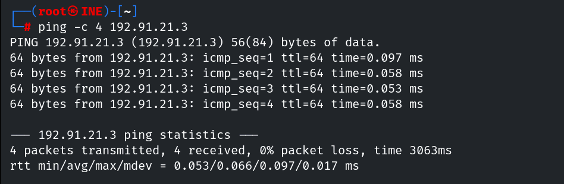
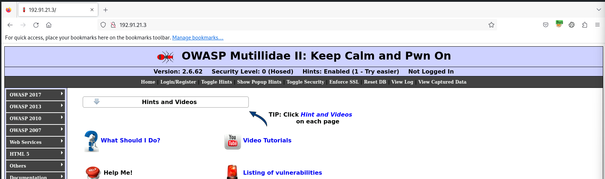
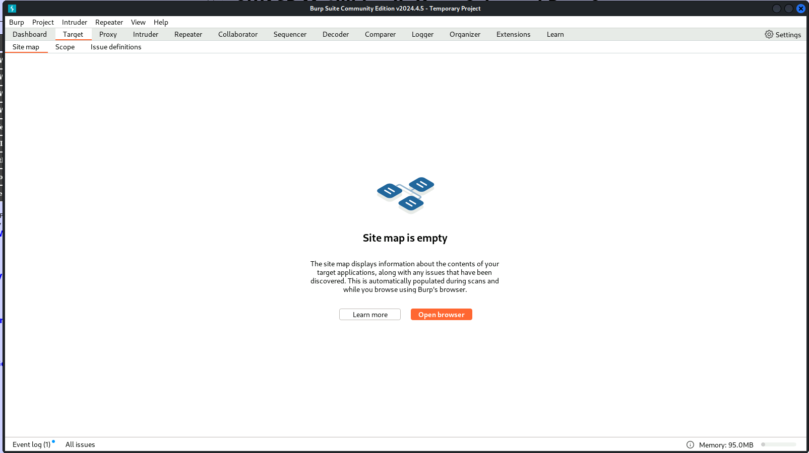
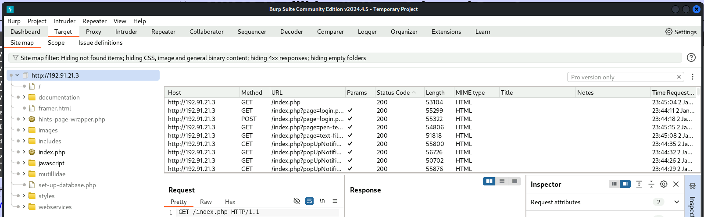
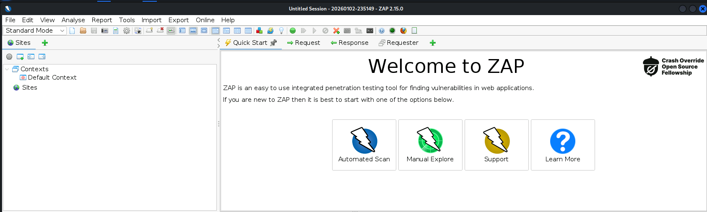
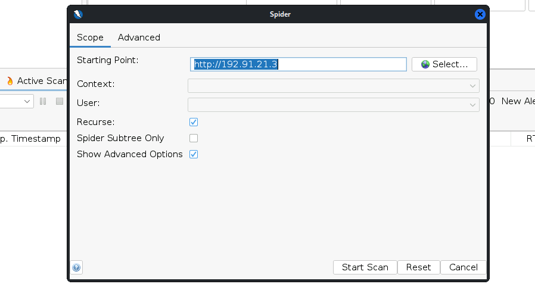
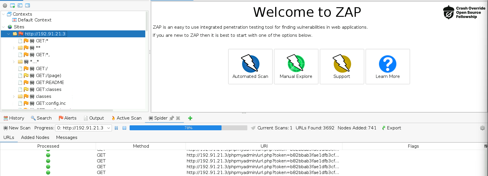
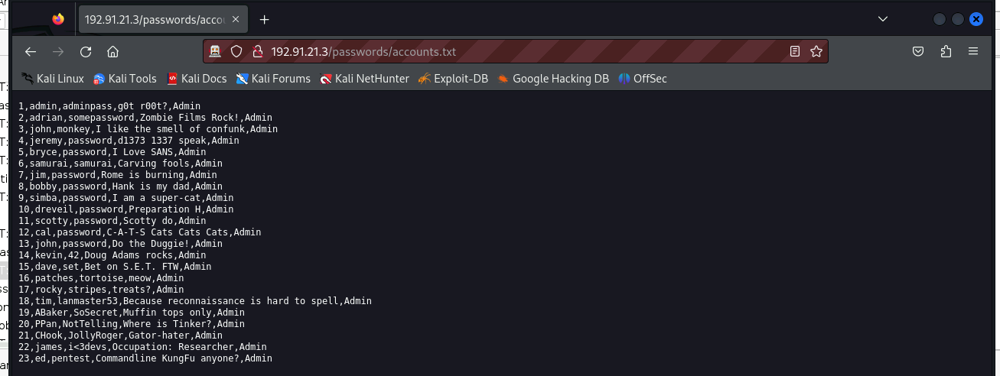

# Passive Crawling with Burp Suite

**Classification:** Host & Network Penetration Testing / Web & HTTP Protocol<br>
**Target:** OWASP Mutillidae web application

## 1. Executive Summary

Passive crawling builds a site map from traffic you generate by browsing, without actively
hammering the server. We proxy the browser through **Burp Suite** (via FoxyProxy, intercept
off) to map **OWASP Mutillidae**, then use **OWASP ZAP**'s spider to actively crawl and
surface hidden content — including a `passwords` file.

## 2. Recon

```bash
ping -c 4 <target>
```



The site hosts OWASP Mutillidae.



## 3. Passive Crawling (Burp Suite)

Routing the browser through Burp (FoxyProxy on, Intercept off) and browsing the app builds
the site map passively.



Clicking through the app populates Burp's site map.



## 4. Active Crawling (OWASP ZAP)

```
Open ZAP -> reload the page -> Spider the site
```







The spider discovers a `passwords` resource.




## 5. Notes

1. **Passive crawling** (Burp) is low-noise and maps what you actually visit; **active
   spidering** (ZAP) follows links to find unlinked/hidden content.
2. Discovered sensitive files (`passwords`, backups, admin panels) are prime follow-up
   targets — and, defensively, should never be reachable.
