# Port Scanning and Enumeration with Armitage

**Classification:** Host & Network Penetration Testing / The Metasploit Framework<br>
**Target:** demo.ine.local (10.2.29.143) — Windows Server 2008 R2–2012, Rejetto HFS<br>
**Objective:** Enumerate and port-scan the target using Armitage.

## 1. Executive Summary

**Armitage** is a graphical front-end for Metasploit that visualises hosts, scans, services
and attacks. Here we start the database and Armitage, add the target, run TCP and OS-detection
scans, review the service table, and use the **Find Attacks** feature.

## 2. Setup

```bash
ping -c 4 demo.ine.local
service postgresql start
msfdb status
```

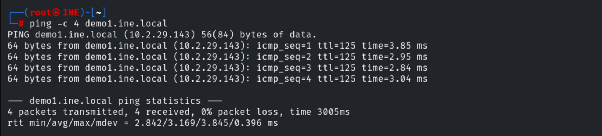

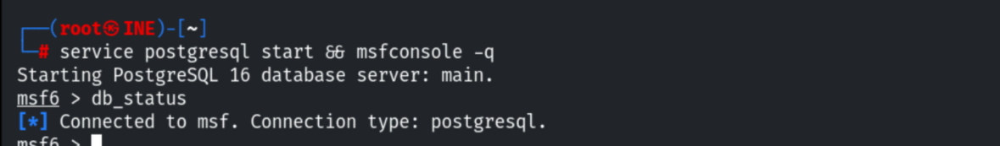

Launching Armitage.

```bash
armitage
```

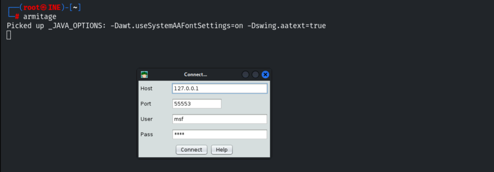


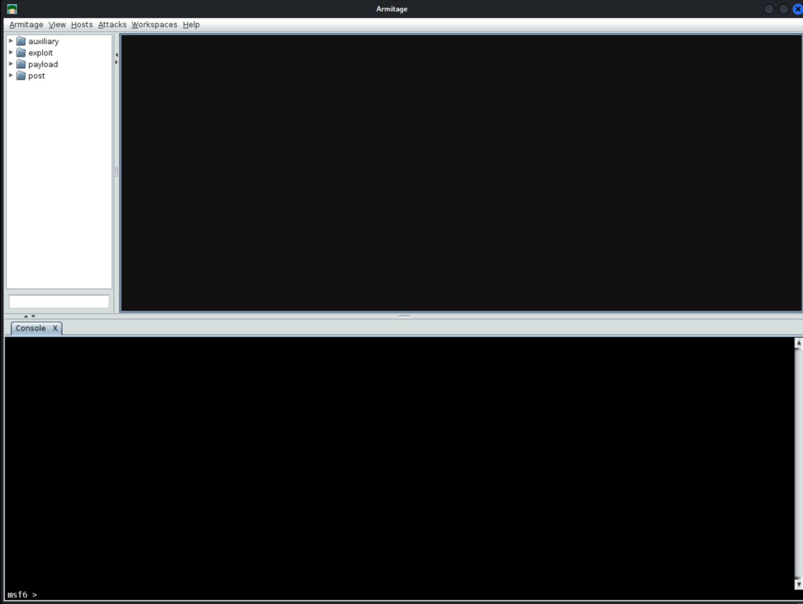

## 3. Interface Tour

The GUI has a module search bar + tree, a target view, and a console.

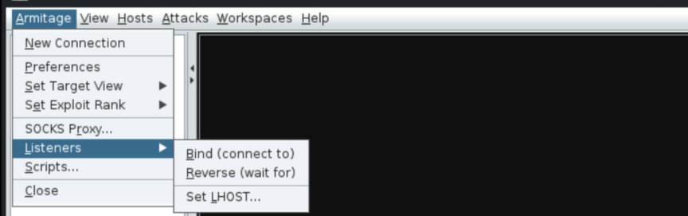

The **Hosts** menu handles import/add hosts, scans and DNS enumeration.

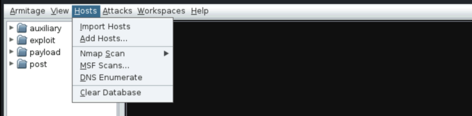

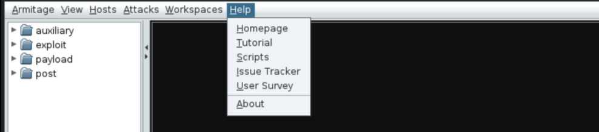

## 4. Adding the Host

```
Hosts -> Add Hosts -> 10.2.29.143
```

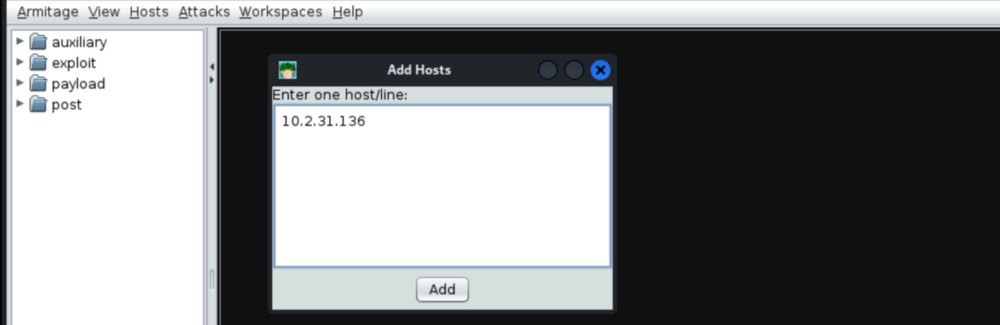

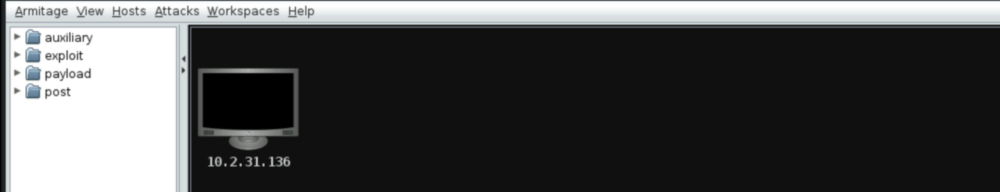

## 5. Scanning

Running a basic TCP port scan (right-click host → Scan); results appear in the **Services**
window.

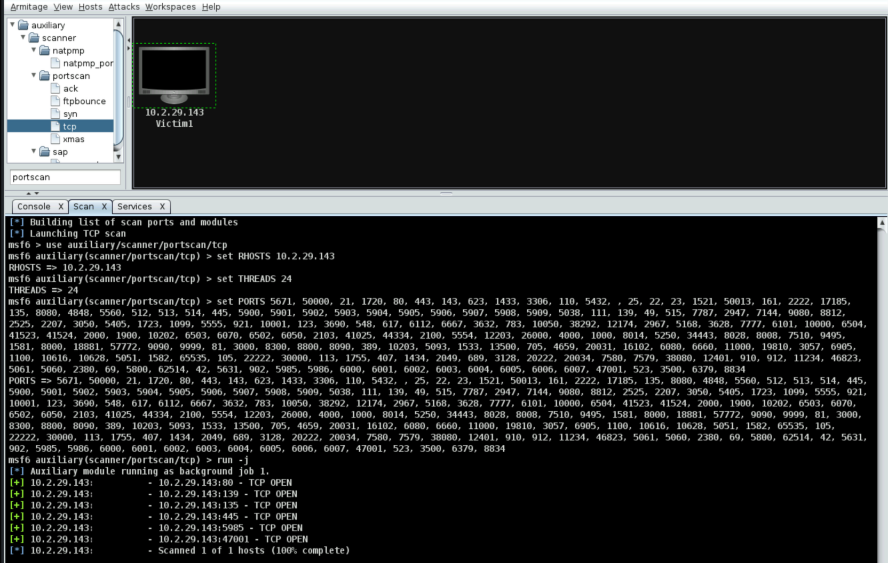

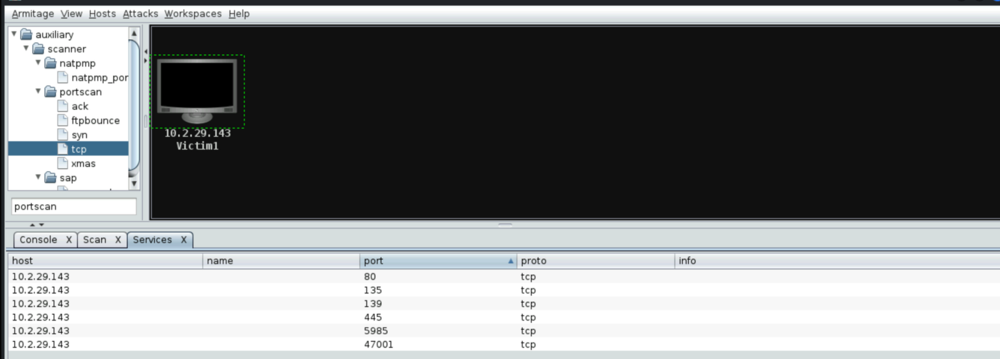

Running a **Quick Scan (OS detect)** to fingerprint versions and OS.

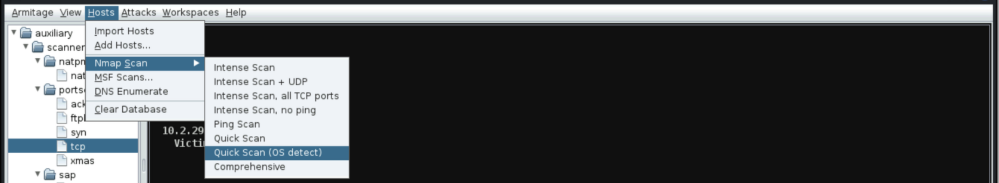

The service table shows **Rejetto HFS (HttpFileServer 2.3)** on 80, SMB, RDP, WinRM, etc.

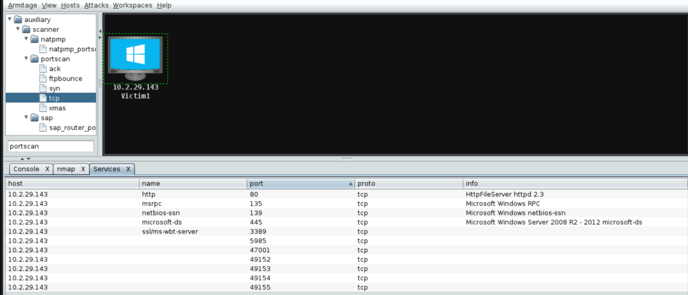

## 6. Find Attacks

```
Attacks -> Find Attacks
```

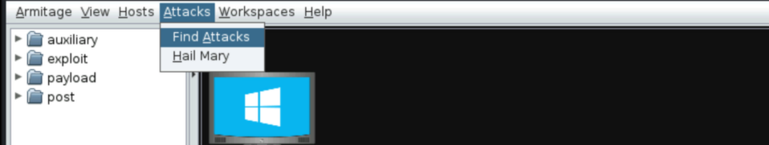

Armitage couldn't auto-match attacks here; the Rejetto module can be configured manually
(covered in the next lab).

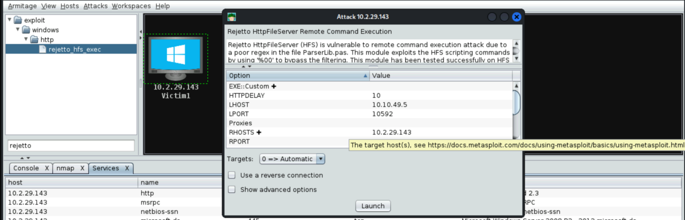

## 7. Notes

1. Armitage is a convenient visual layer over Metasploit for scanning, enumeration and
   managing sessions across many hosts.
2. "Find Attacks" is only a heuristic — manual module selection is still needed for reliable
   exploitation.
