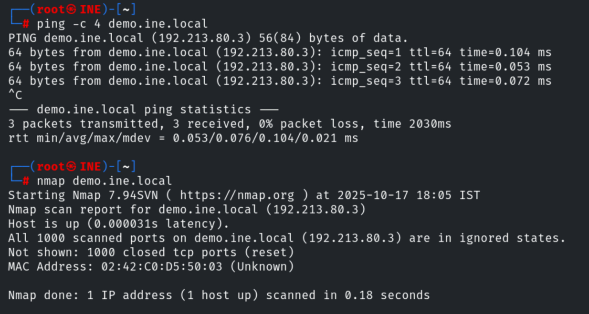
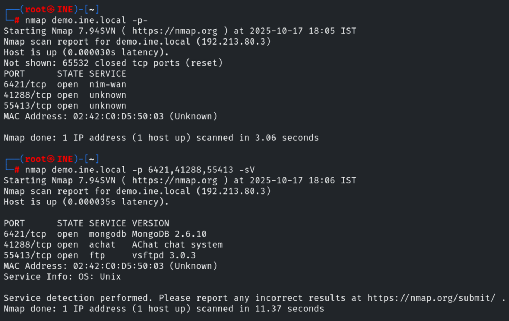

# Scan the Server I

**Classification:** Assessment Methodologies / Footprinting & Scanning<br>
**Target:** demo.ine.local (192.213.80.3)

## 1. Executive Summary

This lab covers basic port scanning and service detection with Nmap. A default scan finds
no open ports, but a full TCP scan (`-p-`) reveals three services on non-standard ports:
**MongoDB 2.6.10**, an **AChat** chat system and **vsftpd 3.0.3**.

## 2. Host Discovery & Default Scan

We confirm connectivity and run a default Nmap scan for basic information. The default scan
(top 1000 ports) reports all ports closed.

```bash
ping -c 4 demo.ine.local
nmap demo.ine.local
```



## 3. Full Port Scan & Service Detection

Scanning all ports with `-p-` reveals three open ports; a version scan (`-sV`) then
fingerprints the services.

```bash
nmap demo.ine.local -p-
nmap demo.ine.local -p 6421,41288,55413 -sV
```

Results:
- `6421/tcp` - **MongoDB 2.6.10**
- `41288/tcp` - **AChat** chat system
- `55413/tcp` - **vsftpd 3.0.3** (FTP)



## 4. Remediation Recommendations

1. **Close or firewall unnecessary services:** running MongoDB, AChat and FTP on
   non-standard ports does not hide them from a full scan; expose only what is required.
2. **Patch outdated software:** MongoDB 2.6.10 and AChat have known vulnerabilities; keep
   services updated.
3. **Avoid security through obscurity:** moving services to high ports is not a substitute
   for authentication and network segmentation.
