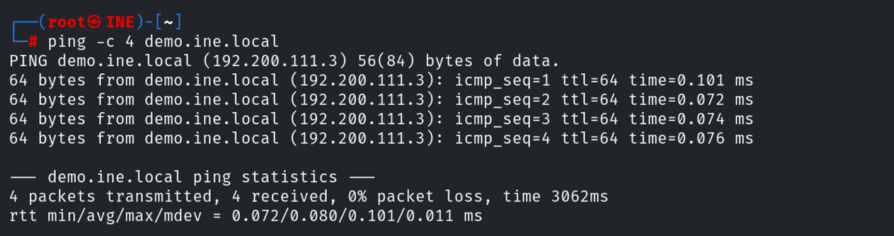
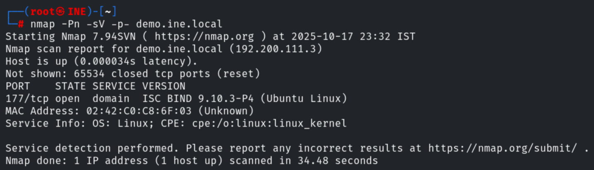
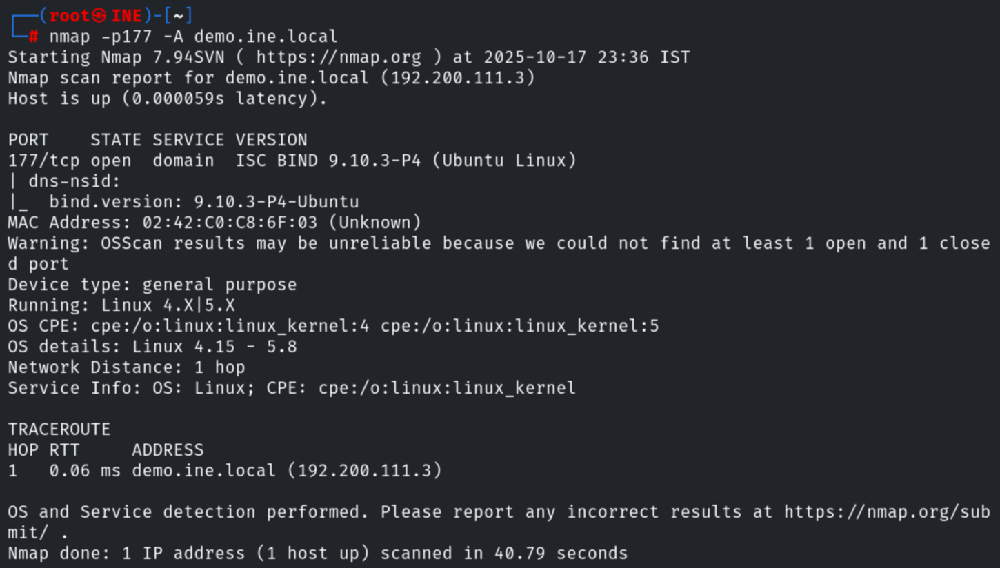
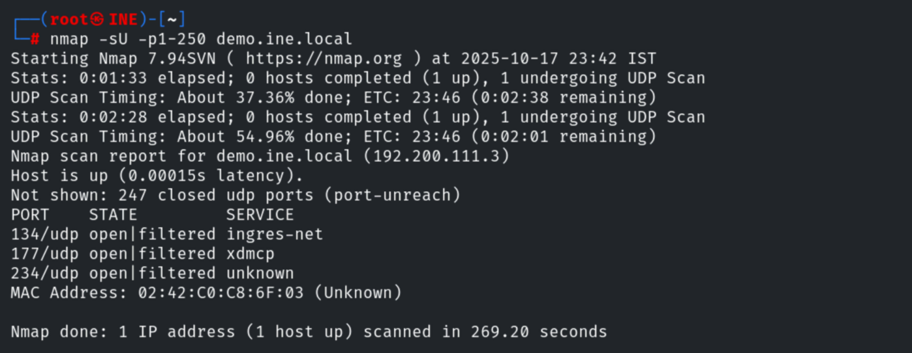
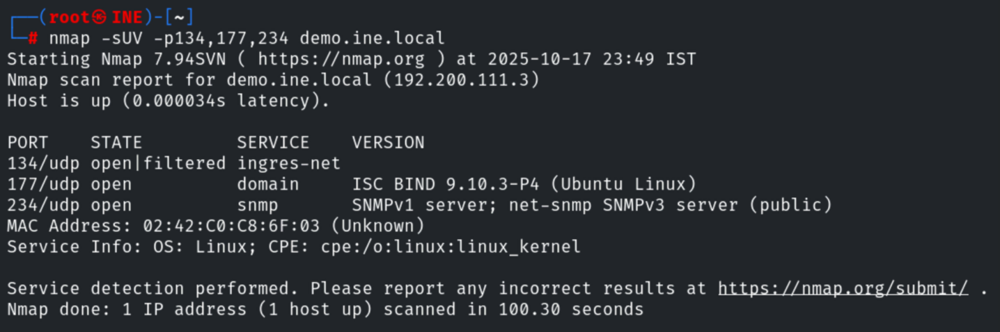
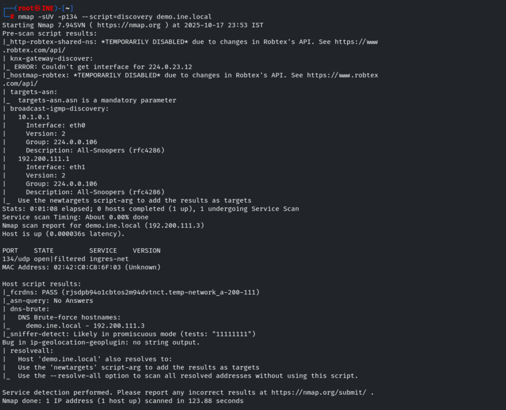
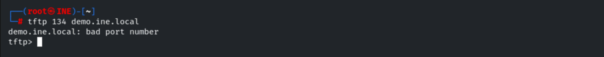

# Scan the Server II

**Classification:** Assessment Methodologies / Footprinting & Scanning<br>
**Target:** demo.ine.local (192.200.111.3)

## 1. Executive Summary

The goal of this lab is to identify the ports running a **Bind DNS** server, a **TFTP**
server and an **SNMP** server. Combining TCP and UDP Nmap scans with aggressive scanning
and NSE discovery scripts, we locate DNS (177/tcp and 177/udp), SNMP (234/udp) and TFTP
(134/udp).

## 2. Host Discovery & TCP Scan

We check connectivity and run a full TCP version scan.

```bash
ping -c 4 demo.ine.local
nmap -Pn -sV -p- demo.ine.local
```



Nmap finds **ISC BIND 9.10.3-P4** on port `177/tcp`.



## 3. Aggressive Scan of the DNS Port

```bash
nmap -p177 -A demo.ine.local
```

The aggressive scan confirms `bind.version: 9.10.3-P4-Ubuntu` and provides OS details
(Linux 4.15 - 5.8), network distance and traceroute.



## 4. UDP Scan

A UDP scan reveals three more services on ports 134, 177 and 234.

```bash
nmap -sU -p1-250 demo.ine.local
```



## 5. UDP Service Detection

```bash
nmap -sUV -p134,177,234 demo.ine.local
```

Ports 177 and 234 run **DNS** and **SNMP** (SNMPv1/SNMPv3, community `public`)
respectively, so port 134 is the likely TFTP server.



## 6. Confirming TFTP with a Discovery Script

```bash
nmap -sUV -p134 --script=discovery demo.ine.local
```

The discovery scripts confirm port 134 as the **TFTP** service.



Finally we confirm access with the `tftp` client.

```bash
tftp 134 demo.ine.local
```



## 7. Remediation Recommendations

1. **Restrict UDP services:** DNS, SNMP and TFTP on UDP are easy to overlook; firewall and
   monitor them.
2. **Harden SNMP:** change the default `public` community string and prefer SNMPv3 with
   authentication and encryption.
3. **Disable TFTP** where possible; it has no authentication and transfers data in clear
   text.
4. **Keep Bind updated** and disable version disclosure (`version.bind`).
