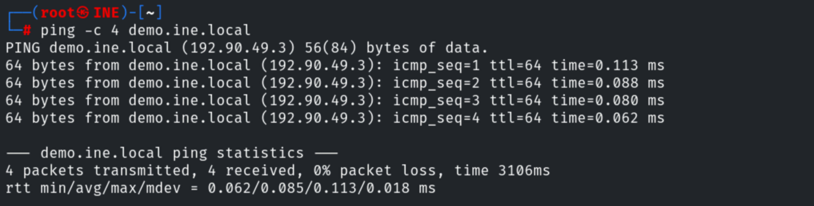
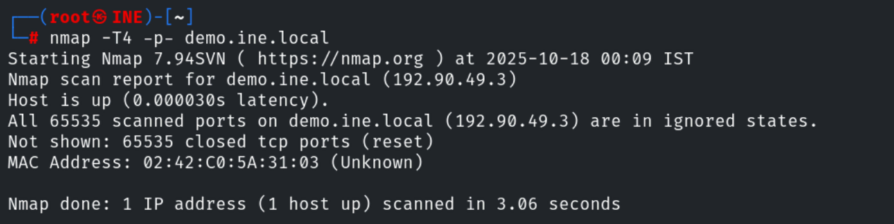
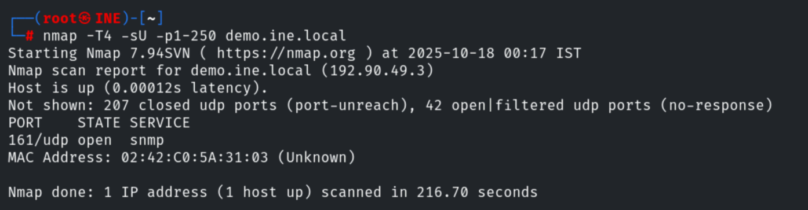
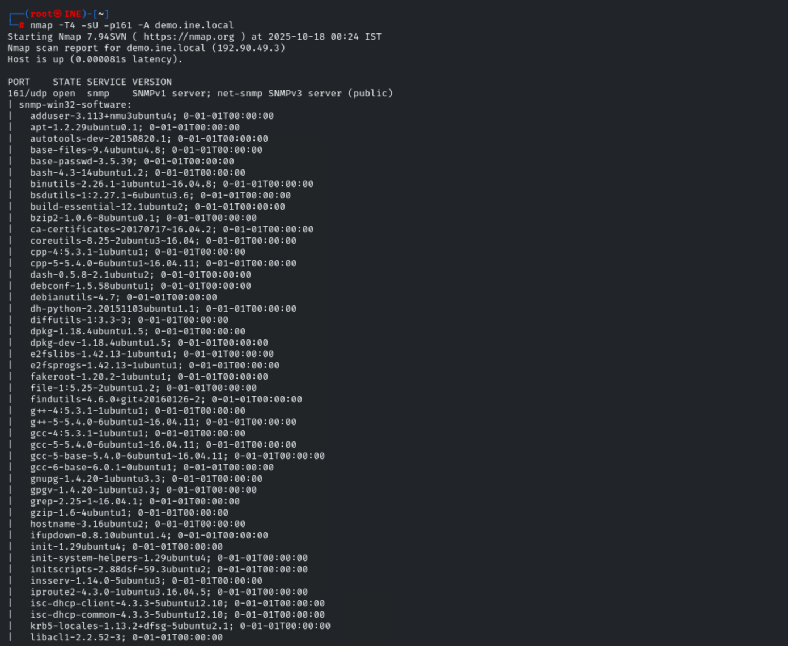
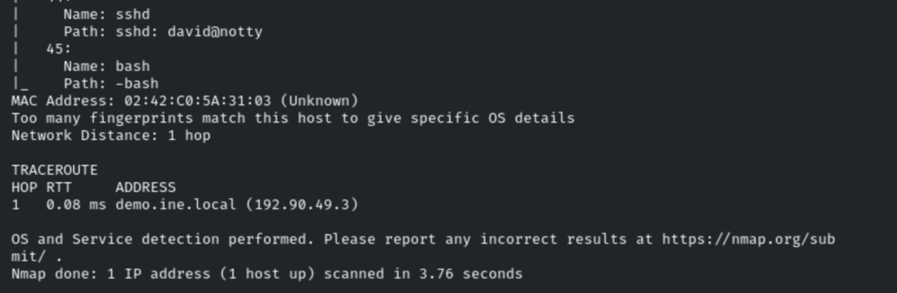

# Scan the Server III

**Classification:** Assessment Methodologies / Footprinting & Scanning<br>
**Target:** demo.ine.local (192.90.49.3)

## 1. Executive Summary

This lab covers port scanning and service detection with Nmap. The TCP scan shows no open
ports, but a UDP scan uncovers **SNMP** on port 161. An aggressive scan of that port
enumerates a large amount of host information (installed software and running processes).

## 2. Host Discovery

```bash
ping -c 4 demo.ine.local
```



## 3. TCP Port Scan

A full TCP scan (with `-T4` for speed) reports all ports as closed/filtered.

```bash
nmap -T4 -p- demo.ine.local
```



## 4. UDP Port Scan

Switching to a UDP scan reveals **SNMP** on port 161.

```bash
nmap -T4 -sU -p1-250 demo.ine.local
```



## 5. Aggressive SNMP Scan

An aggressive scan of port 161 enumerates extensive information through SNMP, including the
list of installed software (`snmp-win32-software`) and running processes (e.g. an sshd
session `david@notty`).

```bash
nmap -T4 -sU -p161 -A demo.ine.local
```





## 6. Remediation Recommendations

1. **Harden SNMP:** change the default `public` community string, restrict access, and use
   SNMPv3 with authentication and encryption.
2. **Limit information exposure:** SNMP leaks installed software and running processes that
   aid an attacker; disable unnecessary OIDs/MIBs.
3. **Firewall UDP services:** a clean TCP scan can give a false sense of security; always
   assess UDP as well.
