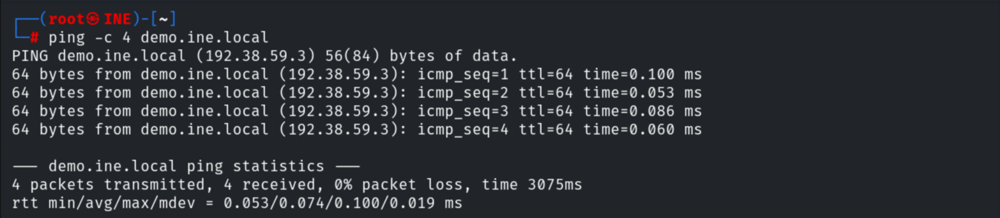
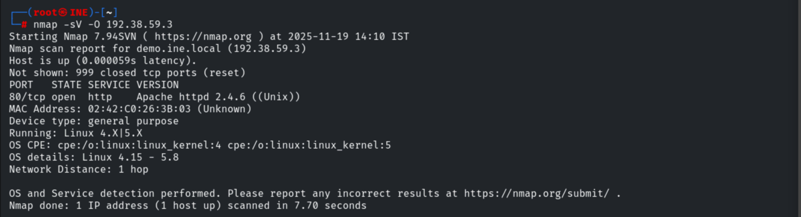
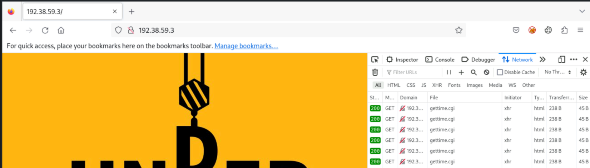
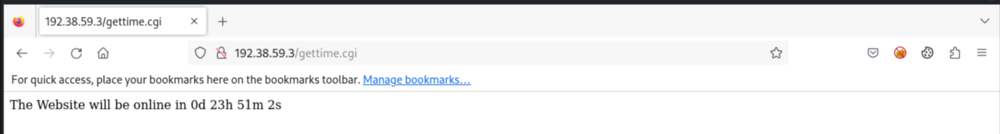
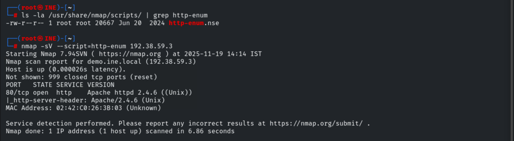
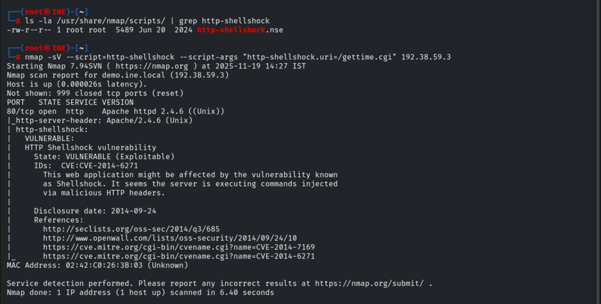

# Vulnerability Scanning with Nmap Scripts

**Classification:** Host & Network Penetration Testing / Exploitation<br>
**Target:** demo.ine.local (192.38.59.3) — Linux, Apache httpd 2.4.6 (Unix)

## 1. Executive Summary

The Nmap Scripting Engine (NSE) can go beyond version detection to actively test for known
vulnerabilities. Here we fingerprint an **Apache 2.4.6** server that runs CGI scripts, use
`http-enum` to map it, and `http-shellshock` to confirm it is **VULNERABLE to Shellshock
(CVE-2014-6271)**.

## 2. Recon

```bash
ping -c 4 demo.ine.local      # 192.38.59.3
nmap -sV -O 192.38.59.3
```

Port 80 — **Apache httpd 2.4.6 (Unix)**.





The site is a CGI-enabled web server.





## 3. http-enum

```bash
ls -la /usr/share/nmap/scripts/ | grep http-enum
nmap -sV --script=http-enum 192.38.59.3
```



## 4. http-shellshock

```bash
ls -la /usr/share/nmap/scripts/ | grep http-shellshock
nmap -sV --script=http-shellshock --script-args "http-shellshock.uri=/gettime.cgi" 192.38.59.3
```

```
| http-shellshock:
|   VULNERABLE:
|   State: VULNERABLE (Exploitable)
|   IDs:  CVE:CVE-2014-6271
```



## 5. Remediation Recommendations

1. **Patch Bash/Shellshock** (CVE-2014-6271/6278) and update Apache; disable or sandbox
   legacy CGI scripts.
2. **Remove unused CGI endpoints** (`/gettime.cgi`) and restrict `mod_cgi` to what's needed.
3. **Deploy a WAF** to filter malicious headers, and keep the server version banner suppressed.
4. **Run periodic NSE/vulnerability scans** as part of routine assessment.
